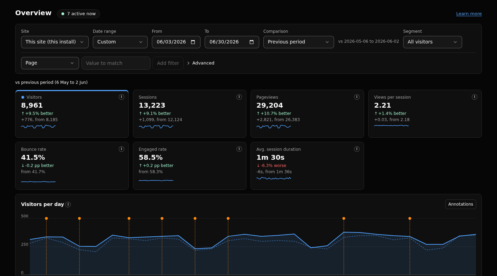
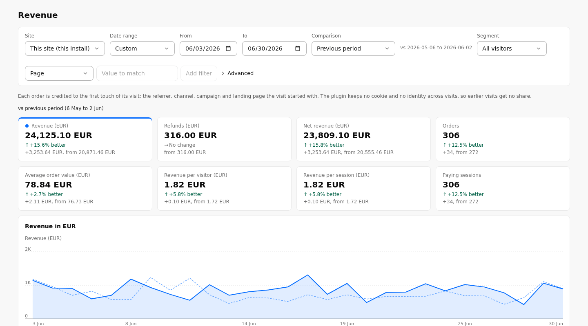
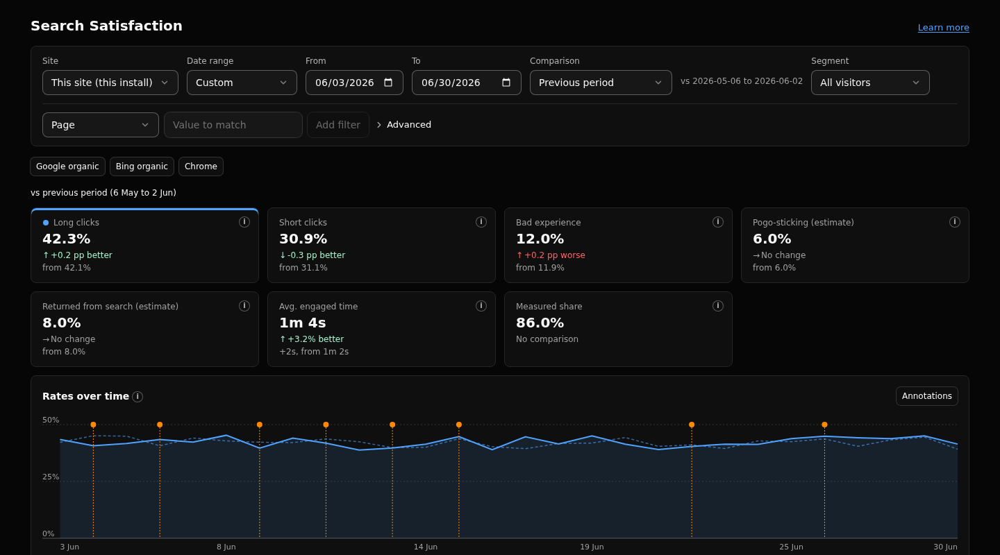
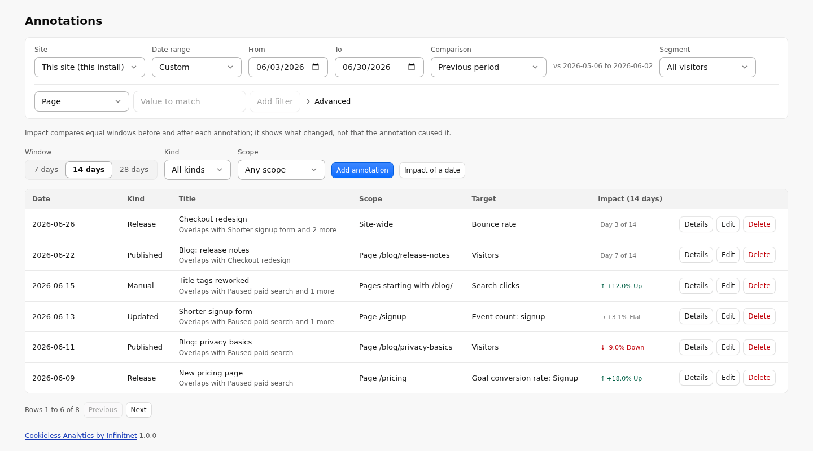
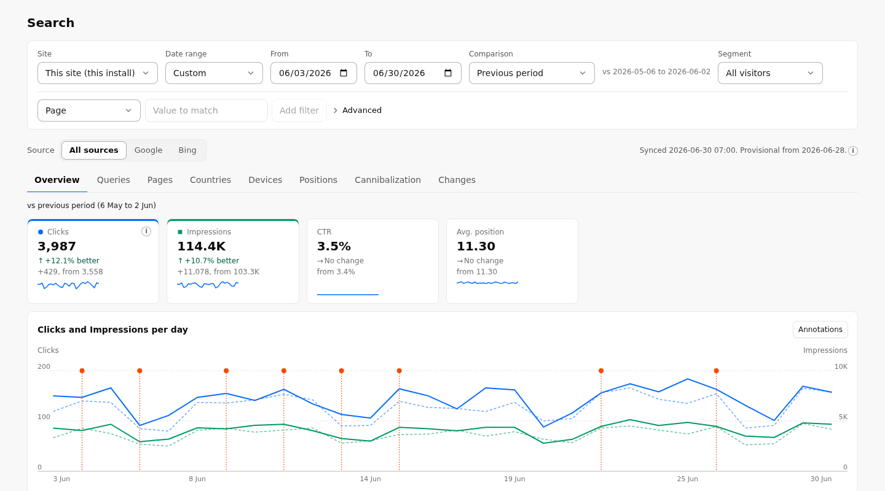
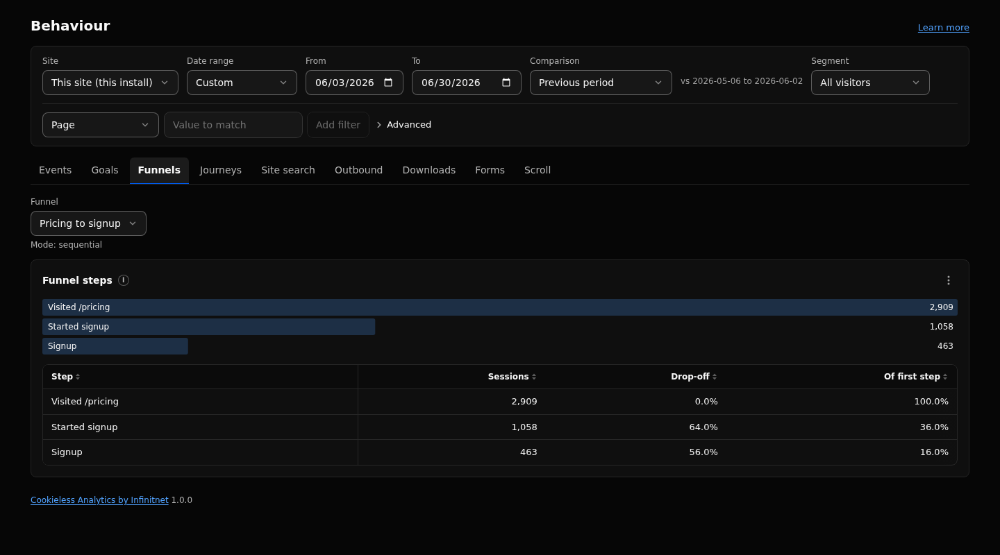

<div align="center">

# Cookieless Analytics by Infinitnet

Self-hosted, cookieless web analytics for EmDash and any site. A ~3 KB script, no extra service, your own database.

[](https://www.npmjs.com/package/@infinitnet/cookieless-analytics) [](https://github.com/infinitnet/cookieless-analytics/actions/workflows/ci.yml) [](LICENSE) [](docs/install.md) [](https://infinitnet.io/cookieless-analytics/)

[Install](#install) · [Docs](#documentation) · [Wiki](https://github.com/infinitnet/cookieless-analytics/wiki)

<a href="https://buymeacoffee.com/infinitnet"></a>&nbsp;&nbsp;<a href="https://ko-fi.com/infinitnet"></a>

<sub>Free and open source. If it saves you time, you can support its development.</sub>

<a href="https://github.com/infinitnet/cookieless-analytics/wiki/Reports"></a>

<sub>All screenshots show synthetic data for example.com.</sub>

</div>

Cookieless Analytics by Infinitnet is a self-hosted, cookieless web analytics plugin for EmDash CMS with real sessions, no cookies and a page script of about 3 KB gzipped.

Cookieless Analytics shows its reports inside the EmDash admin. It also measures sites that are not EmDash, such as a plain Astro site, a static site or another CMS, through one script tag.

Cookieless Analytics needs 2 setup steps: deploy, then complete the EmDash setup wizard. A third step, on the Workers Free plan only, sets the Small capacity profile.

## Why this one

Most cookieless tools count page views and stop there. Cookieless Analytics is a Plausible alternative for self hosted analytics and Astro analytics that keeps real sessions without writing anything to the visitor's device unless a visitor opts out, inside your own EmDash site.

- **Cookieless by design.** Cookieless Analytics sets no cookie and uses no session storage or IndexedDB; the only local storage is the opt-out flag a visitor sets by clicking the opt-out control. A daily salted hash joins the page views of a visit and cannot link days. [Privacy](docs/privacy.md)
- **Real sessions.** Cookieless Analytics reports entry and exit pages, pages per session, bounce, duration and first-touch source, not only page views. [Sessions](docs/sessions.md)
- **Light on your pages.** The page script is under 3 KB gzipped, loads with `defer` from your own site and stays cached for an hour. [Performance](docs/performance.md)
- **Few requests.** A page view sends one request, plus one engagement update when the tab is left. Pages never wait for the analytics database. [Performance](docs/performance.md)
- **Light on your database.** A page view on a known visit costs one statement and one row written; a new visit costs two of each. Daily summaries answer older days. [Performance](docs/performance.md)
- **No extra service.** Cookieless Analytics runs inside your EmDash site on your own Cloudflare account, with no third-party service and no telemetry. [Install](docs/install.md)
- **Two ways to install.** A new site deploys with one click; an existing EmDash site adds the npm package. The tables create themselves on first use. [Install](docs/install.md)
- **Any site.** Cookieless Analytics measures a plain Astro site, a static site or another CMS through one script tag or Google Tag Manager. [Client sites](docs/client-sites.md)
- **Your choice of database.** The data lives in the EmDash D1 database, in a D1 database of its own or in Postgres through Hyperdrive. [Install](docs/install.md)
- **Fits the Workers Free plan.** Capacity profiles size storage and background work to your plan. On Free, a daily write guard keeps the CMS able to save content. [Limits](docs/limits.md)
- **Bot-free and unsampled.** Bots never leave a stored row, and nothing is sampled. The Data page counts what could not be stored: an overloaded database, a capped visit or the Free plan's daily guard. [Bots](docs/bots.md)
- **Revenue and refunds.** Cookieless Analytics reports orders by source, campaign and entry page, with refunds and net revenue. Each report uses one currency and never converts. [Revenue](docs/revenue.md)
- **Search data next to traffic.** Google Search Console and Bing Webmaster Tools data sit in the same UI as your sessions, with SEO views. [Search sources](docs/search-sources.md)
- **Annotations with measured impact.** An annotation marks a release or a publish, and any metric compares before and after it. [Annotations](docs/annotations.md)
- **Search Satisfaction.** Search Satisfaction is an approximation of how a click-based system such as Navboost could rate your pages: long and short clicks, bad experiences and estimated pogo-sticking from search visits, labeled as estimates. [Search Satisfaction](docs/sessions.md#search-satisfaction-metrics)
- **Dashboards you can share.** A share link opens a read-only plain HTML page with no script, no cookie and an optional password. Any dashboard can also go out by scheduled email. [Dashboards](docs/dashboards.md)
- **Built for agents.** Cookieless Analytics offers scoped API keys, an OpenAPI description and MCP tools through your EmDash site. [Agent API](docs/AGENTS.md)
- **Many sites, one admin.** One admin reads client sites in the same database and connected EmDash installs through their agent API. [Multi-site](docs/multi-site.md)
- **Deliberately small.** Cookieless Analytics has no heatmaps, session replay, user profiles or cross-day returning visitors.
- **Open source.** Cookieless Analytics is licensed under Apache-2.0, with the TypeScript source in the repository and in the npm package.

## Install

Cookieless Analytics installs in one of two ways:

- **A) New site:** one click deploys a new EmDash site with the plugin.
- **B) Existing EmDash site:** the npm package adds the plugin.

Either way, the plugin creates its tables on first use, so there is no migration to run. On the Workers Free plan you pick the Small capacity profile once.

Other sites, EmDash or not, are then measured from the same admin with one script tag ([Client sites](docs/client-sites.md)). The data can stay in D1 or move to Postgres through Hyperdrive later ([install.md](docs/install.md#postgres-through-hyperdrive)).

### Why a native plugin

Cookieless Analytics is a native EmDash plugin, distributed on npm as `@infinitnet/cookieless-analytics`. It needs native plugin access to:

- serve the page script through `page:fragments`,
- add Astro middleware for its neutral public paths,
- ship React admin pages,
- keep its facts in SQL tables.

There is therefore no listing in the EmDash plugin registry, which lists sandboxed plugins only.

Cookieless Analytics Companion is a sandboxed helper in the EmDash plugin registry. It guides the install of this plugin and confirms it. It counts nothing and is not required.

### A) New site: Deploy to Cloudflare

[](https://deploy.workers.cloudflare.com/?url=https://github.com/infinitnet/cookieless-analytics/tree/main/template)

The button copies [template/](template/README.md) into a new repository on your GitHub or GitLab account and deploys it to your Cloudflare account. The new site contains:

- an EmDash site (the EmDash Cloudflare starter) with the plugin already installed from npm,
- a D1 database,
- an R2 bucket for media,
- a Cron Trigger every minute.

The button asks for `EMDASH_ENCRYPTION_KEY` (`npx emdash secrets generate`). You can leave it empty until you connect Search. Afterwards:

1. Open `/_emdash/admin` on the new site and complete the setup wizard.
2. On the Workers Free plan, set the capacity profile to Small (Analytics, Settings, Data and capacity).

### B) Existing EmDash site: npm

```sh
npm install @infinitnet/cookieless-analytics   # or: pnpm add @infinitnet/cookieless-analytics, yarn add @infinitnet/cookieless-analytics
```

In `astro.config`, add the plugin to EmDash's `plugins` and the integration after `emdash()`:

```js
import { defineConfig } from "astro/config";
import emdash from "emdash/astro";
import cookielessAnalytics from "@infinitnet/cookieless-analytics";
import cookielessAnalyticsIntegration from "@infinitnet/cookieless-analytics/integration";

export default defineConfig({
  integrations: [
    emdash({ plugins: [cookielessAnalytics()] }),
    cookielessAnalyticsIntegration(), // after emdash()
  ],
});
```

Then redeploy.

### Requirements

- **Head tag.** Your layout must render EmDash's `EmDashHead`, which emits the plugin's one script tag.
- **Runtime.** Cloudflare Workers with D1 is the primary target. Node with SQLite, libSQL or Postgres works wherever the same SQL runs.
- **Postgres.** On Cloudflare the analytics tables can also live in Postgres through a Hyperdrive binding ([Postgres through Hyperdrive](docs/install.md#postgres-through-hyperdrive)).
- **Cron Trigger.** Set a Cron Trigger of `* * * * *` so daily summaries, retention, salt rotation, Search sync, the revenue reconcile and scheduled email run. Every 15 minutes also works: the background tasks then take turns and run about once an hour each ([Cron Trigger](docs/install.md#cron-trigger)).
- **Capacity profile.** Set the `capacityProfile` setting: Small on the Workers Free plan, Standard (default) on Workers Paid, Dedicated when the analytics tables have their own database.
- **Encryption key.** Set `EMDASH_ENCRYPTION_KEY` before you store Search secrets (Google client secret, refresh token, service account key, Bing API key). The host encrypts them with it.

Full steps: [docs/install.md](docs/install.md).

The [wiki](https://github.com/infinitnet/cookieless-analytics/wiki) is a guide with one page per feature and screenshots (source: [docs/wiki](docs/wiki/Home.md)). It starts with [Quick install](https://github.com/infinitnet/cookieless-analytics/wiki/Quick-Install).

### Trust model

A native plugin runs inside your site's process with the same access as the site itself, so read its code before you install it. All of it is in this repository and in the npm package, including the TypeScript source.

- **Telemetry.** Cookieless Analytics sends no telemetry.
- **Network calls.** Cookieless Analytics calls only the Search providers you configure (Google and Bing) and the connected sites you declare. Every call goes through EmDash's `ctx.http` with exact allowed hosts, never a wildcard.
- **Email.** Cookieless Analytics sends email only when you schedule a dashboard email, and only through the mail provider your EmDash site already has configured. It never talks to a mail service itself.

### Registry companion

Cookieless Analytics Companion is a setup assistant in the EmDash plugin registry for sites that run the plugin sandbox. It asks four questions, shows the install steps above for your site, estimates capacity and confirms once this plugin runs. It requests no permissions and holds no analytics data. To find it, search the Registry for Cookieless Analytics Companion in the EmDash admin.

Details: [packages/companion/README.md](packages/companion/README.md) and the wiki page [Registry companion](https://github.com/infinitnet/cookieless-analytics/wiki/Registry-Companion).

## Features

<table>
<tr>
<td width="50%" valign="top"><a href="https://github.com/infinitnet/cookieless-analytics/wiki/Revenue-and-Refunds"></a><br><b><a href="https://github.com/infinitnet/cookieless-analytics/wiki/Revenue-and-Refunds">Revenue and refunds</a></b>: gross, refunds and net per currency, by first-touch source.</td>
<td width="50%" valign="top"><a href="https://github.com/infinitnet/cookieless-analytics/wiki/Search-Satisfaction"></a><br><b><a href="https://github.com/infinitnet/cookieless-analytics/wiki/Search-Satisfaction">Search Satisfaction</a></b>: long clicks, bad experiences and search behavior per landing page.</td>
</tr>
<tr>
<td valign="top"><a href="https://github.com/infinitnet/cookieless-analytics/wiki/Annotations-and-Impact"></a><br><b><a href="https://github.com/infinitnet/cookieless-analytics/wiki/Annotations-and-Impact">Annotations and impact</a></b>: each change measured on its own metric, before and after.</td>
<td valign="top"><a href="https://github.com/infinitnet/cookieless-analytics/wiki/Search-Integrations"></a><br><b><a href="https://github.com/infinitnet/cookieless-analytics/wiki/Search-Integrations">Search</a></b>: Google Search Console and Bing in one view, with SEO views.</td>
</tr>
<tr>
<td valign="top"><a href="https://github.com/infinitnet/cookieless-analytics/wiki/Dashboards-and-Sharing"></a><br><b><a href="https://github.com/infinitnet/cookieless-analytics/wiki/Dashboards-and-Sharing">Dashboards and sharing</a></b>: custom tiles, share links, scheduled email.</td>
<td valign="top"><a href="https://github.com/infinitnet/cookieless-analytics/wiki/Goals-and-Funnels"></a><br><b><a href="https://github.com/infinitnet/cookieless-analytics/wiki/Goals-and-Funnels">Behavior and funnels</a></b>: events, goals, funnels, journeys, outbound links, forms.</td>
</tr>
<tr>
<td valign="top"><a href="https://github.com/infinitnet/cookieless-analytics/wiki/Multi-Site-and-Sites-View"></a><br><b><a href="https://github.com/infinitnet/cookieless-analytics/wiki/Multi-Site-and-Sites-View">All sites</a></b>: one table over every site you measure.</td>
<td valign="top"><a href="https://github.com/infinitnet/cookieless-analytics/wiki/Settings-Reference"></a><br><b><a href="https://github.com/infinitnet/cookieless-analytics/wiki/Settings-Reference">Settings</a></b>: every tunable with a validated range and a documented default.</td>
</tr>
</table>

### Everything it does

#### Reports

- **Overview and comparison.** The Overview shows pageviews, visitors per day, sessions, bounce, duration, scroll depth, active time and a realtime count. It compares them with the previous period or the year before. [Reports](https://github.com/infinitnet/cookieless-analytics/wiki/Reports)
- **Pages.** The Pages report lists top, entry, exit and not found pages. [Reports](https://github.com/infinitnet/cookieless-analytics/wiki/Reports)
- **Sources.** The Sources report shows channels, sources, campaigns and AI assistants. [Reports](https://github.com/infinitnet/cookieless-analytics/wiki/Reports)
- **Audience.** The Audience report shows country, region, device, browser, OS and language. [Reports](https://github.com/infinitnet/cookieless-analytics/wiki/Reports)
- **Content and site search.** Cookieless Analytics reports traffic per EmDash collection and what visitors search for on your site, and adds a Traffic panel to the content editor. [Content and site search](https://github.com/infinitnet/cookieless-analytics/wiki/Content-and-Site-Search), [content.md](docs/content.md)

#### Behavior

- **Events.** The Behavior page shows events, properties, goals, outbound links, downloads, forms and scroll. [Events](https://github.com/infinitnet/cookieless-analytics/wiki/Events)
- **Goals and funnels.** Funnels run in sequential, strict (no other page in between) or flexible (any order) mode, with revenue per step. [Goals and funnels](https://github.com/infinitnet/cookieless-analytics/wiki/Goals-and-Funnels), [behavior.md](docs/behavior.md)
- **Journeys.** Journeys show the next and previous pages of a page and the most common paths. [behavior.md](docs/behavior.md)
- **Segment comparison.** Segment comparison puts two saved segments side by side over the same range. [behavior.md](docs/behavior.md)
- **Filters and segments.** A filter applies to any dimension, event property, currency or revenue. It supports is, is not, contains, does not contain, starts with and regex, as include or exclude. Segments save a filter, and the whole view lives in the URL. [Filters and segments](https://github.com/infinitnet/cookieless-analytics/wiki/Filters-and-Segments), [filters.md](docs/filters.md)

#### Search and SEO

- **Search Satisfaction.** Search Satisfaction shows long and short clicks, bad experiences, estimated pogo-sticking and returns from search. It ranks the best and worst landing pages by score, with a drawer per page. [Search Satisfaction](https://github.com/infinitnet/cookieless-analytics/wiki/Search-Satisfaction), [sessions.md](docs/sessions.md#search-satisfaction-metrics)
- **Search Console and Bing.** The Search page shows clicks, impressions, CTR and position by query, page, country and device, and the Pages report shows the queries of each page. [Search integrations](https://github.com/infinitnet/cookieless-analytics/wiki/Search-Integrations), [search-sources.md](docs/search-sources.md)
- **SEO views.** The SEO views find cannibalization, position bands, striking distance, movers and content decay. [search-sources.md](docs/search-sources.md)
- **Annotations and impact.** Scoped markers (site-wide, host, path, query) appear on every chart. Cookieless Analytics adds an annotation on publish (optionally on update, per collection, capped per day) and measures the before and after impact on any metric. [Annotations and impact](https://github.com/infinitnet/cookieless-analytics/wiki/Annotations-and-Impact), [annotations.md](docs/annotations.md)

#### Revenue and links

- **Revenue and refunds.** Order values arrive from the page or a payment webhook, with refunds and voids. Revenue splits by channel, source, campaign, entry page, page, country, device and goal. [Revenue and refunds](https://github.com/infinitnet/cookieless-analytics/wiki/Revenue-and-Refunds), [revenue.md](docs/revenue.md)
- **Links report.** The Links report shows impressions, clicks and click-through rate per short link, placement, page and channel, from any link plugin that follows the convention. [Links report](https://github.com/infinitnet/cookieless-analytics/wiki/Links-Report), [integration.md](docs/integration.md)

#### Sharing and automation

- **Dashboards and sharing.** A dashboard holds up to 12 tiles from the existing reports and starts from one of fourteen built-in templates. A share link is read-only, with an optional password and expiry. [Dashboards and sharing](https://github.com/infinitnet/cookieless-analytics/wiki/Dashboards-and-Sharing), [dashboards.md](docs/dashboards.md)
- **Scheduled email.** Any dashboard goes out weekly or monthly by email, and a weekly digest takes one click. Mail goes through your site's own mail provider. [email.md](docs/email.md)
- **Multi-site.** One site switcher covers the local site, client sites through a snippet and connected EmDash installs, with an All sites table of every site you measure. [Multi site and Sites view](https://github.com/infinitnet/cookieless-analytics/wiki/Multi-Site-and-Sites-View), [multi-site.md](docs/multi-site.md), [client-sites.md](docs/client-sites.md)
- **Agent API and MCP.** Scoped keys open one `query` endpoint for every report, plus annotations, dashboards, server-side events and MCP tools. [Agent API and MCP](https://github.com/infinitnet/cookieless-analytics/wiki/Agent-API-and-MCP), [AGENTS.md](docs/AGENTS.md), [mcp.md](docs/mcp.md)
- **Other plugins.** Other plugins use `recordEvent` in process, the current session through a public route, plugin detection and the page script's window API. [Events](https://github.com/infinitnet/cookieless-analytics/wiki/Events), [integration.md](docs/integration.md)

#### Administration

- **Definitions.** The Definitions page manages goals, funnels, segments, user agent rules, annotations, a UTM builder, API keys and sites. [Definitions](https://github.com/infinitnet/cookieless-analytics/wiki/Definitions)
- **Data page and privacy receipt.** The Data page shows storage and retention, exports CSV and JSON, and deletes matching visits. It also holds a privacy receipt and a Markdown block for your privacy page. [Data page](https://github.com/infinitnet/cookieless-analytics/wiki/Data-Page), [privacy.md](docs/privacy.md)
- **Bot handling.** Bots get an empty 204 and are never stored. The Definitions page holds your own user agent rules. [Bot handling](https://github.com/infinitnet/cookieless-analytics/wiki/Bot-Handling), [bots.md](docs/bots.md)
- **Capacity and scale-out.** Capacity profiles, a write guard on Free, an optional queue tier and an own D1 database for analytics or one per site cover growth. [Capacity profiles](https://github.com/infinitnet/cookieless-analytics/wiki/Capacity-Profiles-and-Cloudflare-Plans), [Queue worker](https://github.com/infinitnet/cookieless-analytics/wiki/Queue-Worker), [limits.md](docs/limits.md)
- **Settings.** Every tunable is a plugin setting with a validated range and a documented default. An invalid value falls back to the default. [Settings reference](https://github.com/infinitnet/cookieless-analytics/wiki/Settings-Reference), [settings.md](docs/settings.md)

## Use cases

### One EmDash site

For a blog, a docs site or a company site on EmDash. Cookieless Analytics brings sessions, sources, goals and Search data into the CMS admin, a Traffic panel to every entry and an annotation to every publish. [Quick install](https://github.com/infinitnet/cookieless-analytics/wiki/Quick-Install)

### Sites that are not EmDash

Hosted on your EmDash install, measuring every site you register. For a plain Astro site, a static site or another CMS:

1. Register the site on the Definitions page (Sites tab).
2. Paste one script tag into its `<head>` or into a Google Tag Manager Custom HTML tag.

Every report, filter, dashboard and the agent API then work for that site. [Client sites](docs/client-sites.md)

<details>
<summary>The script tag</summary>

```html
<script defer src="https://your-install.example/_/e.js" data-ec-key="abcdefghij0123456789"></script>
```

Its visits land in your database under its own site id. Single page apps call `window.__ec.page()` after a route change.

The key is public and only allows "accept visits for this site from these host names". Details, limits and the capacity guideline: [docs/client-sites.md](docs/client-sites.md).

</details>

### Many sites and agencies

For a portfolio or an agency with client sites. Cookieless Analytics gives:

- one admin with a site switcher and an All sites table,
- dashboards copied between sites and shared with clients as read-only links (optional password and expiry),
- a weekly digest by email.

Visitors are never summed across sites. [Multi-site](docs/multi-site.md), [Dashboards](docs/dashboards.md)

### Shops and paid products

For e-commerce and SaaS checkouts. Cookieless Analytics reports orders, revenue, refunds and net revenue by first-touch channel, campaign and entry page, and revenue per funnel step.

Orders arrive from the page or a payment webhook, with a duplicate guard by order id. [Revenue](docs/revenue.md)

### SEO and content teams

For sites that live on search traffic. Cookieless Analytics shows:

- Search Console and Bing next to your sessions,
- per-page queries, cannibalization, striking distance and content decay,
- Search Satisfaction signals per landing page,
- the measured impact of every title change or publish.

[Search sources](docs/search-sources.md), [Annotations](docs/annotations.md)

### AI agents and automation

For deploy scripts, reporting bots and AI clients. Cookieless Analytics provides scoped API keys, an OpenAPI description, server-side events and MCP tools through your EmDash site's MCP endpoint. [Agent API](docs/AGENTS.md), [MCP](docs/mcp.md)

### Privacy-sensitive sites

For sites that want analytics without storing anything on the device (the opt-out flag a visitor sets by clicking is the only exception). Cookieless Analytics stores no cookies and no raw IP address or user agent, honors Global Privacy Control by default and writes a privacy receipt for your privacy page. [Privacy](docs/privacy.md)

### Small sites on the Free plan

For a personal site on Workers Free. Cookieless Analytics runs the full feature set with the Small capacity profile, which pauses recording for the rest of the UTC day before the account's daily write limit. [Limits](docs/limits.md)

## How it works

1. **One script tag.** `EmDashHead` emits the page script (or a client site loads it from your install). The script stores nothing on the device unless a visitor chooses to stop being counted ([Visitor opt-out](docs/privacy.md#visitor-opt-out)), and never changes a link or the address.
2. **A neutral route.** The script posts to a short public path of your site. The middleware answers 204, and bots get an empty 204 without a write.
3. **One row per visit.** Each visit is one database document that holds its page views and events, joined across full page loads by a daily salted key.
4. **Daily summaries.** A Cron Trigger rolls closed days into summaries, applies retention, rotates the salt and syncs Search. Old days and long ranges are answered from summaries.
5. **Capacity profiles.** The `capacityProfile` setting sizes storage, scan budgets and background work to your plan, with the daily write guard on Small.
6. **Reports in the admin.** React pages inside EmDash show the reports, and the agent API and MCP tools run the same queries.

Details: [How visits are counted](https://github.com/infinitnet/cookieless-analytics/wiki/How-Visits-Are-Counted), [docs/sessions.md](docs/sessions.md), [docs/limits.md](docs/limits.md).

<details>
<summary>Sessions without cookies</summary>

Cookieless Analytics writes nothing to the device except the opt-out flag a visitor sets by clicking the opt-out control: no cookie, no session storage, no IndexedDB, no cache tricks.

A visitor key is a daily salted hash of a truncated IP address and the browser family. The salt rotates every day, so the key cannot link days.

The page script never changes a link or the address and makes no history call. A full page load continues the visit through the daily key, and soft navigations keep the in-memory session id.

Visitor counts are per day, and multi-day visitor figures are labeled as sums of daily visitors. Details: [docs/sessions.md](docs/sessions.md).

</details>

## Limits and plans

| Profile | Use it on | Storage budget | Notes |
|---|---|---|---|
| Small (`small`) | Workers Free | 300 MB | Daily write guard: recording pauses for the rest of the UTC day before the Free plan's write limit, so the CMS can still save content |
| Standard (`standard`, default) | Workers Paid, analytics in the EmDash database | 6 GB | About 17,500 page views a day with 25 months of detail (estimate) |
| Dedicated (`dedicated`) | Analytics in a D1 database of its own | 9 GB | About 26,200 page views a day with 25 months of detail (estimate) |

Beyond one database, Cookieless Analytics scales out in three steps:

- the optional queue tier absorbs bursts,
- the analytics tables move to their own D1 database,
- busy sites get one database each.

Measured and estimated figures, side by side: [docs/limits.md](docs/limits.md), [Capacity profiles and Cloudflare plans](https://github.com/infinitnet/cookieless-analytics/wiki/Capacity-Profiles-and-Cloudflare-Plans).

<details>
<summary>Measured on production D1</summary>

Each visit is one database row that holds its page views and events. With a typical mix of engagement updates, events and new visits, a page view costs about 3.3 rows written.

These figures were measured on production D1, on a Workers Paid and a Workers Free account:

- the cost of every write statement,
- about 25 ms per write statement end to end from a Worker in Europe,
- 200 write statements per second without an error,
- about 383 bytes per page view as inserted.

Detailed visits are kept for 25 months by default. Older days and ranges too large to scan are answered from daily summaries, and the Data page says which.

Estimates, not measured on D1: 25 months of detail fit up to about 17,500 page views a day in the default 6 GB budget.

A page views per day figure for the Workers Free plan is not published until it is measured. On Free, the Small profile pauses recording for the rest of the UTC day before the account's daily write limit, so the CMS can still save content.

</details>

## Privacy

- **No device storage.** Cookieless Analytics stores no cookies and writes to the device only the opt-out flag a visitor sets by clicking the opt-out control. It keeps no raw IP address and no raw user agent.
- **IP address.** The IP address is used only inside one request to derive the daily key.
- **Privacy signals.** Global Privacy Control is honored by default, Do Not Track optionally.
- **Privacy receipt.** The admin has a privacy receipt that lists every table and column in plain language with its retention, and a Markdown block for your privacy page.
- **Consent.** Cookieless Analytics sets no cookies and stores nothing on the visitor's device, so it has no cookie to ask consent for. The only value it writes is the opt-out flag a visitor sets by clicking the opt-out control, which gives every visitor a one-click way to object. Counting visits rests on legitimate interest (GDPR Art. 6(1)(f)), which needs a privacy notice and a way to object, not consent. France, Spain, Italy, the Netherlands and the United Kingdom exempt audience measurement from the consent rule for device access under conditions; Germany, Austria and Ireland have no such exemption. Conditions, country notes and sources: [Consent and the law](docs/privacy.md#consent-and-the-law).

Details: [docs/privacy.md](docs/privacy.md), [Privacy model](https://github.com/infinitnet/cookieless-analytics/wiki/Privacy-Model).

## Agent API and MCP

Scoped API keys in the `X-Api-Key` header open `/agent/v1/*`. The agent API offers:

- one generic `query` endpoint for every report,
- the catalog,
- annotations and dashboards,
- event ingestion.

The scopes are `read:analytics`, `read:search`, `sync:search`, `write:annotations`, `write:dashboards` and `write:events`. Failed authentication always answers the same 404.

AI clients connected to your EmDash site's MCP endpoint can query reports, read the catalog and the All sites summary, and add annotations once an admin enables the tools.

Details: [docs/AGENTS.md](docs/AGENTS.md), [docs/openapi.json](docs/openapi.json), [docs/mcp.md](docs/mcp.md).

## Documentation

| Page | What it covers |
|---|---|
| [Wiki](https://github.com/infinitnet/cookieless-analytics/wiki) | A guide with one page per feature and screenshots |
| [install.md](docs/install.md) | Install, Cloudflare notes, own database, Postgres through Hyperdrive, queue tier, Cron Trigger, secrets, trust model, upgrade |
| [sessions.md](docs/sessions.md) | Sessions and visitors without cookies, Search Satisfaction metrics |
| [privacy.md](docs/privacy.md) | What is stored per table, privacy signals, retention, deleting data, the privacy receipt |
| [bots.md](docs/bots.md) | How bots are kept out, your own user agent rules |
| [filters.md](docs/filters.md) | Filter dimensions and operators, segments |
| [behavior.md](docs/behavior.md) | Funnel modes, segment comparison, journeys |
| [revenue.md](docs/revenue.md) | Order values, currencies, refunds, revenue reports |
| [search-sources.md](docs/search-sources.md) | Google Search Console and Bing setup, SEO views, annotation impact |
| [annotations.md](docs/annotations.md) | Scopes, automatic annotations, impact |
| [content.md](docs/content.md) | Collections report, site search, the editor panel |
| [dashboards.md](docs/dashboards.md) | Dashboards, templates, share links and their headers |
| [email.md](docs/email.md) | Scheduled dashboard email and the weekly digest |
| [client-sites.md](docs/client-sites.md) | Measuring other sites with the script tag |
| [multi-site.md](docs/multi-site.md) | Local, client and connected sites, the All sites table |
| [integration.md](docs/integration.md) | Events from other plugins and your server code, the Links convention |
| [AGENTS.md](docs/AGENTS.md) | The agent API, with [openapi.json](docs/openapi.json) |
| [mcp.md](docs/mcp.md) | MCP tools |
| [performance.md](docs/performance.md) | Script size, requests and database work per page view, how to re-run the measurements |
| [limits.md](docs/limits.md) | Capacity profiles, measured costs, scale-out ladder |
| [settings.md](docs/settings.md) | Every setting with its range and default, generated from the code |
| [release.md](docs/release.md) | Release checks |
| [design-notes.md](docs/design-notes.md) | Design decisions with their evidence from the EmDash source |

## Contributors

Thanks to everyone who has helped. The [contributors graph](https://github.com/infinitnet/cookieless-analytics/graphs/contributors) lists every contribution; [CONTRIBUTING.md](CONTRIBUTING.md) explains how to join it.

[](https://github.com/infinitnet/cookieless-analytics/graphs/contributors)

## Security

Please report security problems privately through GitHub private vulnerability reporting, not in a public issue. The policy and the security model in short: [SECURITY.md](SECURITY.md).

## License and notices

Cookieless Analytics is licensed under Apache-2.0, see [LICENSE](LICENSE). Copyright 2026 Constantin Oesterling (Infinitnet).

Copies and derivative works must keep the attribution in [NOTICE](NOTICE) (Apache-2.0, section 4(d)).

- Website: <https://infinitnet.io/cookieless-analytics/>
- Bundled data sources and their licenses: [THIRD_PARTY_NOTICES.md](THIRD_PARTY_NOTICES.md)
- Changes: see the GitHub releases
- Contributing: [CONTRIBUTING.md](CONTRIBUTING.md)
- Code of conduct: [CODE_OF_CONDUCT.md](CODE_OF_CONDUCT.md)
- Security reports: [SECURITY.md](SECURITY.md)
