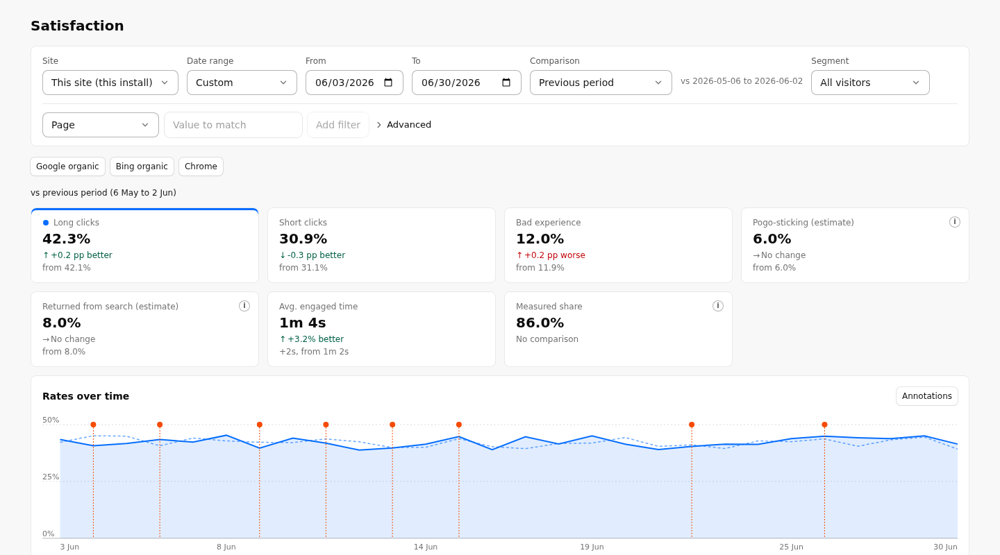
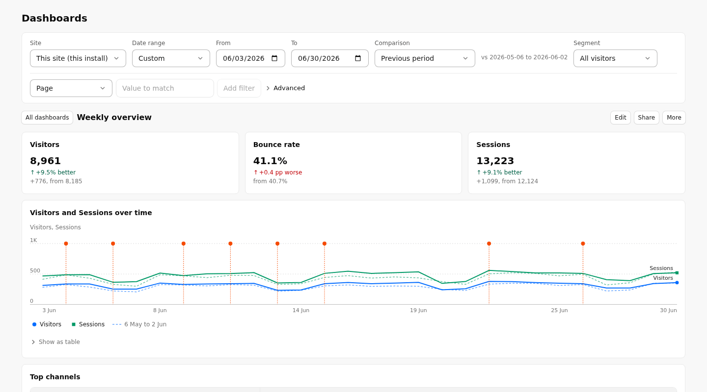
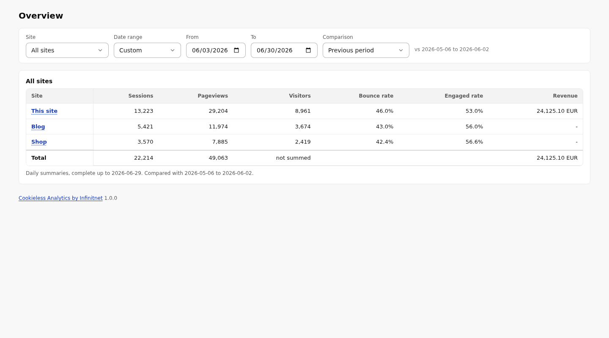
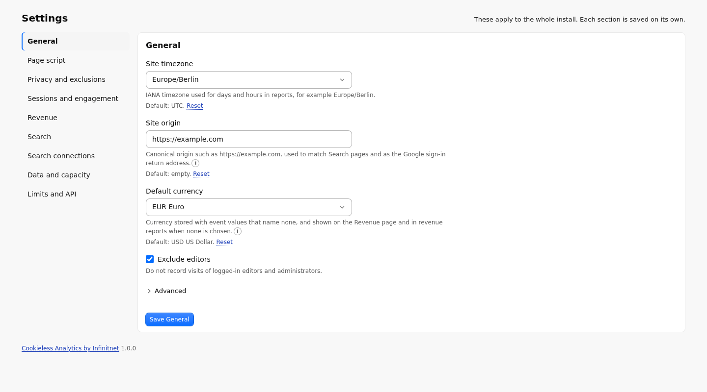

<div align="center">

# Cookieless Analytics by Infinitnet

Self-hosted, cookieless web analytics. Runs on EmDash, tracks any site.

[](https://www.npmjs.com/package/@infinitnet/cookieless-analytics) [](https://www.npmjs.com/package/@infinitnet/cookieless-analytics) [](https://github.com/infinitnet/cookieless-analytics/actions/workflows/ci.yml) [](LICENSE) [](docs/install.md)

**Product page** <https://infinitnet.io/cookieless-analytics/> · [Install](#install) · [Docs](#documentation) · [Wiki](https://github.com/infinitnet/cookieless-analytics/wiki)

<a href="https://github.com/infinitnet/cookieless-analytics/wiki/Reports"></a>

<sub>All screenshots show synthetic data for example.com.</sub>

</div>

Cookieless Analytics by Infinitnet: self-hosted, privacy-first web analytics. Runs on EmDash CMS (Cloudflare Workers and D1) and tracks any site: real sessions without cookies, channels, goals, funnels, Search Console and Bing data, client sites through a snippet, custom dashboards you can share by link, revenue by source and currency, and an API for agents, inside your CMS admin.

## Why this one

Most cookieless tools count page views and stop there. This one keeps real sessions without writing anything to the visitor's device, stores every number in your own database next to your content, and shows it inside the EmDash admin.

| | |
|---|---|
| **Cookieless by design** | No cookie, no local or session storage, no IndexedDB. Visits are joined by a daily salted hash that cannot link days. [Privacy](docs/privacy.md) |
| **Real sessions** | Entry and exit pages, pages per session, bounce, duration and first-touch source, not only page views. [Sessions](docs/sessions.md) |
| **Your Cloudflare account, your database** | Runs inside your EmDash site on Workers and D1. No third-party service, no telemetry. [Install](docs/install.md) |
| **Fits the Workers Free plan** | Capacity profiles size storage and background work to your plan; on Free a daily write guard keeps the CMS able to save content. [Limits](docs/limits.md) |
| **Tracks any site** | One script tag measures a plain Astro site, a static site or another CMS, also through Google Tag Manager. [Client sites](docs/client-sites.md) |
| **Bot-free and unsampled** | Bots never leave a stored row. Nothing is sampled, and what could not be stored (an overloaded database, a capped visit, the Free plan's daily guard) is counted on the Data page. [Bots](docs/bots.md) |
| **Revenue and refunds** | Orders by source, campaign and landing page, refunds and net revenue, one currency per report and never converted. [Revenue](docs/revenue.md) |
| **Search data next to traffic** | Google Search Console and Bing Webmaster Tools in the same UI, with SEO views. [Search sources](docs/search-sources.md) |
| **Annotations with measured impact** | Mark a release or a publish and compare any metric before and after it. [Annotations](docs/annotations.md) |
| **Satisfaction signals** | Long and short clicks, bad experiences and estimated pogo-sticking from search visits, labelled as estimates. [Satisfaction](docs/sessions.md#satisfaction-metrics) |
| **Dashboards you can share** | Read-only links to plain HTML pages with no script, no cookie and an optional password; scheduled email. [Dashboards](docs/dashboards.md) |
| **Built for agents** | Scoped API keys, an OpenAPI description and MCP tools through your EmDash site. [Agent API](docs/AGENTS.md) |
| **Many sites, one admin** | Client sites in the same database and connected EmDash installs read through their agent API. [Multi-site](docs/multi-site.md) |
| **Open source** | Apache-2.0, TypeScript source in the repository and in the npm package. |

If you are looking for a Plausible alternative, self hosted analytics or Astro analytics that lives inside your CMS: like Plausible, this plugin is cookieless and shows a compact set of reports; unlike a separate analytics service, it runs inside your EmDash site on your own Cloudflare account, with its data in your own D1 database, real sessions across pages, Search Console and Bing data next to your traffic, and an API for agents. It does not offer heatmaps, session replay, user profiles or cross-day returning visitors, by design.

## Install

The plugin is a native EmDash plugin, distributed on npm as `@infinitnet/cookieless-analytics`. It needs a native plugin because it serves the page script through `page:fragments`, adds Astro middleware for its neutral public paths, ships React admin pages and keeps its facts in SQL tables. There is therefore no one-click listing in the EmDash plugin registry, which lists sandboxed plugins only. Two ways to install it:

### A) New site: Deploy to Cloudflare

[](https://deploy.workers.cloudflare.com/?url=https://github.com/infinitnet/cookieless-analytics/tree/main/template)

The button copies [template/](template/README.md) into a new repository on your GitHub or GitLab account and deploys it to your Cloudflare account: an EmDash site (the EmDash Cloudflare starter) with the plugin already installed from npm, a D1 database, an R2 bucket for media and a Cron Trigger every minute. It asks for `EMDASH_ENCRYPTION_KEY` (`npx emdash secrets generate`; you can leave it empty until you connect Search). Afterwards:

1. Open `/_emdash/admin` on the new site and complete the setup wizard.
2. On the Workers Free plan, set the capacity profile to Small (Analytics, Settings, Data and capacity).

### B) Existing EmDash site: npm

```sh
npm install @infinitnet/cookieless-analytics   # or: pnpm add @infinitnet/cookieless-analytics, yarn add @infinitnet/cookieless-analytics
```

In `astro.config`, add the plugin to EmDash's `plugins` and the integration after `emdash()`:

```js
import { defineConfig } from "astro/config";
import emdash from "emdash/astro";
import cookielessAnalytics from "@infinitnet/cookieless-analytics";
import cookielessAnalyticsIntegration from "@infinitnet/cookieless-analytics/integration";

export default defineConfig({
  integrations: [
    emdash({ plugins: [cookielessAnalytics()] }),
    cookielessAnalyticsIntegration(), // after emdash()
  ],
});
```

Then redeploy. Requirements and notes:

- Your layout must render EmDash's `EmDashHead`, which emits the plugin's one script tag.
- Cloudflare Workers with D1 is the primary target; Node with SQLite, libSQL or Postgres works wherever the same SQL runs.
- Set a Cron Trigger of `* * * * *` so daily summaries, retention, salt rotation, Search sync, the revenue reconcile and scheduled email run. Every 15 minutes also works, with the background tasks taking turns and running about once an hour each ([Cron Trigger](docs/install.md#cron-trigger)).
- Set the `capacityProfile` setting: Small on the Workers Free plan, Standard (default) on Workers Paid, Dedicated when the analytics tables have their own database.
- Set `EMDASH_ENCRYPTION_KEY` before you store Search secrets (Google client secret, refresh token, service account key, Bing API key); the host encrypts them with it.

Full steps: [docs/install.md](docs/install.md). A guide with one page per feature and screenshots is in the [wiki](https://github.com/infinitnet/cookieless-analytics/wiki) (source: [docs/wiki](docs/wiki/Home.md)), starting with [Quick install](https://github.com/infinitnet/cookieless-analytics/wiki/Quick-Install).

### Trust model

A native plugin runs inside your site's process with the same access as the site itself, so read its code before you install it: it is all in this repository and in the npm package, including the TypeScript source. The plugin sends no telemetry. It makes network calls only to the Search providers you configure (Google and Bing) and to the connected sites you declare, through EmDash's `ctx.http` with exact allowed hosts and never a wildcard. It sends email only when you schedule a dashboard email, and only through the mail provider your EmDash site already has configured; it never talks to a mail service itself.

## Features

<table>
<tr>
<td width="50%" valign="top"><a href="https://github.com/infinitnet/cookieless-analytics/wiki/Revenue-and-Refunds"></a><br><b><a href="https://github.com/infinitnet/cookieless-analytics/wiki/Revenue-and-Refunds">Revenue and refunds</a></b>: gross, refunds and net per currency, by first-touch source.</td>
<td width="50%" valign="top"><a href="https://github.com/infinitnet/cookieless-analytics/wiki/Satisfaction"></a><br><b><a href="https://github.com/infinitnet/cookieless-analytics/wiki/Satisfaction">Satisfaction</a></b>: long clicks, bad experiences and search behaviour per landing page.</td>
</tr>
<tr>
<td valign="top"><a href="https://github.com/infinitnet/cookieless-analytics/wiki/Annotations-and-Impact"></a><br><b><a href="https://github.com/infinitnet/cookieless-analytics/wiki/Annotations-and-Impact">Annotations and impact</a></b>: each change measured on its own metric, before and after.</td>
<td valign="top"><a href="https://github.com/infinitnet/cookieless-analytics/wiki/Search-Integrations"></a><br><b><a href="https://github.com/infinitnet/cookieless-analytics/wiki/Search-Integrations">Search</a></b>: Google Search Console and Bing in one view, with SEO views.</td>
</tr>
<tr>
<td valign="top"><a href="https://github.com/infinitnet/cookieless-analytics/wiki/Dashboards-and-Sharing"></a><br><b><a href="https://github.com/infinitnet/cookieless-analytics/wiki/Dashboards-and-Sharing">Dashboards and sharing</a></b>: custom tiles, share links, scheduled email.</td>
<td valign="top"><a href="https://github.com/infinitnet/cookieless-analytics/wiki/Goals-and-Funnels"></a><br><b><a href="https://github.com/infinitnet/cookieless-analytics/wiki/Goals-and-Funnels">Behaviour and funnels</a></b>: events, goals, funnels, journeys, outbound links, forms.</td>
</tr>
<tr>
<td valign="top"><a href="https://github.com/infinitnet/cookieless-analytics/wiki/Multi-Site-and-Sites-View"></a><br><b><a href="https://github.com/infinitnet/cookieless-analytics/wiki/Multi-Site-and-Sites-View">All sites</a></b>: one table over every site you measure.</td>
<td valign="top"><a href="https://github.com/infinitnet/cookieless-analytics/wiki/Settings-Reference"></a><br><b><a href="https://github.com/infinitnet/cookieless-analytics/wiki/Settings-Reference">Settings</a></b>: every tunable with a validated range and a documented default.</td>
</tr>
</table>

### Everything it does

| Feature | What you get | Read more |
|---|---|---|
| Overview and comparison | Pageviews, visitors per day, sessions, bounce, duration, scroll depth and time on page, a realtime count, compared with the previous period or the year before | [Reports](https://github.com/infinitnet/cookieless-analytics/wiki/Reports) |
| Pages, Sources, Audience | Top, entry, exit and not found pages; channels, sources, campaigns and AI assistants; country, region, device, browser, OS and language | [Reports](https://github.com/infinitnet/cookieless-analytics/wiki/Reports) |
| Behaviour | Events, properties, goals, outbound links, downloads, forms and scroll | [Events](https://github.com/infinitnet/cookieless-analytics/wiki/Events) |
| Goals and funnels | Sequential, strict (no other page in between) and flexible (any order) funnels, with revenue per step | [Goals and funnels](https://github.com/infinitnet/cookieless-analytics/wiki/Goals-and-Funnels), [behaviour.md](docs/behaviour.md) |
| Journeys and segment comparison | Next and previous pages of a page, the most common paths, and two saved segments side by side over the same range | [behaviour.md](docs/behaviour.md) |
| Filters and segments | Any dimension with is, is not, contains, does not contain, starts with and regex, include and exclude, event properties, currency and revenue; saved segments; the whole view lives in the URL | [Filters and segments](https://github.com/infinitnet/cookieless-analytics/wiki/Filters-and-Segments), [filters.md](docs/filters.md) |
| Satisfaction | Long and short clicks, bad experiences, estimated pogo-sticking and returns from search, best and worst landing pages by score, a drawer per page | [Satisfaction](https://github.com/infinitnet/cookieless-analytics/wiki/Satisfaction), [sessions.md](docs/sessions.md#satisfaction-metrics) |
| Revenue and refunds | Order values from the page or a payment webhook, refunds and voids, revenue by channel, source, campaign, landing page, page, country, device and goal | [Revenue and refunds](https://github.com/infinitnet/cookieless-analytics/wiki/Revenue-and-Refunds), [revenue.md](docs/revenue.md) |
| Links report | Impressions, clicks and click-through rate per short link, placement, page and channel, from any link plugin that follows the convention | [Links report](https://github.com/infinitnet/cookieless-analytics/wiki/Links-Report), [integration.md](docs/integration.md) |
| Search Console and Bing | Clicks, impressions, CTR and position by query, page, country and device; per-page queries in Pages; cannibalization, position bands, striking distance, movers and content decay | [Search integrations](https://github.com/infinitnet/cookieless-analytics/wiki/Search-Integrations), [search-sources.md](docs/search-sources.md) |
| Annotations and impact | Scoped markers (site-wide, host, path, query) on every chart, automatic annotations on publish and update, before and after impact on any metric | [Annotations and impact](https://github.com/infinitnet/cookieless-analytics/wiki/Annotations-and-Impact), [annotations.md](docs/annotations.md) |
| Content and site search | Traffic per EmDash collection, what visitors search for on your site, and a Traffic panel in the content editor | [Content and site search](https://github.com/infinitnet/cookieless-analytics/wiki/Content-and-Site-Search), [content.md](docs/content.md) |
| Dashboards and sharing | Up to 12 tiles from the existing reports, fourteen built-in templates, read-only links with optional password and expiry | [Dashboards and sharing](https://github.com/infinitnet/cookieless-analytics/wiki/Dashboards-and-Sharing), [dashboards.md](docs/dashboards.md) |
| Scheduled email | Any dashboard weekly or monthly by email, a weekly digest in one click, through your site's own mail provider | [email.md](docs/email.md) |
| Multi-site | The local site, client sites through a snippet and connected EmDash installs, one site switcher, an All sites table | [Multi site and Sites view](https://github.com/infinitnet/cookieless-analytics/wiki/Multi-Site-and-Sites-View), [multi-site.md](docs/multi-site.md), [client-sites.md](docs/client-sites.md) |
| Agent API and MCP | Scoped keys, one `query` endpoint for every report, annotations, dashboards and server-side events, MCP tools | [Agent API and MCP](https://github.com/infinitnet/cookieless-analytics/wiki/Agent-API-and-MCP), [AGENTS.md](docs/AGENTS.md), [mcp.md](docs/mcp.md) |
| Other plugins | `recordEvent` in process, the current session through a public route, plugin detection, the page script's window API | [Events](https://github.com/infinitnet/cookieless-analytics/wiki/Events), [integration.md](docs/integration.md) |
| Definitions | Goals, funnels, segments, user agent rules, annotations, a UTM builder, API keys and sites | [Definitions](https://github.com/infinitnet/cookieless-analytics/wiki/Definitions) |
| Data page and privacy receipt | Storage and retention, CSV and JSON export, deleting matching visits, a receipt and a Markdown block for your privacy page | [Data page](https://github.com/infinitnet/cookieless-analytics/wiki/Data-Page), [privacy.md](docs/privacy.md) |
| Bot handling | Bots answered with an empty 204 and never stored; your own user agent rules | [Bot handling](https://github.com/infinitnet/cookieless-analytics/wiki/Bot-Handling), [bots.md](docs/bots.md) |
| Capacity and scale-out | Capacity profiles, a write guard on Free, an optional queue tier, an own D1 database for analytics or one per site | [Capacity profiles](https://github.com/infinitnet/cookieless-analytics/wiki/Capacity-Profiles-and-Cloudflare-Plans), [Queue worker](https://github.com/infinitnet/cookieless-analytics/wiki/Queue-Worker), [limits.md](docs/limits.md) |
| Settings | Every tunable is a plugin setting with a validated range and a documented default; invalid values fall back to the default | [Settings reference](https://github.com/infinitnet/cookieless-analytics/wiki/Settings-Reference), [settings.md](docs/settings.md) |

## Use cases

**One EmDash site.** For a blog, a docs site or a company site on EmDash. You get sessions, sources, goals and Search data inside the CMS admin, a Traffic panel on every entry and an annotation on every publish. [Quick install](https://github.com/infinitnet/cookieless-analytics/wiki/Quick-Install)

**Sites that are not EmDash.** Hosted on your EmDash install, measuring every site you register. For a plain Astro site, a static site or another CMS: register it on the Definitions page (Sites tab) and paste one script tag into its `<head>` or a Google Tag Manager Custom HTML tag. Every report, filter, dashboard and the agent API work for it. [Client sites](docs/client-sites.md)

<details>
<summary>The script tag</summary>

```html
<script defer src="https://your-install.example/_/e.js" data-ec-key="abcdefghij0123456789"></script>
```

Its visits land in your database under its own site id. Single page apps call `window.__ec.page()` after a route change. The key is public and only allows "accept visits for this site from these host names". Details, limits and the capacity guideline: [docs/client-sites.md](docs/client-sites.md).

</details>

**Many sites and agencies.** For a portfolio or an agency with client sites. You get one admin with a site switcher, an All sites table, dashboards copied between sites and shared with clients as read-only links (optional password and expiry), and a weekly digest by email. Visitors are never summed across sites. [Multi-site](docs/multi-site.md), [Dashboards](docs/dashboards.md)

**Shops and paid products.** For e-commerce and SaaS checkouts. You get orders, revenue, refunds and net revenue by first-touch channel, campaign and landing page, revenue per funnel step, sent from the page or a payment webhook with a duplicate guard by order id. [Revenue](docs/revenue.md)

**SEO and content teams.** For sites that live on search traffic. You get Search Console and Bing next to your sessions, per-page queries, cannibalization, striking distance and content decay, satisfaction signals per landing page, and the measured impact of every title change or publish. [Search sources](docs/search-sources.md), [Annotations](docs/annotations.md)

**AI agents and automation.** For deploy scripts, reporting bots and AI clients. You get scoped API keys, an OpenAPI description, server-side events and MCP tools through your EmDash site's MCP endpoint. [Agent API](docs/AGENTS.md), [MCP](docs/mcp.md)

**Privacy-sensitive sites.** For sites that want analytics without storing anything on the device. You get no cookies and no raw IP address or user agent stored, Global Privacy Control honoured by default, and a privacy receipt for your privacy page. [Privacy](docs/privacy.md)

**Small sites on the Free plan.** For a personal site on Workers Free. You get the full feature set with the Small capacity profile, which pauses recording for the rest of the UTC day before the account's daily write limit. [Limits](docs/limits.md)

## How it works

1. **One script tag.** `EmDashHead` emits the page script (or a client site loads it from your install). It reads nothing from the device and never changes a link or the address.
2. **A neutral route.** The script posts to a short public path of your site; the middleware answers 204 and bots get an empty 204 without a write.
3. **One row per visit.** Each visit is one database document that holds its page views and events, joined across full page loads by a daily salted key.
4. **Daily summaries.** A Cron Trigger rolls closed days into summaries, applies retention, rotates the salt and syncs Search; old days and long ranges are answered from summaries.
5. **Capacity profiles.** The `capacityProfile` setting sizes storage, scan budgets and background work to your plan, with the daily write guard on Small.
6. **Reports in the admin.** React pages inside EmDash, plus the agent API and MCP tools over the same queries.

Details: [How visits are counted](https://github.com/infinitnet/cookieless-analytics/wiki/How-Visits-Are-Counted), [docs/sessions.md](docs/sessions.md), [docs/limits.md](docs/limits.md).

<details>
<summary>Sessions without cookies</summary>

Nothing is written to the device: no cookie, no local or session storage, no IndexedDB, no cache tricks. A visitor key is a daily salted hash of a truncated IP address and the browser family; the salt rotates every day, so the key cannot link days. The page script never changes a link or the address and makes no history call; a full page load continues the visit through the daily key, and soft navigations keep the in-memory session id. Visitor counts are per day, and multi-day visitor figures are labelled as sums of daily visitors. Details: [docs/sessions.md](docs/sessions.md).

</details>

## Limits and plans

| Profile | Use it on | Storage budget | Notes |
|---|---|---|---|
| Small (`small`) | Workers Free | 300 MB | Daily write guard: recording pauses for the rest of the UTC day before the Free plan's write limit, so the CMS can still save content |
| Standard (`standard`, default) | Workers Paid, analytics in the EmDash database | 6 GB | About 17,500 page views a day with 25 months of detail (estimate) |
| Dedicated (`dedicated`) | Analytics in a D1 database of its own | 9 GB | About 26,200 page views a day with 25 months of detail (estimate) |

Beyond one database, the optional queue tier absorbs bursts, the analytics tables can move to their own D1 database, and busy sites can get one database each. Measured and estimated figures, side by side: [docs/limits.md](docs/limits.md), [Capacity profiles and Cloudflare plans](https://github.com/infinitnet/cookieless-analytics/wiki/Capacity-Profiles-and-Cloudflare-Plans).

<details>
<summary>Measured on production D1</summary>

Each visit is one database row that holds its page views and events, so a page view costs about 3.3 rows written with a typical mix of engagement updates, events and new visits. That figure and the cost of every write statement were measured on production D1 (on a Workers Paid and a Workers Free account), as were about 25 ms per write statement end to end from a Worker in Europe, 200 write statements per second without an error, and about 383 bytes per page view as inserted. Detailed visits are kept for 25 months by default; older days and ranges too large to scan are answered from daily summaries, and the Data page says which. Estimates, not measured on D1: 25 months of detail fit up to about 17,500 page views a day in the default 6 GB budget. A page views per day figure for the Workers Free plan is not published until it is measured; on Free the Small profile pauses recording for the rest of the UTC day before the account's daily write limit, so the CMS can still save content.

</details>

## Privacy

- No cookies, no device storage, no raw IP address and no raw user agent are stored; the IP address is used only inside one request to derive the daily key.
- Global Privacy Control is honoured by default, Do Not Track optionally.
- The admin has a privacy receipt that lists every table and column in plain language with its retention, and a Markdown block for your privacy page.
- The design aims to need no consent banner. This is a description of how the software works, not legal advice: whether you need consent depends on your jurisdiction and on everything else your site does.

Details: [docs/privacy.md](docs/privacy.md), [Privacy model](https://github.com/infinitnet/cookieless-analytics/wiki/Privacy-Model).

## Agent API and MCP

Scoped API keys in the `X-Api-Key` header open `/agent/v1/*`: one generic `query` endpoint for every report, the catalog, annotations, dashboards and event ingestion, with scopes `read:analytics`, `read:search`, `sync:search`, `write:annotations`, `write:dashboards` and `write:events`. Failed authentication always answers the same 404. AI clients connected to your EmDash site's MCP endpoint can query reports, read the catalog and the All sites summary, and add annotations once an admin enables the tools.

Details: [docs/AGENTS.md](docs/AGENTS.md), [docs/openapi.json](docs/openapi.json), [docs/mcp.md](docs/mcp.md).

## Documentation

| Page | What it covers |
|---|---|
| [Wiki](https://github.com/infinitnet/cookieless-analytics/wiki) | A guide with one page per feature and screenshots |
| [install.md](docs/install.md) | Install, Cloudflare notes, own database, queue tier, Cron Trigger, secrets, trust model, upgrade |
| [sessions.md](docs/sessions.md) | Sessions and visitors without cookies, satisfaction metrics |
| [privacy.md](docs/privacy.md) | What is stored per table, privacy signals, retention, deleting data, the privacy receipt |
| [bots.md](docs/bots.md) | How bots are kept out, your own user agent rules |
| [filters.md](docs/filters.md) | Filter dimensions and operators, segments |
| [behaviour.md](docs/behaviour.md) | Funnel modes, segment comparison, journeys |
| [revenue.md](docs/revenue.md) | Order values, currencies, refunds, revenue reports |
| [search-sources.md](docs/search-sources.md) | Google Search Console and Bing setup, SEO views, annotation impact |
| [annotations.md](docs/annotations.md) | Scopes, automatic annotations, impact |
| [content.md](docs/content.md) | Collections report, site search, the editor panel |
| [dashboards.md](docs/dashboards.md) | Dashboards, templates, share links and their headers |
| [email.md](docs/email.md) | Scheduled dashboard email and the weekly digest |
| [client-sites.md](docs/client-sites.md) | Measuring other sites with the script tag |
| [multi-site.md](docs/multi-site.md) | Local, client and connected sites, the All sites table |
| [integration.md](docs/integration.md) | Events from other plugins and your server code, the Links convention |
| [AGENTS.md](docs/AGENTS.md) | The agent API, with [openapi.json](docs/openapi.json) |
| [mcp.md](docs/mcp.md) | MCP tools |
| [limits.md](docs/limits.md) | Capacity profiles, measured costs, scale-out ladder |
| [settings.md](docs/settings.md) | Every setting with its range and default, generated from the code |
| [release.md](docs/release.md) | Release checks |
| [design-notes.md](docs/design-notes.md) | Design decisions with their evidence from the EmDash source |

## Contributors

Thanks to everyone who has helped. The [contributors graph](https://github.com/infinitnet/cookieless-analytics/graphs/contributors) lists every contribution; [CONTRIBUTING.md](CONTRIBUTING.md) explains how to join it.

[](https://github.com/infinitnet/cookieless-analytics/graphs/contributors)

## Security

Please report security problems privately through GitHub private vulnerability reporting, not in a public issue. The policy and the security model in short: [SECURITY.md](SECURITY.md).

## Licence and notices

Apache-2.0, see [LICENSE](LICENSE). Copyright 2026 Constantin Oesterling (Infinitnet). Copies and derivative works must keep the attribution in [NOTICE](NOTICE) (Apache-2.0, section 4(d)). Product page: <https://infinitnet.io/cookieless-analytics/>. Bundled data sources and their licences: [THIRD_PARTY_NOTICES.md](THIRD_PARTY_NOTICES.md). Changes: see the GitHub releases. Contributing: [CONTRIBUTING.md](CONTRIBUTING.md). Code of conduct: [CODE_OF_CONDUCT.md](CODE_OF_CONDUCT.md). Security reports: [SECURITY.md](SECURITY.md).
