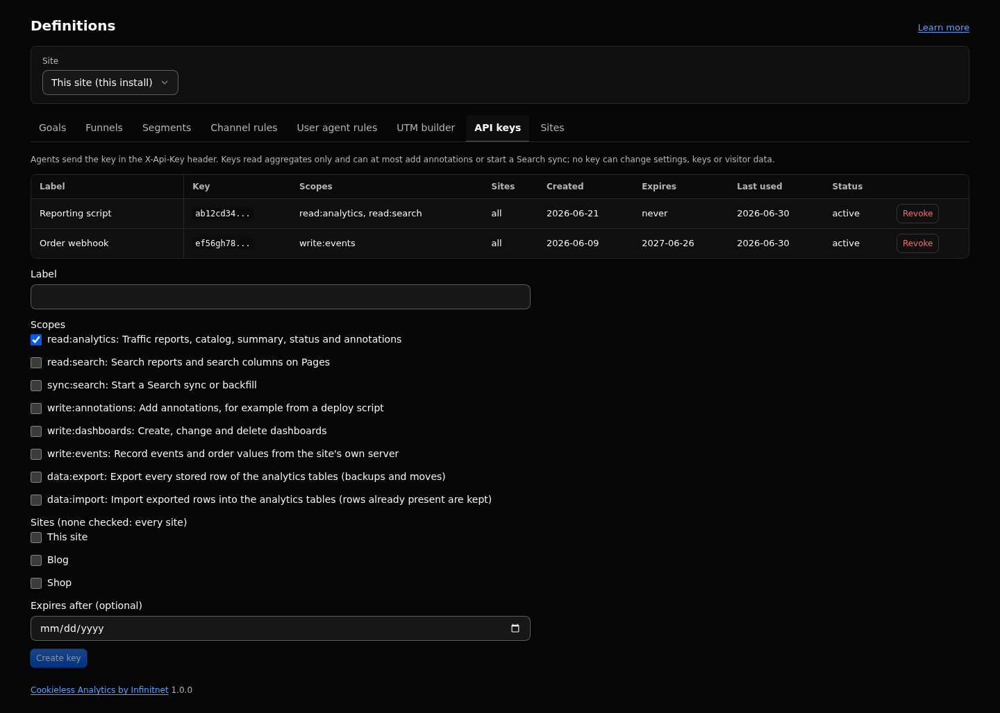

# Agent API and MCP

Scripts, AI agents, backends and a multi-site master read aggregated analytics through the agent API with a scoped API key. EmDash users and EmDash API tokens can use four MCP tools instead. Neither returns raw visitor data, except the export route for backups and moves (scope `data:export`).

Base URL: `https://example.com/_emdash/api/plugins/cookieless-analytics/`

## How to use it

### 1. Create a key

1. Open Definitions, API keys.
2. Pick a label, the scopes, an optional site restriction and an optional expiry day.
3. Copy the key. It is shown once; the site stores only its prefix and a SHA-256 hash. A key is an 8 character prefix (lowercase letters and digits), a dot and a 43 character secret, for example `ab12cd34.EXAMPLESECRET` (shortened here).
4. Revoke a key on the same tab. A revoked key can then be deleted there.



| Scope | Grants |
|---|---|
| `read:analytics` | Traffic reports through `query`, the catalog, summary, status, reading annotations and dashboards |
| `read:search` | The `search_*` reports; with `read:analytics`, the search columns on `pages` |
| `sync:search` | `search/sync` and `search/backfill` |
| `write:annotations` | Adding annotations, for example from a deploy script |
| `write:dashboards` | Creating, changing and deleting dashboards |
| `write:events` | Recording events, orders and refunds from your server |
| `data:export` | Exporting every stored row of the analytics tables, for backups and moves ([Move Data](Move-Data)) |
| `data:import` | Importing exported rows ([Move Data](Move-Data)) |

No scope exists for settings, keys or deletion. A `data:export` key reads the stored rows, daily visitor keys included: give it an expiry date and revoke it after use.

### 2. Send the key in `X-Api-Key`

```sh
curl -s "https://example.com/_emdash/api/plugins/cookieless-analytics/agent/v1/summary" \
  -H "X-Api-Key: ab12cd34.EXAMPLESECRET"
```

Do not send it as `Authorization: Bearer`: the EmDash host checks every Bearer token on plugin routes first and answers `401`. The key is never read from the query string. Browser based clients must add `X-EmDash-Request: 1` to POSTs; curl, servers and agents do not need it.

### 3. Call sequence

1. `GET agent/v1/reports`: the catalog of reports, dimensions, operators, parameters, metric definitions, scopes and limits.
2. `GET agent/v1/summary?from=2026-03-01&to=2026-03-07`: the Overview numbers against the previous period (`compare=year` or `compare=none`), plus revenue, refunds, net revenue and orders per currency.
3. `POST agent/v1/query` with `{ "report", "query", "params"?, "limit"?, "offset"? }`.
4. `GET agent/v1/status`: versions, the latest day with traffic, the start of the detailed window, the rollup watermark, drop counters and the Search sync state.

```sh
curl -s -X POST "https://example.com/_emdash/api/plugins/cookieless-analytics/agent/v1/query" \
  -H "X-Api-Key: $KEY" -H "content-type: application/json" \
  -d '{"report":"pages","query":{"from":"2026-03-01","to":"2026-03-31","compare":"previous","filters":[{"dim":"channel","op":"is","values":["Organic Search"]}]},"limit":50}'
```

### Other routes

| Route | Method | Scope |
|---|---|---|
| `agent/v1/annotations` | GET | `read:analytics` |
| `agent/v1/annotations` | POST | `write:annotations` |
| `agent/v1/search/sync`, `agent/v1/search/backfill` | POST | `sync:search` |
| `agent/v1/dashboards`, `agent/v1/dashboards/data` | GET, POST | `read:analytics` (plus `read:search` for search tiles) |
| `agent/v1/dashboards/save`, `agent/v1/dashboards/delete` | POST | `write:dashboards` |
| `agent/v1/events` | POST | `write:events` |
| `agent/v1/data/dump` | POST | `data:export` |
| `agent/v1/data/load` | POST | `data:import` |
| `agent/v1/openapi.json` | GET | any valid key |

```sh
# Annotation from a deploy script
curl -s -X POST "https://example.com/_emdash/api/plugins/cookieless-analytics/agent/v1/annotations" \
  -H "X-Api-Key: $KEY" -H "content-type: application/json" \
  -d '{"text":"Release 2.1","path":"/pricing"}'

# One order from a payment webhook
curl -s -X POST "https://example.com/_emdash/api/plugins/cookieless-analytics/agent/v1/events" \
  -H "X-Api-Key: $KEY" -H "content-type: application/json" \
  -d '{"events":[{"name":"purchase","val":49.9,"cur":"EUR","oid":"A-1001"}]}'
```

Client sites: `query.site` in the query body, `?site=` on `summary`, `status` and GET `annotations`, a `site` body field elsewhere. Absent means the local site.

### OpenAPI

The OpenAPI 3.1 document is committed as `docs/openapi.json` in the repository and served at `agent/v1/openapi.json` (any valid key, any scope).

### Responses

- Success: `{ "ok": true, "data": ..., "meta": { "site", "from", "to", "generatedAt", "truncated" } }`. `truncated` is true when more rows exist; page with `offset`.
- `400 { "ok": false, "error", "message" }` for invalid input, for example `range_too_long`, `invalid_filter`, `unknown_site`, `site_not_allowed`.
- `404 {}` for a missing, wrong, revoked or expired key, a missing scope, or a site outside the key's restriction. All look the same on purpose.
- `429 { "ok": false, "error": "rate_limited" }` with `Retry-After`.
- Every response is `Cache-Control: private, no-store`. There is no CORS.

## MCP tools

EmDash serves an MCP endpoint at `https://example.com/_emdash/api/mcp`. The plugin adds four tools, listed by the host as `cookieless-analytics__<name>`.

1. Open the plugin list in the EmDash admin, open the plugin and enable its MCP tools. After an update that changes a tool, confirm the new list again.
2. Give the EmDash API token the scope `mcp:tools:cookieless-analytics` (or `mcp:tools`). The `admin` token scope does not include it. A signed-in admin session needs no scope.
3. Call `analytics_catalog` first, then `analytics_query` with a report name from it.

| Tool | Permission | What it does |
|---|---|---|
| `analytics_query` | `plugins:read` | One report for a site and range (`report`, `query`, `params`, `limit`, `offset`, `withAnnotations`) |
| `analytics_catalog` | `plugins:read` | The catalog, the same document as `agent/v1/reports`; takes `{}` |
| `analytics_sites_summary` | `plugins:read` | One row per site with sessions, page views, visitors, bounce and engaged rate and revenue per currency; `{ from, to, compare? }` |
| `analytics_annotate` | `plugins:manage` | Adds an annotation, or replaces one when `id` is given |

```json
{ "report": "channels", "query": { "from": "2026-03-01", "to": "2026-03-07", "compare": "previous" }, "limit": 10 }
```

Not exposed as tools: event ingestion, deleting data, API keys, share links, settings and dashboards. EmDash writes an audit row for every tool call.

## Settings

| Key | Default | What it does |
|---|---|---|
| `agentRateLimitPerMinute` | `60` | Requests per minute per key and Worker isolate (5 to 1200), so approximate across isolates. |

## Limits

- Range: at most 400 days per query. Rows: at most 1000 per call, offset up to 100,000. Filters: at most 20.
- SEO views: at most 93 days. Journeys: at most 31 days.
- `agent/v1/events`: 1 to 20 events per call.
- At most 100 keys per install (all sites together), revoked keys included until they are deleted. `last_used` is updated at most once per 10 minutes.
- Dashboards: at most 20 per site, 12 tiles each, 16 KB per dashboard.
- For a hard rate limit across isolates, put a WAF rate rule in front.

## Gotchas

- A key with `write:events` alone cannot read reports, and `read:analytics` alone cannot send events. `write:dashboards` alone cannot read any report.
- Responses hold aggregates only: never IP addresses, visitor keys, session ids, user agents or rows per visitor. The exception is `agent/v1/data/dump`, which returns the stored rows for backups and moves.
- Ranges before the detailed window are answered from daily summaries; check `notices` for `summary`, `filter_unavailable:<dim>:<reason>` and `detail_from:<day>`.
- Visitors are distinct per day and summed over days; there are no cross-day uniques.
- No agent route deletes data. Deleting is on the Data page only.
- MCP tools see every site the user can open; a key's site restriction does not apply there.

## Related

[Events](Events), [Revenue and refunds](Revenue-and-Refunds), [Links report](Links-Report), [Dashboards and sharing](Dashboards-and-Sharing), [Annotations and impact](Annotations-and-Impact), [Multi-site and Sites view](Multi-Site-and-Sites-View), [Definitions](Definitions). Full reference: https://github.com/infinitnet/cookieless-analytics/blob/main/docs/AGENTS.md and https://github.com/infinitnet/cookieless-analytics/blob/main/docs/mcp.md
