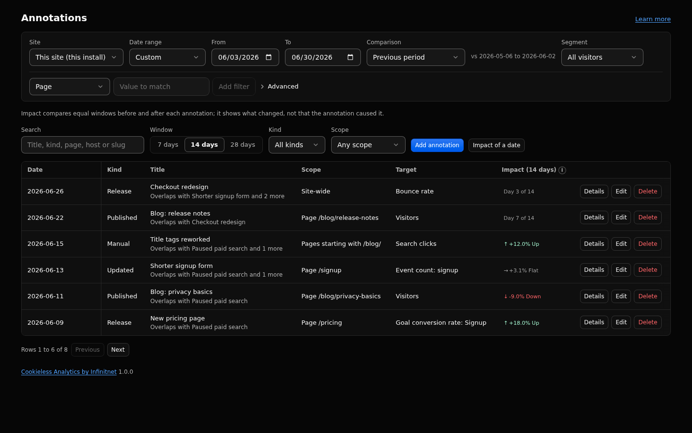
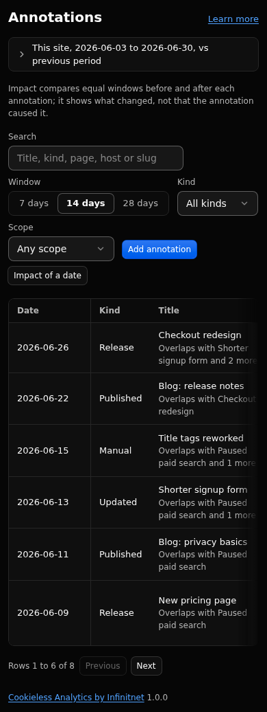

# Annotations and Impact

An annotation is a dated note on your charts: a release, a published post, a campaign start. The Annotations page lists them with the impact on one target KPI each, so you can see what changed around them.

## How to use it

### Add an annotation

1. Open Analytics, **Annotations**, and click **Add annotation**.
2. Pick the date and write the text (up to 200 characters).
3. Choose the scope. Simple mode offers **Site-wide**, **This page** (one path) and **This section** (a path prefix). Advanced mode has rule lists for Host, Path and Query, each with an operator (is, starts with for paths, contains, regex).
4. Check the summary line and the preview, which counts what the scope matched in the last 30 days ("n hosts, n pages, n queries in the last 30 days", with up to five samples).
5. Optionally choose the **Target KPI**, the one metric the page measures for this annotation (for example bounce rate of the page, completions of a goal, sessions of a channel, Search clicks). Without one the page measures visitors of the scope (Search clicks for a query scope while Search is connected). Search metrics are offered only while Google or Bing is connected.
6. Save. The marker shows on every chart whose range and filters match.

### Read impact

1. Open Analytics, **Annotations**. Each row shows the date, kind, title, scope, target and the impact: an arrow, the percent change and a word, Up, Down, Flat, Too early or Not enough data. The colour says whether the change is good news, so a fall in bounce rate or Search position is green. Hover for both values and both windows.
2. Choose the window above the list: 7, 14 (default) or 28 days. The page keeps your choice. To find an annotation, type in **Search**: it matches the title, kind, scope (a page, host or query) and the slug of the published item, in any case, and the term stays in the link; the x clears it.
3. A recent annotation shows "Day 5 of 14" until its after window is complete. A row that says "Overlaps with ..." has another change on the same scope inside its windows; their effects cannot be separated.
4. Click **Details** for the full impact panel: the chart with the annotation day marked, before and after, another metric or row to compare, the annotation scope or site-wide, and a strip of the standard KPIs for the same scope and windows. "Impact of a date" opens the same panel for any date.
5. From a chart, open a marker and click **Open in Annotations** to go to its row.





## Where annotations come from

- **Manual**, written on the Annotations page.
- **Release**, posted by a deploy script through the agent API (scope `write:annotations`):

```sh
curl -s -X POST "https://example.com/_emdash/api/plugins/cookieless-analytics/agent/v1/annotations" \
  -H "X-Api-Key: ab12cd34.EXAMPLESECRET" -H "content-type: application/json" \
  -d '{"text":"Release 2.1","scope":{"v":1,"host":[{"op":"is","value":"shop.example.com"}]}}'
```

- **Published** and **Updated**, added by the plugin when a content item is published or updated (see [Automatic annotations](#automatic-annotations)): one per item, kind and day, with the item's title as text and its public path as scope. When the path cannot be resolved the annotation is site-wide; set the path by hand. Client sites get no automatic annotations.

## Automatic annotations

Publishing an item adds a **Published** annotation; saving an already published item again can add an **Updated** one. Four settings in the Annotations section of the Settings page control this ([Settings reference](Settings-Reference)):

- **Automatic annotations** (on): the master switch. Off, nothing is added.
- **Annotate publishing** (on) and **Annotate updates** (off): which of the two adds one. Updates are off by default because every save of a published item would mark the charts.
- **Annotated collections** (empty is all): only these collection slugs annotate, for example `posts`.
- **Automatic annotations per day** (10, from 1 to 200): the cap per site and day in the site timezone. Once it is reached, further publishes and updates that day add nothing, so a bulk import or content push leaves at most this many markers. Saving the same item again that day replaces its annotation and does not count again.

Before a bulk import, turn **Automatic annotations** off or narrow the collections, then add one manual annotation for the import itself.

## Scopes

- Rules of one kind are combined with "or", kinds with "and": host a or b, and path p.
- A kind with no filter on a chart always matches, so an unfiltered chart shows every annotation in range.
- Query rules apply to Search charts only. Host rules do not apply to Search data.
- A chart shows an annotation when its day is in range and its scope matches the chart's page filters, segment and tile filters together. When two patterns are compared and the overlap is unclear, the marker is shown.

## Annotations on charts

Overview, Search Satisfaction, Search and the dashboard view have an **Annotations** button. Turning it off is kept in the address (`ann=0`), so the choice travels with links; nothing is stored in the browser. Annotations on the same point share a marker with a count. Click, Enter or Space opens the list; Escape closes it.

Shared dashboard pages show annotations only when "Show annotations to viewers" is on. See [Dashboards and Sharing](Dashboards-and-Sharing).

## How impact is computed

- The annotation day is in neither window, because the change happened during it.
- The after window runs from the day after the annotation and ends at yesterday (for Search metrics, at the newest final Search day, so provisional days are never included). The before window has the same number of days and ends the day before the annotation.
- While the after window is shorter than the chosen window, the panel says so: "The after window has n of 28 days; numbers will change."
- Counts are flagged **Notable** when the change is larger than twice the square root of the sum of both values, a rule of thumb for counts, not a statistical test. Rates show their denominators (measured sessions or impressions) instead.
- Host rules do not apply to Search metrics and query rules do not apply to traffic metrics; the panel says so.
- Every result carries the caution: "Before and after comparisons show correlation, not causation. Seasonality, other changes and search engine updates overlap; annotations in the same window are listed." The view never claims a cause and shows no confidence percentage.

Impact is also a dashboard tile (number or line). The template "Impact of last changes" compares the 28 days after the newest annotation with the 28 days before.

## Limits

- Annotation text: up to 200 characters.
- Scope: at most 10 rules per kind and 20 in total, values up to 512 characters. Regex rules follow the safe regex rules of filters (200 characters).
- A scope pattern that matches more than 2,000 values is refused.
- At most 500 annotations are read per range (newest first); the page measures 6 rows at a time (5 on the small capacity profile), so one page stays inside the Free plan query budget.
- Impact windows: 7, 14 or 28 days on the Annotations page; 7, 14, 28, 60 or 90 days in the impact view of agents and dashboard tiles.
- Shared pages list at most 12 annotations per tile.

## Gotchas

- Annotations and the impact view have no setting.
- An annotation without a scope is site-wide and shows on every chart.
- A query-scoped annotation never shows on traffic charts.
- Before and after is correlation only. Check the listed overlapping annotations and the season before drawing conclusions.
- The impact view greys out results below 50 sessions or impressions.
- Annotation texts are visible to anyone with a share link when shared annotations are on.

Full reference: https://github.com/infinitnet/cookieless-analytics/blob/main/docs/annotations.md

## Related

- [Reports](Reports)
- [Search Integrations](Search-Integrations)
- [Dashboards and Sharing](Dashboards-and-Sharing)
- [Agent API and MCP](Agent-API-and-MCP)
