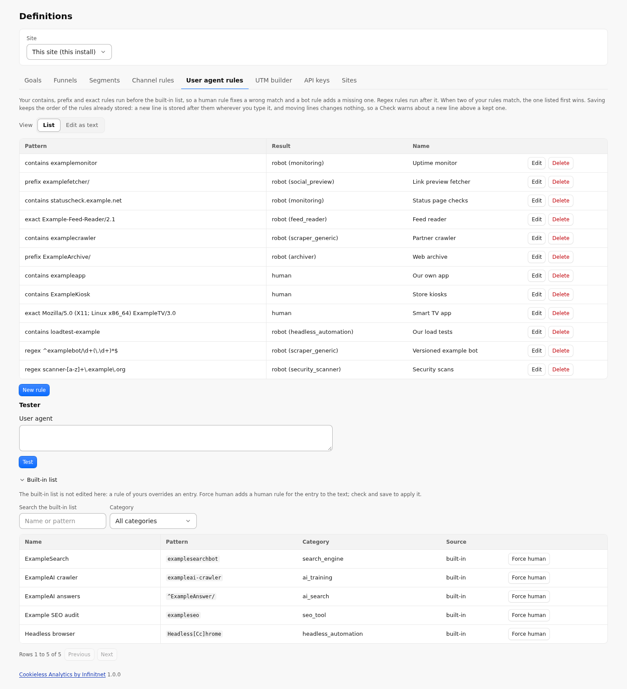
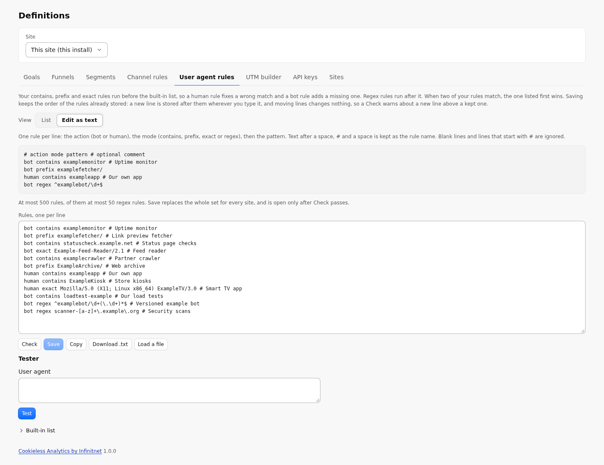

# Bot Handling

Bots are excluded, never reported. A known bot never gets a stored row of any kind, error pages included, and never receives anything from the plugin except an empty 204. There is no bot report and no bot log; only a daily count shows how many were excluded.

## How to use it

1. Leave the defaults on: the built-in list and the client checks need no setup.
2. To keep out a tool of your own (an uptime monitor, an internal checker), open Definitions, tab User agent rules, and add a rule that marks it as a bot.
3. To let a tool through that the list catches, add a rule that forces it to human.
4. To check how many bot requests were excluded, open Data, tab Storage and retention, and read the "Known bots" row of "Not recorded" (the Privacy receipt lists the same count under "Requests not recorded").
5. If bot visits already got into the numbers (a bot with an ordinary browser user agent), remove them with Delete matching visits on the [Data-Page](Data-Page), then add a user agent rule or an excluded IP range so they stay out.

## The user agent classifier

The classifier reads the user agent string and nothing else. It lowercases it, cuts it to 512 characters and caches up to 2,000 results per isolate. The answer is human or bot, with no "uncertain" band. It checks, in this order:

1. A user agent shorter than 10 characters (including an empty one) is a bot.
2. Your own rules of mode `contains`, `prefix` and `exact`.
3. In-app browsers of social apps (Facebook, Instagram, LinkedIn and Line) are human.
4. The built-in list of known bots.
5. Your own `regex` rules.
6. A bounded generic fallback: words such as bot, spider, scraper, fetch, monitor, check and probe when not followed by a letter, so a phone brand such as cubot is not caught.
7. Everything else is human.

The default HTTP clients (python-requests, curl, wget, go-http-client, okhttp, axios, undici, scrapy) and HeadlessChrome are in the built-in list. Every known bot has a category (search engine, AI training, AI search, AI assistant, SEO tool, social preview, monitoring, feed reader, security scanner, headless automation, generic scraper, archiver, ads verification or unknown). The category only labels the match.

The built-in list is built from curated vendor entries, the ai.robots.txt list and the crawler-user-agents list (both MIT licensed).

## User agent rules (Definitions)

A rule has a pattern, a mode (`contains`, `prefix`, `exact` or `regex`) and an action: mark the match as a bot, or force it to human. Rules keep traffic out from the moment they are saved. They do not remove what was already counted. The rules are one set for every site, so the tab shows with this install selected.

- **Fix a false positive**: add a `human` rule (`contains`, `prefix` or `exact`). These run before the built-in list and override it.
- **Add a missing bot**: add a `bot` rule. A `regex` rule runs after the built-in list, so it adds bots but never undoes a built-in match.
- The built-in list is never edited; your rules override it, and an update of the list keeps your fixes.



**Edit as text** shows every rule as one line, `action mode pattern # optional comment`:

```text
bot contains examplemonitor # Uptime monitor
human prefix exampleapp/
```

Check validates every line (errors with their line number, a click selects the line) and shows how many rules are added, changed and removed. Save opens after a clean Check and replaces the whole set; an invalid set saves nothing. A large change is written 30 rows a request, with a progress line, until none remain. Copy and Download .txt export the text; paste or Load a file to import it (nothing is saved before Check and Save).



**Built-in list** (below the tester): search the list, filter by category, 50 rows a page. Force human adds a `human` rule for an entry to the text, to check and save.

## Where a bot is stopped

| Place | What happens |
|---|---|
| Event path (`POST /_/e`) | The user agent is classified first. A bot gets 204 before the body is parsed. Nothing is stored; only the daily `bot` counter goes up. |
| Session read route | A bot gets 204 with no body. |
| Error page logging | A bot's 404 is never recorded. |
| Request locals | The middleware sets `locals.__ec = { audience, botId }` so later middleware can tell a known bot (best effort). |

## Client checks

The page script has its own, smaller checks. If any applies, it does nothing at all: it sends nothing and adds no listener.

- `navigator.webdriver` is true.
- The user agent matches a short bot pattern (words such as bot, spider, headless, lighthouse, puppeteer, playwright, preview, python, curl and wget).
- `navigator.languages` is empty.
- A desktop Chromium browser reports no plugins.
- The page is being prerendered (the script waits until it is shown).
- A privacy signal applies.

## Byte identical HTML

With the plugin installed, a page differs from the same page without it by exactly one tag in `<head>`, identical for every request and every user agent:

```html
<script defer src="/_/e.js"></script>
```

No links, fragments, query parameters, canonical or meta tags and no `Link` headers are added. The middleware never reads, buffers or rewrites a page response. A search engine sees the same page as a visitor. With `scriptDelivery` set to `inline` the tag becomes one inline script, still identical for everyone.

## Settings

| Key | Default | What it does |
|---|---|---|
| `scriptForBots` | `always` | `always` emits the same tag for every visitor. `skip_known_bots` leaves it out for known bot user agents. |
| `excludeIpPrefixes` | empty | IP ranges (CIDR) that are not recorded. |

## AI assistants

A person who follows a link from an AI assistant arrives with an ordinary browser and is counted as human traffic, in the channel AI Assistants. The assistant's own fetcher is a bot and is excluded.

## Limits

- At most 500 user agent rules, of them at most 50 regex rules; patterns up to 512 characters. Regex rules follow the safe regex limits of the report filters.
- The rules are edited in the admin only; the agent API has no routes for them.
- Classifier cache: 2,000 results per isolate; user agents cut to 512 characters.

## Gotchas

- `skip_known_bots` is risky with route caching: page fragments land in the route cache, which is keyed without the user agent and sends no `Vary: User-Agent`. A page first cached for a bot would be served to humans without the script, and they would not be counted. Enable it only with route caching off.
- The classifier sees only the user agent. A bot that sends an ordinary browser user agent, runs scripts and passes every client check is counted as human. The plugin does not verify IP ranges or reverse DNS.
- Cloudflare Bot Management fields (Enterprise only) are never read.
- A page served from Cloudflare's cache does not start the Worker, so the server sees a bot only when it reaches the Worker. This changes no count, because bots are never counted.

## Related

[Definitions](Definitions), [Privacy-Model](Privacy-Model), [Data-Page](Data-Page), [How-Visits-Are-Counted](How-Visits-Are-Counted), [Troubleshooting](Troubleshooting).

Full reference: https://github.com/infinitnet/cookieless-analytics/blob/main/docs/bots.md
