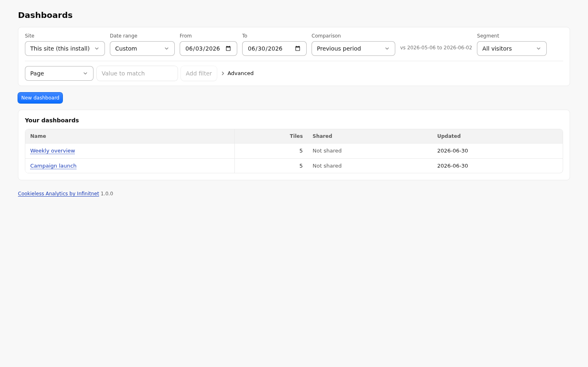
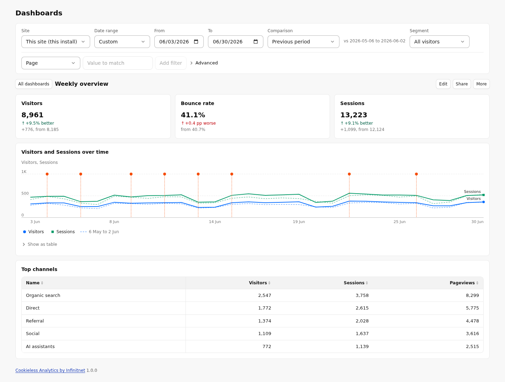
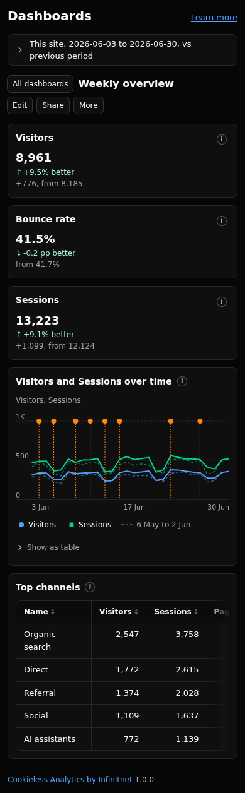

# Dashboards and Sharing

A dashboard is a saved view of your reports: up to 12 tiles, each one report shown as a number, a chart or a table. You can share a dashboard as a read-only link and send it by email on a schedule. Dashboards hold only the layout, never visitor data.

## How to use it

1. Open **Dashboards**. Create a dashboard, or pick one from the template gallery.
   With more than 10 dashboards, a search box above the list finds one by its name.
2. Add tiles: choose the report, the kind of tile (number, line, area, bars, donut, table), the metric, a title, tile filters, the number of rows and a width of 1, 2 or 3 columns.
3. Reorder tiles by dragging the handle, or with the Up and Down buttons (the keyboard path).
4. Set the defaults: range, comparison, segment and filters. When you open the dashboard the header starts from them.
5. Open the dashboard. Change the header to look at another range; the change lasts until you leave.
6. Choose **Share** to create a link, or **Schedule email** to send it on a schedule.

## Tiles

| Reports | Kinds |
|---|---|
| Overview | Number |
| Visitors over time, Search Satisfaction over time | Line, Area |
| Search overview | Number, Line, Area |
| Search Satisfaction, Goals | Number, Bars, Donut, Table |
| Cannibalization, Position movement | Number, Table |
| Position bands | Number, Bars, Donut, Table |
| Bands over time | Stacked bars, Line, Area |
| Competing pages, Striking distance, Search movers, Search decay, Traffic movers, Traffic decay | Table |
| Impact | Number, Line |
| Revenue | Number |
| Revenue over time | Line, Area |
| Every other report, Revenue breakdown | Bars, Donut, Table |

- A Goals number tile shows one goal, a Funnels tile one funnel, an Event properties tile needs the event name, which the field suggests from the events seen in the dashboard range.
- Search tiles take a source (all, Google, Bing) and stay empty until a Search source is connected.
- Revenue tiles show one currency: the chosen one, or the site's default currency when the tile runs.
- A donut shows at most 7 slices, one color each; the rest is folded into "other".
- A table tile shows the name and the first three figures of its report, or the columns you check in the tile editor (up to 6, in the report's order).
- Line and area tiles show matching annotations. The Annotations button of the dashboard view hides them.
- Tiles with the same report, filters and options share one request. The editor shows the number of distinct requests.

## Templates

- **Export** downloads the dashboard as a template file, with or without the segments, goals and funnels it uses.
- **Import** reads a template into the selected site. Segments, goals and funnels are matched by name; missing ones are created from the file when it carries them, otherwise the reference is dropped and listed.
- **Gallery**: fourteen built-in templates. Analytics: Overview, Content, Acquisition, Behavior, Search Satisfaction, Revenue, Weekly digest, Search, Links and Impact of last changes. SEO: SEO overview, Cannibalization, Position bands, and Winners and losers.

## Copy to sites

"Copy to sites" copies the dashboard into each chosen site, and creates missing goals, funnels and segments there when the box is ticked. The copies are independent: changing one does not change the others.

## Share links

1. Open the dashboard and choose **Share**.
2. Optionally give the link a label (for example "Client A"), a password and an expiry: 7, 30 or 90 days, a date, or never.
3. Create the link. The full link, for example `https://example.com/_/s/<token>`, is shown **once** with a copy button. Only a prefix and a hash are stored.
4. The dialog lists every link with its label, state (open, password, expired), created and expiry dates, views and last view, and a Revoke button.

**What viewers can do**

- See the tiles for the dashboard's default range, and switch between the ranges the dashboard allows.
- Turn on the comparison with the previous period, when the dashboard allows comparison and has at most 6 distinct report requests.
- See annotations only when you turn on "Show annotations to viewers". Annotation texts are then visible to anyone with the link.
- Viewers cannot change filters or segments, drill down, export or see raw rows.

The shared page is plain HTML with no script, no cookie and no storage. It never names the product, and it shows the site's name only if you put it in the dashboard name. Opening it is not counted as a visit.

**Passwords.** The browser asks with its own sign-in prompt; the user name is ignored. A password belongs to its link and cannot be changed: create a new link and revoke the old one. After 10 wrong passwords within 15 minutes the link is locked for 15 minutes.

## Scheduled email

1. Open the dashboard and choose **Schedule email**.
2. Pick weekly (a weekday) or monthly (a day from 1 to 28), the hour in the site time zone, 1 to 5 recipients, the range preset, the comparison and an optional subject.
3. **Send test** sends it to your own account address only.
4. Save.

**Set up weekly digest** on the dashboard list creates a dashboard from the Weekly digest template and opens this dialog with weekly, Monday, 08:00 and the comparison already set. Add the recipients and save.

Email needs an email provider plugin on the site. Without one, schedules can be saved but nothing is sent. Each recipient gets their own message. The email has tables instead of charts, no images, no tracking pixel and no share link. Only an Admin sees the recipients.

## Settings

| Key | Default | What it does |
|---|---|---|
| `sharePath` | `/_/s` | Public path of share links. Neutral words only, no trailing slash, different from the script and event paths. |
| `siteTimezone` | UTC | Time zone of the range presets and of the email hour. |

## Limits

- 20 dashboards per site, 12 tiles per dashboard, 16 KB per stored dashboard.
- Tile filters: up to 5. Dashboard default filters: up to 10. Rows per tile: 5 to 25.
- Share links: 10 per dashboard, 100 per site. Labels 1 to 40 characters, passwords 8 to 128 characters.
- Comparison on shared pages: only with at most 6 distinct report requests.
- Shared annotations: at most 12 per tile.
- Email: 1 to 5 recipients, subject up to 80 characters, test send at most once a minute per dashboard.

## Gotchas

- The full share link is shown once. If you lose it, create a new link.
- Deleting a dashboard deletes all of its share links.
- A revoked open link can still show for about a minute in a browser that already opened it.
- The password lock lives in a store without atomic counters. Add a Cloudflare rate limiting rule for paths under your `sharePath` (for example 30 requests per minute per IP address) as the hard limit.
- Dashboards of a connected remote site cannot be shared or scheduled.
- Recipients are never exported, copied, or returned by the agent API.
- The SEO templates offer ranges up to 90 days, because the SEO views read at most 93 days.

Full reference: https://github.com/infinitnet/cookieless-analytics/blob/main/docs/dashboards.md

## Related

- [Reports](Reports)
- [Annotations and Impact](Annotations-and-Impact)
- [Search Integrations](Search-Integrations)
- [Multi-Site and Sites View](Multi-Site-and-Sites-View)
- [Agent API and MCP](Agent-API-and-MCP)
- [Privacy Model](Privacy-Model)
