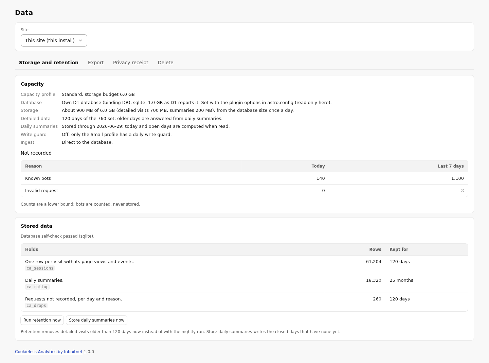
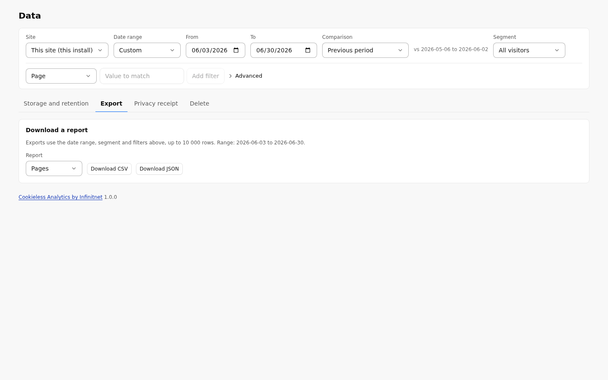
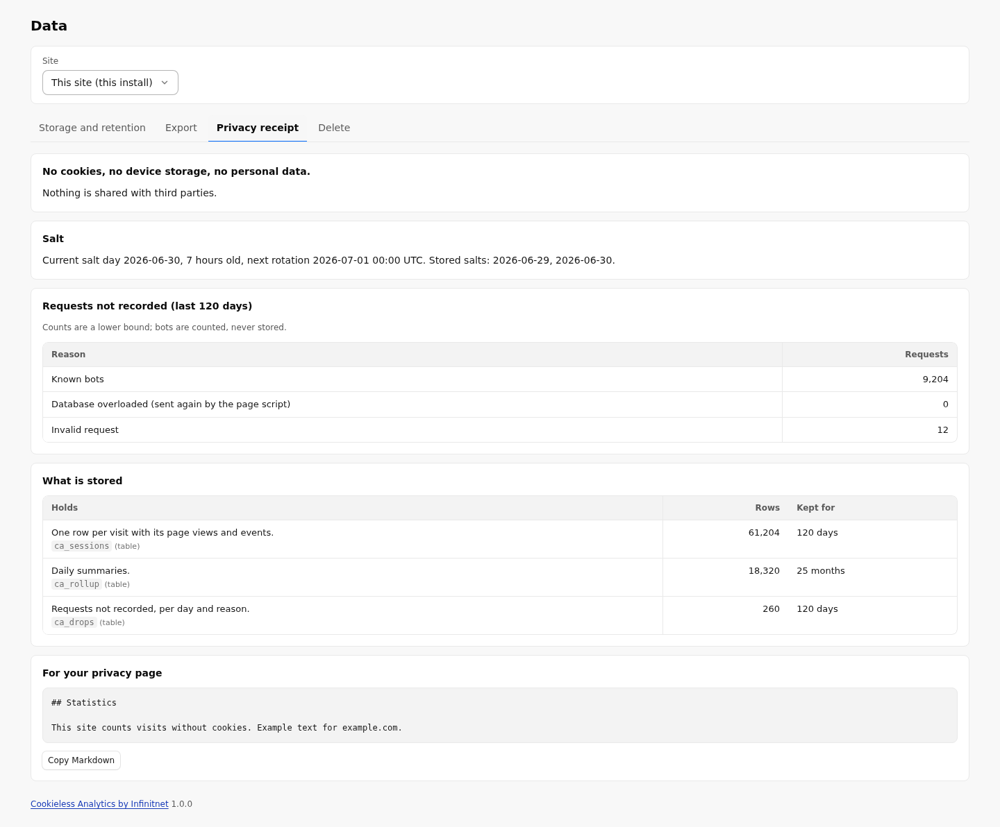
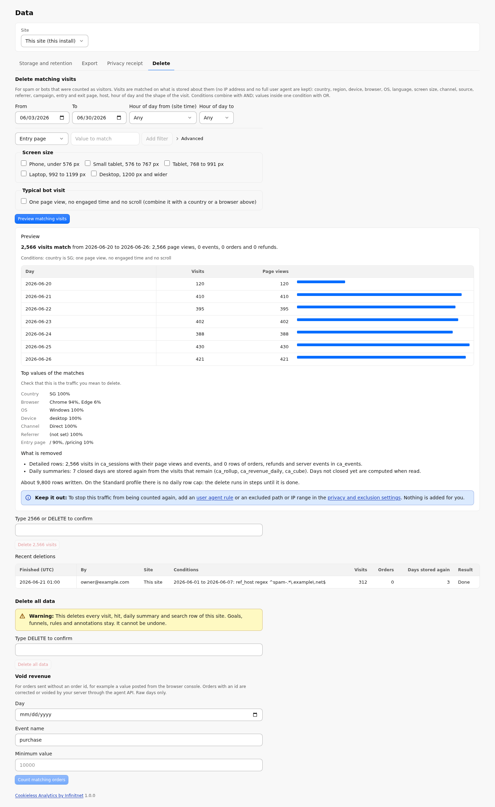

# Data Page

The Data page shows what the plugin stores and lets you export, explain and delete it. It has four tabs: Storage and retention, Export, Privacy receipt and Delete. Tabs are in the URL, so Back returns to the previous tab.

## How to use it

Open Analytics, Data. The site switcher in the header picks the site; the date range, segment and filters in the header apply to Export, and the Delete tab starts from the header range.

### Storage and retention

- **Capacity**: the profile, the storage estimate against its budget (for example "About 1.2 GB of 6 GB"), how many days of detailed data are kept, the date through which daily summaries are stored, the write guard state (Small only) and the ingest tier.
- **Not recorded**: requests that were not stored, by reason, for today and the last 7 days (for example `bot`, `privacy_signal`, `overload`, `budget_blocked`). The counts are a lower bound.
- **Storage table**: every table with what it holds, its row count and how long it is kept.
- **Run retention now**: deletes expired days at once instead of waiting for the hourly task. Run it again while it says a batch was deleted.
- **Store daily summaries now**: stores the closed days that are not stored yet.

Notices appear here when storage nears the budget, when the detailed window was shortened, when the write guard paused recording, when writes were refused because of overload (with a hint to the queue tier), and when the install appears to run on the Workers Free plan without the Small profile.

### Export

1. Set the date range, segment and filters in the header.
2. Pick a report: Pages, Entry pages, Exit pages, Not found, Channels, Sources, Campaigns, Countries, Devices, Browsers, OS, Languages, Events, Goals or Timeseries.
3. Click **Download CSV** or **Download JSON**.

The file holds the report's rows for the header range and filters, up to 10 000 rows.

### Privacy receipt

The receipt states, fixed: "No cookies, no device storage, no raw IP, no raw user agent." Below it:

- the current salt day, its age and the next rotation;
- the requests not recorded, by reason, over the detailed window;
- every table and column with a plain description, its retention and its row count;
- a block of Markdown for your own privacy page, with a **Copy Markdown** button.

With a client site selected, the receipt shows that site's row counts and says that retention is shared by the database. See [Privacy-Model](Privacy-Model).

### Delete

The Delete tab needs the manage permission (admins only). It offers:

**Delete matching visits** removes the visits that spam or a bot the classifier missed left in the numbers, with their page views, events, orders and refunds.

1. Set a date range (required, at most 400 days) and conditions. A visit is matched on what is stored about it: country, region, device class, browser, OS, language, screen size class, channel, source, referrer host, campaign fields, entry and exit page, host, hour of day (site time), and the shape of the visit. A preset matches typical bot visits: one page view with no engaged time and no scroll. Conditions use the report filter operators (is, starts with, contains, regex, each also as exclude); they combine with AND, values inside one condition with OR.
2. **Preview** (reads only). It shows the matching visits, page views, events, orders and refunds per day; the top countries, browsers, OS, devices, channels, referrers and entry pages among the matches; the closed days whose summaries are stored again; the rows the delete writes; and on Small, how many UTC days it takes. If the matches carry orders or refunds, a warning names them per currency: revenue figures go down.
3. **Confirm** by typing the number of matching visits, or `DELETE`. Any change to the conditions drops the preview.
4. The delete runs as a job in budgeted steps. While the page is open, it continues the job call by call; otherwise the hourly `retention` task continues it. The progress panel shows days done, visits deleted and rows written today.
5. On Small, the job pauses by itself when today's rows for deleting are used or the write guard is high ("Paused: the daily write guard is high, so recording keeps priority."), and resumes after 00:00 UTC. **Cancel delete** stops it; the touched days are still stored again.
6. **Recent deletions** lists the last 10 finished or cancelled jobs: who started it, when, the conditions and the counts.

Every closed day that lost visits or orders has its daily summaries computed again from the visits that remain, so summary and detailed reports agree.

**Delete all data** removes every visit, page view, event, order, daily summary and Search row of the selected site after you type `DELETE`. Goals, funnels, rules and annotations stay. It cannot be undone.

**Void revenue** (shown only when the site has revenue) nulls the value and currency of one day's events of one name at or above a minimum value, for orders sent without an order id. Count first, then confirm.

## Limits

- Export: up to 10 000 rows per file.
- Filtered delete: a range of at most 400 days; at most 500 visits per statement; each call stays inside the request budget of the profile (40 on `small`, 400 otherwise); one job at a time.
- On `small`, the delete writes at most 15,000 rows per UTC day and waits while the write guard's estimate for today is at 51,000 rows or more.
- Rows written: 2 per deleted visit and per deleted order or server event, plus the summary rows that change on each closed day stored again.
- Recent deletions: the last 10 jobs.

## Gotchas

- Days older than the detailed window keep only daily summaries, which cannot be filtered. The preview says so and does not count them. As a separate choice you can delete the whole summaries of those days (all their traffic, not only the matches).
- The delete never adds a rule. To keep the same traffic out from then on, add a user agent rule (Definitions, User agent rules) or an excluded path or IP range (Settings, Privacy and exclusions).
- The agent API and the MCP tools have no delete route.
- Queued messages (queue tier) cannot be deleted until the consumer has written them.
- An interrupted delete call repeats at most one chunk, and deleting twice does nothing.
- The Data page of a connected remote site is on that site's own install.

## Related

[Retention](Retention), [Privacy-Model](Privacy-Model), [Bot-Handling](Bot-Handling), [Capacity-Profiles-and-Cloudflare-Plans](Capacity-Profiles-and-Cloudflare-Plans), [Queue-Worker](Queue-Worker), [Filters-and-Segments](Filters-and-Segments), [Troubleshooting](Troubleshooting).

Full reference: https://github.com/infinitnet/cookieless-analytics/blob/main/docs/privacy.md
