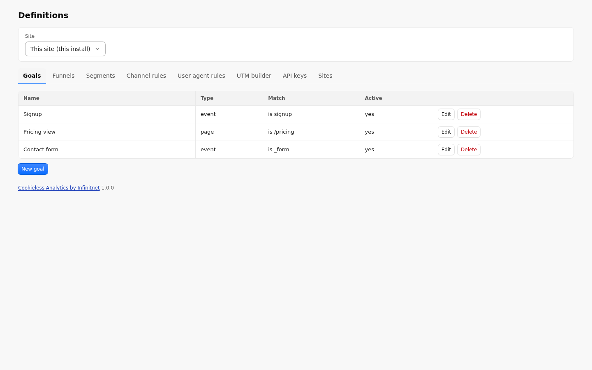

# Definitions

The Definitions page holds what the reports are built from: goals, funnels, segments, channel and user agent rules, annotations, and, for this install, API keys and client sites. Each tab is one list with an editor. Definitions are configuration only; they hold no visitor data.

## How to use it

1. Open **Definitions** in the sidebar.
2. Pick a tab. Each tab lists its items (the first 100) with an editor to add or change one.
3. Fill in the editor and save. A value that is refused is named with its field; a regex is checked against the safe regex rules while you type.
4. To delete an item, click Delete, then "Confirm delete".
   A list of more than 10 items has a search box that keeps the items whose name, key or other text contains what you type.
5. Empty views that need a goal, funnel or segment offer a button such as **Create a goal**; it opens the matching tab here with the new item form open.
6. Select a client site in the site select to edit that site's goals, funnels, segments, channel rules and annotations. API keys and Sites are shown with this install selected only.

## The tabs

| Tab | What it holds | More |
|---|---|---|
| **Goals** | Named goals, each a page (matched with is, starts with, contains or regex), an event (its exact name, optionally with event properties) or an outbound link (is, starts with or contains). The form offers only the match modes a type honors. A goal can be made inactive. | [Goals and Funnels](Goals-and-Funnels) |
| **Funnels** | Named funnels of 2 to 6 steps with a mode: sequential (the default), strict or flexible. A page step matches with is, starts with or regex; an event step matches its exact name. | [Goals and Funnels](Goals-and-Funnels) |
| **Segments** | Named lists of 1 to 20 filters, for the header, segment comparison, dashboards and the agent API. | [Filters and Segments](Filters-and-Segments) |
| **Channel rules** | The built-in channel rules as a checklist (uncheck to turn one off) and your own rules: a channel, a priority and one condition (referrer host list, `utm_medium`, `utm_source` or `utm_campaign` pattern). | [How Visits Are Counted](How-Visits-Are-Counted) |
| **User agent rules** | Your own user agent rules: a pattern, a mode (contains, prefix, exact, regex) and an action (mark as a bot, or force human). Use them for an uptime monitor of your own or a tool you want counted. Two views: List (one rule at a time) and Edit as text (one rule per line, with Check, Save, export and import), plus a searchable view of the built-in list with Force human. They keep traffic out from the moment they are saved. | [Bot Handling](Bot-Handling) |
| **UTM builder** | Enter a page URL and the UTM fields, and copy the tagged URL. Nothing is saved. | [Reports](Reports) |
| **API keys** | Keys for scripts and agents: a label, scopes, an optional site restriction and an optional expiry. The key is shown once; only its prefix and a hash are stored. Revoke here, then delete a revoked key to free its place. | [Agent API and MCP](Agent-API-and-MCP) |
| **Sites** | Client sites and linked hosts: label, id, host names, Search mapping, revenue and site search overrides, the snippet, Pause, New key and Delete. | [Multi-Site and Sites View](Multi-Site-and-Sites-View) |

Annotations have their own page: [Annotations and Impact](Annotations-and-Impact).

Screenshots of single tabs: [Goals and Funnels](Goals-and-Funnels) (funnels), [Multi-Site and Sites View](Multi-Site-and-Sites-View) (sites), [Agent API and MCP](Agent-API-and-MCP) (API keys).

## Notes per tab

### Goals and Funnels

A session completes a goal when one of its page views, events or outbound link clicks matches it. Goals show on Overview (Goals panel), on Behavior, Goals, and as filters ("Goal is ..."). Funnels show on Behavior, Funnels. The mode decides how steps chain within a session: sequential and flexible read at most 50,000 sessions, strict at most 10,000.

### Segments

Segments built here are the same as those saved with "Save as segment" in the header. A segment never changes stored data; it is applied when a report runs.

### Channel rules and User agent rules

Rules apply to new visits from the moment they are saved. Past visits keep the channel they were given, and visits counted before a user agent rule existed stay counted.

### User agent rules, API keys and Sites

These three tabs belong to the install, not to one site, so they are hidden while a client site is selected. User agent rules apply to every site. A key with a site restriction answers only for its sites.

## Bounce and engaged sessions

A session is engaged when it has active time of at least `engagedThresholdSeconds` (default 10), two or more page views, or any event, custom or automatic (the link impression `seen`, which the page sends without a visitor action, does not count), and a bounce is a session that is not engaged, so bounce rate is always 1 minus engaged rate. This is the GA4 meaning of bounce rate, so a one page visit read for minutes counts as engaged and not as a bounce. More: [How Visits Are Counted](How-Visits-Are-Counted).

## Active time and duration

- **Active time**: time with interaction. A page view collects it only while the page is visible and the visitor interacted (pointer down, key press, scroll or touch) within the last 60 seconds. Shown as **Avg. active time** in the Pages report (per page view) and on Search Satisfaction (per session).
- **Duration**: time in view. A session's duration is the longer of the span from its start to its last page view or event and the time its pages were visible. Shown as **Avg. session duration**. The Pages report also shows **Avg. visible time** per page view from detailed data.
- **Engaged session**: active time of at least `engagedThresholdSeconds`, two or more page views, or any event, custom or automatic (the GA4 meaning). Engaged rate is the share of such sessions.

Active time can be 0 s while duration is several seconds: a page that is open and visible but never touched has visible time and no active time. Link scanners, link previews and quick glances look like that. How other tools measure page time: [How Visits Are Counted](How-Visits-Are-Counted#how-other-tools-measure-it).

## Settings

Definitions have no settings of their own. Related settings live on the Settings page:

| Key | Default | What it does |
|---|---|---|
| `excludePaths` | `/_emdash/` | Path prefixes that are never recorded. Works next to user agent rules. |
| `excludeIpPrefixes` | empty | IP ranges that are never recorded. |
| `ignoreReferrerHosts` | empty | Hosts that never start a source, before channel rules run. |
| `agentRateLimitPerMinute` | 60 | Requests per minute per API key. |

## Limits

- Each tab lists the first 100 items, without paging; User agent rules lists all of them.
- Goal and funnel names: up to 64 characters; goal values up to 512 characters.
- Funnels: 2 to 6 steps.
- Segments: 1 to 20 filters, name up to 64 characters.
- Channel rules: up to 10 conditions per rule (one is editable in the admin).
- User agent rules: at most 500 in total, of them at most 50 regex rules; pattern up to 512 characters.
- Annotations: text up to 200 characters, at most 10 scope rules per kind and 20 in total.
- Suggestions in the goal, funnel step and channel rule fields list up to 50 values of the last 90 days, ordered by count; property keys come from up to 10 keys and 50 values per key of the chosen event. Reserved event names starting with an underscore are not listed.
- Regex fields follow the safe regex limits: up to 200 characters, see [Filters and Segments](Filters-and-Segments).

## Gotchas

- User agent rules and exclusions apply from the moment they are saved. To remove traffic counted before, use Delete matching visits on the [Data Page](Data-Page).
- User agent rules apply to every site and are edited with this install selected. Channel rules are per site.
- Built-in channel rules can only be turned off, not edited. Host lists are not editable.
- Deleting a segment that is the default of a dashboard makes that dashboard show all visitors, and it says so.
- With a connected remote site selected, Definitions shows a link to that site's own admin instead of forms.

## Related

- [Goals and Funnels](Goals-and-Funnels)
- [Filters and Segments](Filters-and-Segments)
- [Annotations and Impact](Annotations-and-Impact)
- [Bot Handling](Bot-Handling)
- [Multi-Site and Sites View](Multi-Site-and-Sites-View)
- [Agent API and MCP](Agent-API-and-MCP)
