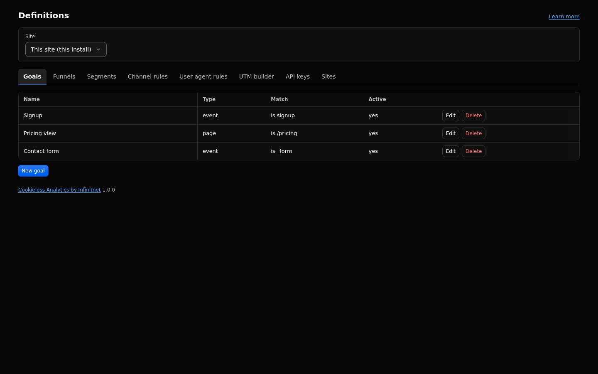
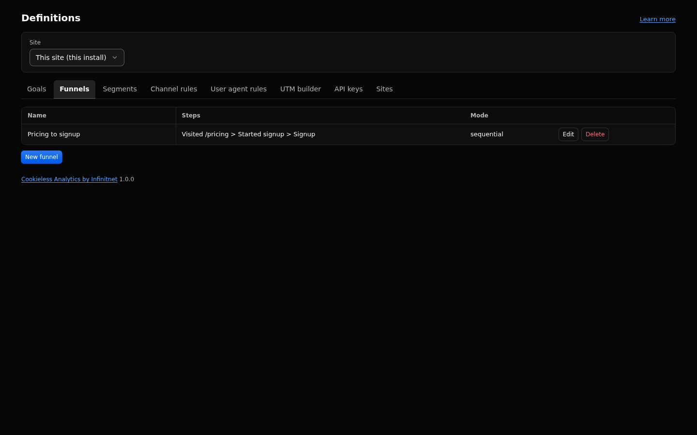
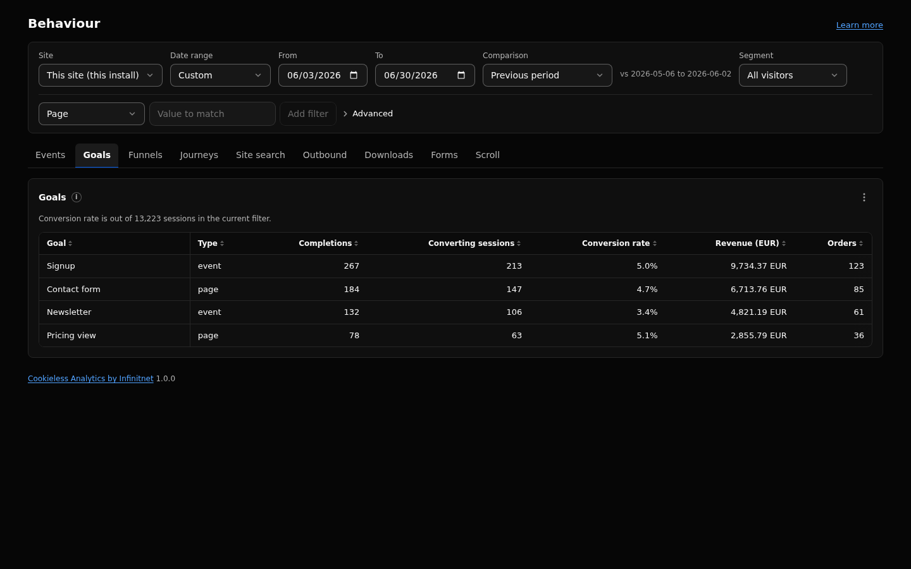
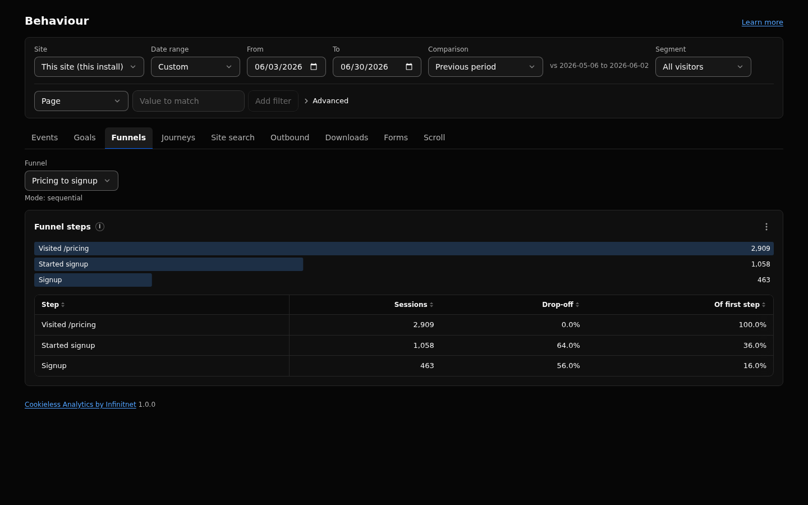

# Goals and funnels

A goal marks a visit as converted when it reaches a page, sends an event or clicks a link to another site. A funnel counts how many visits pass a fixed list of steps, and where they drop off.

## How to use it

### Create a goal

1. Open Definitions, Goals.
2. Add a goal: a name (1 to 64 characters), a type, a match and a value.
3. For an event goal, add properties when only some events should count (for example `slug` for one short link).
4. Save. On detailed data goals are matched when reports run, so a new goal also covers past days inside the detailed window.
5. Open Behaviour, Goals to see completions, converting sessions and the conversion rate.

A goals or funnels view on a site without goals or funnels offers **Create a goal** or **Create a funnel**, which opens the form in Definitions.

### Goal types and matching

| Type | Matches | Match options | Example value |
|---|---|---|---|
| `page` | a page view whose path matches | `is`, `prefix`, `regex`, `contains` | `/thank-you` |
| `event` | an event with exactly this name, and every listed property equal | the name is compared exactly | `signup` |
| `outbound` | an `_outbound` click whose `url` (host and path) matches | `is` (that host, or that host and path and anything under it), `prefix`, `contains` | `partner.example.com` |

- Values are 1 to 512 characters. A regex must be a safe pattern (no backreferences, lookarounds or nested quantifiers); an unsafe one is refused on save.
- Outbound values are compared in lower case.
- A click that a link rule (`linkRules`) matches sends the rule's event instead of `_outbound`, so an outbound goal does not count it; use an event goal on the rule's event name.
- A goal can be switched inactive without deleting it.
- Only event goals carry revenue: their revenue is the sum of the values of the matching events. Page and outbound goals show no revenue.

### Create a funnel

1. Open Definitions, Funnels.
2. Add 2 to 6 steps. Each step is a page (`is`, `prefix` or `regex`) or an event (by name), with an optional label.
3. Pick the mode (below) and save.
4. Open Behaviour, Funnels and pick the funnel. The tab names its mode.

### Funnel modes

- **Sequential** (default): step n is reached by a matching hit after the step n-1 hit in the same session. Anything may happen between.
- **Strict**: step n must be the next countable hit after step n-1. Countable hits are page views, your own events and any hit that matches a step, so a step on `_outbound` or `_download` works. Hits in the same second count as simultaneous. When the chain breaks it may start again later in the session; the session counts the furthest step it reached.
- **Flexible**: steps may happen in any order within one session. Step n counts sessions that completed steps 1 to n in any order.

Example, steps `/` then `/pricing`, and a session that views `/`, then `/about`, then `/pricing`:

| Mode | Step 1 | Step 2 |
|---|---|---|
| Sequential | counted | counted |
| Strict | counted | not counted (`/about` came between) |
| Flexible | counted | counted |

A session that views `/pricing` and then `/` reaches step 2 only in the flexible mode. A funnel saved without a mode runs as sequential.

## Where they show

- Behaviour, Goals: one row per goal with Type, Completions, Converting sessions and Conversion rate. Revenue and Orders columns appear when the site has revenue.
- Behaviour, Funnels: per step Sessions, Drop-off and "Of first step". When the site has revenue: Revenue, Orders, Average order value, Revenue per session (Refunds and Net revenue when present) of the sessions that reached the step, in one currency, and Est. lost revenue, an estimate that values the sessions that left before the step at the revenue per session of those that reached the last step. A session counts its whole revenue in the range at every step it reached, also an order placed before the step. No orders in the range: no revenue columns.
- Overview: a Goals panel.
- Filters and segments: the `goal` filter keeps visits that reached a goal.
- Dashboards: tile reports `goals` (`kpi` needs the goal id) and `funnels` (needs the funnel id).
- Agent API: reports `goals` and `funnels` through `agent/v1/query`. Stored funnels use their own mode; ad hoc steps take `params.mode`.

## Limits

- Funnels: 2 to 6 steps. Sequential and flexible funnels read at most 50,000 sessions per query, strict funnels at most 10,000. Above that the report answers `funnel_cap`: narrow the range or add filters.
- Funnels need detailed data. A range that starts before the detailed window answers `raw_only` and names the first detailed day.
- Goals before the detailed window come from the daily summaries, with the filters those summaries can apply.
- Definitions tabs list the first 100 items.

## Gotchas

- Conversions count sessions, not completions: a session that reaches a goal twice converts once.
- A purchase that matches two event goals counts in both goal rows, revenue included.
- Funnels and goals apply visit level filters only, so a page filter cannot remove other steps of a visit.
- For short links, define the event goal `Link clicks` (type `event`, match `is`, value `out`), never a goal on `_form` or `_outbound`. The built-in Links dashboard template creates it on import.
- Strict mode depends on second resolution: two hits in the same second may satisfy consecutive steps in either order.

## Related

[Events](Events), [Revenue and refunds](Revenue-and-Refunds), [Filters and segments](Filters-and-Segments), [Definitions](Definitions), [Reports](Reports), [Dashboards and sharing](Dashboards-and-Sharing). Full reference: https://github.com/infinitnet/cookieless-analytics/blob/main/docs/behaviour.md
