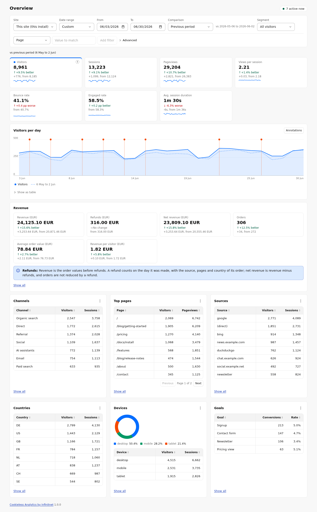

# Cookieless Analytics

Self-hosted, cookieless web analytics for EmDash CMS. It runs on Cloudflare Workers with D1 (or Node with SQLite, libSQL or Postgres), stores every number in your own database and shows the reports inside the EmDash admin. It can also measure other sites through a small script tag.

## Start here

1. [Quick install](Quick-Install): add the plugin, deploy, check that the first page view arrives.
2. [How visits are counted](How-Visits-Are-Counted): sessions and visitors without cookies.
3. [Reports](Reports): what each admin page shows and how the header, charts and tables work.
4. [Settings reference](Settings-Reference): every key with its default.

## Features

| Page | What it covers |
|---|---|
| [Reports](Reports) | Overview, Pages, Sources, Audience, Behaviour, the charts and the header controls |
| [Filters and segments](Filters-and-Segments) | Filter dimensions and operators, saved segments, segment comparison |
| [Satisfaction](Satisfaction) | Long clicks, short clicks, bad experiences, pogo sticking, returns from search |
| [Goals and funnels](Goals-and-Funnels) | Goal types, funnel modes, conversion reports |
| [Events](Events) | Every event, how to send it from the page, a server, another plugin or another CMS |
| [Revenue and refunds](Revenue-and-Refunds) | Orders, currencies, refunds, net revenue, revenue by source |
| [Links report](Links-Report) | Short link clicks, views and sales |
| [Search integrations](Search-Integrations) | Google Search Console and Bing Webmaster data, SEO views |
| [Content and site search](Content-and-Site-Search) | Per collection report, internal site search, the editor panel |
| [Dashboards and sharing](Dashboards-and-Sharing) | Custom dashboards, templates, share links, scheduled email |
| [Annotations and impact](Annotations-and-Impact) | Chart markers, scopes, automatic annotations, before and after impact |
| [Agent API and MCP](Agent-API-and-MCP) | API keys, the agent routes, MCP tools |
| [Multi site and Sites view](Multi-Site-and-Sites-View) | Client sites, linked hosts, the All sites table |
| [Definitions](Definitions) | Goals, funnels, segments, rules, annotations, UTM builder, API keys, sites |
| [Data page](Data-Page) | Storage, export, privacy receipt, deleting matching visits |

## Running it

| Page | What it covers |
|---|---|
| [Queue worker](Queue-Worker) | The optional queue ingest tier |
| [Capacity profiles and Cloudflare plans](Capacity-Profiles-and-Cloudflare-Plans) | Small, Standard and Dedicated profiles, plan limits, own database |
| [Retention](Retention) | How long detailed rows, summaries and Search rows are kept |
| [Bot handling](Bot-Handling) | How bots are kept out of the numbers |
| [Privacy model](Privacy-Model) | What is stored, what is not, privacy signals |
| [Troubleshooting](Troubleshooting) | Symptoms, causes and fixes |
| [Upgrade](Upgrade) | Updating the package |

## Screenshots

All screenshots in this wiki show synthetic data for example.com with invented numbers.

## Full reference

The `docs` folder of the [repository](https://github.com/infinitnet/cookieless-analytics/tree/main/docs) holds the full reference these pages condense. Where a number differs, the repository docs are right.
