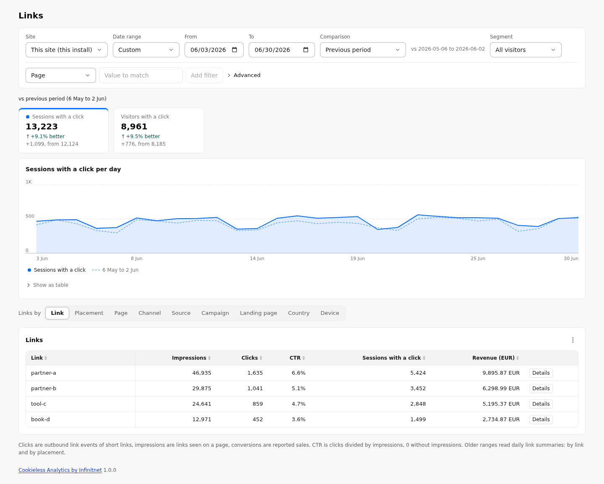

# Links report

The Links page reports short links of your site: how often each link was shown, how often it was clicked, the click-through rate, the sessions with a click and the sales it led to. It reads three event names that any short link plugin or redirect sends (the Links convention).



## How to use it

1. Serve your short links under a path prefix of your own, for example `/go/<slug>`.
2. Set `ignorePathPrefixes` to that prefix (Settings, Page script), so the page script records no `_download` or `_form` for those links.
3. Send the three events below from the redirect, the page and your server.
4. Open Links. Pick "Links by" (Link, Placement, Page, Channel, Source, Campaign, Landing page, Country, Device). With Link selected, Details opens one link with its placements.
5. Optional: import the built-in Links dashboard template; it creates the goal `Link clicks` on import.

## The Links convention

| Event | Sent by | How | Properties | Revenue |
|---|---|---|---|---|
| `out` (click) | the redirect, server side, once per answered redirect | `recordEvent` or an in-process post to the `in` route without `Origin` | `slug` (required), `place` (optional) | none |
| `seen` (impression) | the page | `window.__ec.event("seen", { s0: "alpha-offer", s1: "beta-offer@offers-table" })` | `s0` to `s9`, up to ten link keys; a key is `<slug>` or `<slug>@<place>` | none |
| `conv` (sale) | your server, with an API key | `POST agent/v1/events` (scope `write:events`) | `slug`, `place` | `val`, `cur`, `oid` |

The names are `LINK_EVENTS` in `@infinitnet/cookieless-analytics/contract`; a plugin may copy them instead of importing the package.

### Click from the redirect (EmDash site code or another plugin)

```ts
import { recordEvent } from "@infinitnet/cookieless-analytics/server";

// Frontmatter of src/pages/go/[slug].astro, for GET and POST only. Do not await it before redirecting.
const ref = Astro.request.headers.get("referer");
const from = ref && new URL(ref).origin === Astro.url.origin ? new URL(ref).pathname : undefined;
void recordEvent(Astro.locals, { name: "out", ...(from ? { u: from } : {}), p: { slug: "alpha-offer", place: "sidebar" } }, Astro.request);
return Astro.redirect("https://partner.example.com/offer", 302);
```

### Impressions from the page

```html
<script>
  window.__ecq = window.__ecq || [];
  window.__ecq.push(["event", "seen", { s0: "alpha-offer@sidebar", s1: "beta-offer@offers-table" }]);
</script>
```

### Sale from your server

```sh
curl -X POST "https://example.com/_emdash/api/plugins/cookieless-analytics/agent/v1/events" \
  -H "X-Api-Key: $KEY" -H "content-type: application/json" \
  -d '{"events":[{"name":"conv","val":12.5,"cur":"EUR","oid":"P-2201","p":{"slug":"alpha-offer","place":"sidebar"}}]}'
```

### Rules

- One click record per click. A short link is a same-host link, so the page script records no `_outbound` for it.
- Send `out` only for `GET` and `POST`, never for `HEAD` or a prefetch.
- `u` of an `out` event is the path of the page that held the link (a same-origin referrer); without one, leave it out.
- Channel, source, campaign, landing page, country and device come from the visitor's session, which the click joins by visitor key. A click without a counted session shows as `(not set)`.
- Bots and privacy signals follow the same rules as page views.
- Goal: one event goal `Link clicks`, match `is`, value `out`. A goal per link adds the property `slug`. Never define a goal on `_form` or `_outbound` for short links.

## What the report shows

| Column | Meaning |
|---|---|
| Impressions | link keys of `seen` events |
| Clicks | `out` events |
| CTR | clicks / impressions from the sums, 0 without impressions |
| Sessions with a click | distinct sessions with a click |
| Conversions | `conv` events, every currency |

- A key without a placement counts under `(none)`.
- When the site records revenue, the page adds revenue in one currency; amounts of two currencies are never added.
- The chart shows sessions with a link click per day. It counts visits with at least one page view; clicks of visits without a page view are in the table only.
- The `page` filter keeps visits that viewed that page. The page a link was clicked on is the "Page" breakdown.

Agent API: report `links` through `agent/v1/query` (scope `read:analytics`), `params.by` (`link`, `place`, `page`, `channel`, `source`, `campaign`, `entry`, `country`, `device`), `params.slug` for one link, `params.withRevenue` for revenue.

```sh
curl -X POST "https://example.com/_emdash/api/plugins/cookieless-analytics/agent/v1/query" \
  -H "X-Api-Key: $KEY" -H "content-type: application/json" \
  -d '{"report":"links","query":{"from":"2026-10-01","to":"2026-10-31"},"params":{"by":"place","slug":"alpha-offer"}}'
```

## Settings

| Key | Default | What it does |
|---|---|---|
| `ignorePathPrefixes` | empty | Short link prefixes, one per line or comma separated, for example `/go/`. Links and form targets under them get no `_download` or `_form` event. A prefix must start with `/`; one containing a word of the neutral public footprint is dropped. |
| `rawRetentionDays` | `760` | Days of detailed rows; older ranges read the daily link summaries. |

## Limits

- `seen`: up to ten link keys per event (`s0` to `s9`).
- Before the detailed window (or over the scan budget when every filter applies) the report reads daily link summaries: by link (all links, one link, or one filter on channel, country or device) and by place. Each day keeps its top 200 links and 200 placements; the rest is `(other)`. Other breakdowns answer `raw_only` there.
- Dashboard tiles of `links` show no amounts.

## Gotchas

- Clicks without a counted session (for example a direct hit on the short link) appear with `(not set)` and do not raise "Sessions with a click".
- `conv` sent without `sid` is unattributed; add the visit's `sid` when you have it.
- Forgetting `ignorePathPrefixes` turns short links that end in `.pdf` into `_download` events and forms posting to them into `_form` events.

## Related

[Events](Events), [Goals and funnels](Goals-and-Funnels), [Revenue and refunds](Revenue-and-Refunds), [Dashboards and sharing](Dashboards-and-Sharing), [Agent API and MCP](Agent-API-and-MCP), [Settings reference](Settings-Reference). Full reference: https://github.com/infinitnet/cookieless-analytics/blob/main/docs/integration.md
