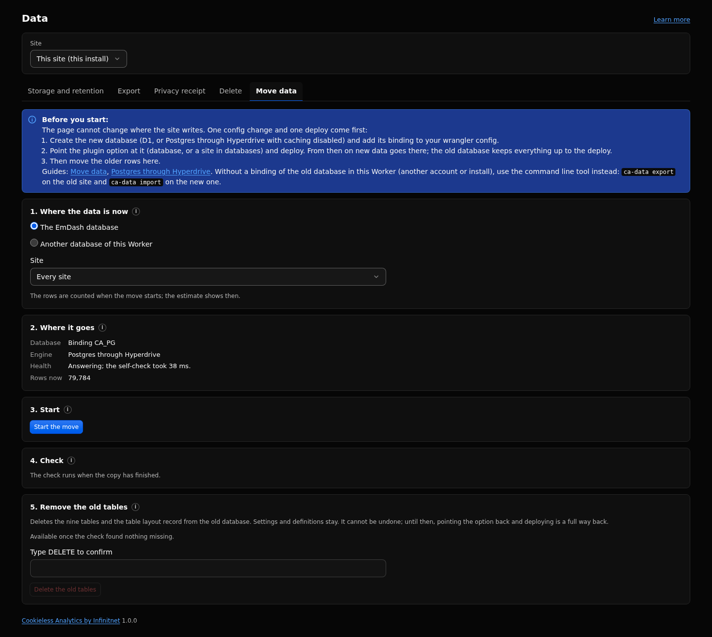

# Move Data

Move the analytics tables to another database: on the Data page for a database bound to this Worker, or as files with the `ca-data` command line tool that ships in the package, into another site, install or Cloudflare account. Use the tool for backups, for a source the Worker cannot bind, and for databases of any size: the Worker never holds more than one chunk of under 1.2 MB.

## Move data on the Data page

For a database bound to this Worker, the Data page copies the tables for you. Switch first: create the new database, add its binding, point the plugin option at it and deploy (one config change and one deploy, see [Postgres through Hyperdrive](Postgres-Hyperdrive) for Postgres). New data goes to the new database from then on. Then open Data, Move data:



1. **Where the data is now**: the EmDash database or the old binding, and one site or every site.
2. **Where it goes**: the database the site writes to now, its engine and health.
3. **Start**: chunks of 50 rows (Small) or 200, continued each minute in the background and faster while the tab is open. "Moving data: N percent. Older days appear as they arrive." Pause, Resume and Cancel; Start with the same source and site continues a cancelled move. Summaries, retention and Search skip the new database and the delete tools wait until the move ends. On Small into a D1 database the move writes at most 15,000 rows a day (shared with imports) and continues after 00:00 UTC by itself.
4. **Check**: per table, site and day, inside the new database's detailed window; on days where the new database holds more rows, the old rows are looked up one by one. Short means rows are missing; More means rows written since the switch or split visits.
5. **Remove the old tables**: type `DELETE`; enabled once the check found nothing short, and refused when the old database is one the site writes to under another binding name.

A visitor who was on the site during the deploy counts as two visits on that day; page views, events and revenue are complete. The per day counters (not found pages, requests not recorded) are added once: moving the same pair again adds nothing, and moving back keeps the larger count. Full reference: [docs/move-data.md](https://github.com/infinitnet/cookieless-analytics/blob/main/docs/move-data.md#move-data-on-the-data-page).

## How to use it

### 1. Create the keys

1. On the site the data comes from, open Definitions, API keys and create a key with the scope `data:export`.
2. On the site the data goes to, create a key with the scope `data:import`.
3. Give both an expiry date. A `data:export` key reads every stored row, the visit details and the daily visitor keys included: revoke it after the run.

### 2. Export

```sh
CA_DATA_KEY="ab12cd34.EXAMPLESECRET" pnpm exec ca-data export --url https://example.com --out ./backup
```

Add `--site shop` to export one site. The folder then holds one `<table>.ndjson.gz` per table and `manifest.json` with the table layout, the database engine, the site filter, the creation time and per file the row count and sha256. Neither holds the URL or the key.

### 3. Import

```sh
CA_DATA_KEY="cd34ef56.EXAMPLESECRET" pnpm exec ca-data import --url https://new.example.com --in ./backup
```

The tool reads the key from `CA_DATA_KEY` first; `--key` is only the fallback, since a key on the command line shows in the shell history. Add `--rows 50` to import into a site on the Small profile.

The import:

- refuses a file whose sha256 does not match the manifest, before it posts anything;
- refuses files of another table layout (`layout_mismatch`); there is no conversion;
- posts chunks of 500 rows (or `--rows`), halves them after a server error, and keeps `progress.json`, so running the same command again after a broken run resumes where it stopped;
- checks every row (`400 invalid_row`) before anything of a chunk is written, and is refused and with `409` while a delete or a move into the same database runs;
- compares row counts at the end and exits with code 1 when the site holds fewer rows than the files.

A row whose key exists is kept as it is, so a second import of the same files inserts 0 rows.

## What to know

- Import into an empty database. In a database that already received traffic the destination's values win for keys on both sides, and the per day counters of `ca_srv` and `ca_drops` keep the destination's count.
- Settings, plugin state and the storage collections (API keys, goals, funnels, segments, annotations, dashboards, client sites) are not in the files; they stay in the EmDash database.
- With per site databases, export each site that has its own database with `--site`. An import writes each row into the database its site writes to.
- Every chunk is one request against the key's rate limit (`agentRateLimitPerMinute`, default 60). The tool waits on `429`; raise the setting for a large export.
- On the Small profile with D1, imports and moves together write at most 15,000 rows a day. A chunk over that answers `429` until 00:00 UTC; the tool waits and continues the next day.
- On synthetic test data in the test suite: 5,000 page views over 14 days exported in 102 requests; a visit took about 129 bytes in the gzip file, a summary row about 9 bytes.

The routes behind the tool: [Agent API and MCP](Agent-API-and-MCP). Full reference: https://github.com/infinitnet/cookieless-analytics/blob/main/docs/move-data.md
