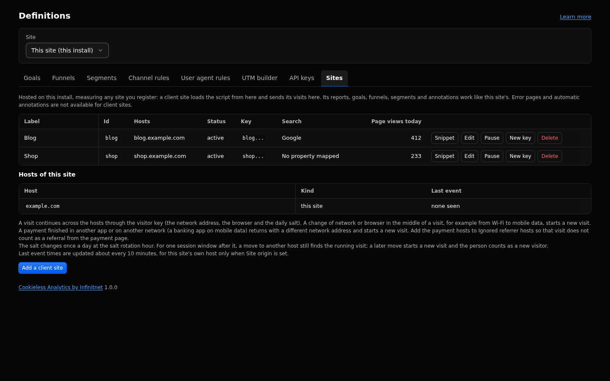
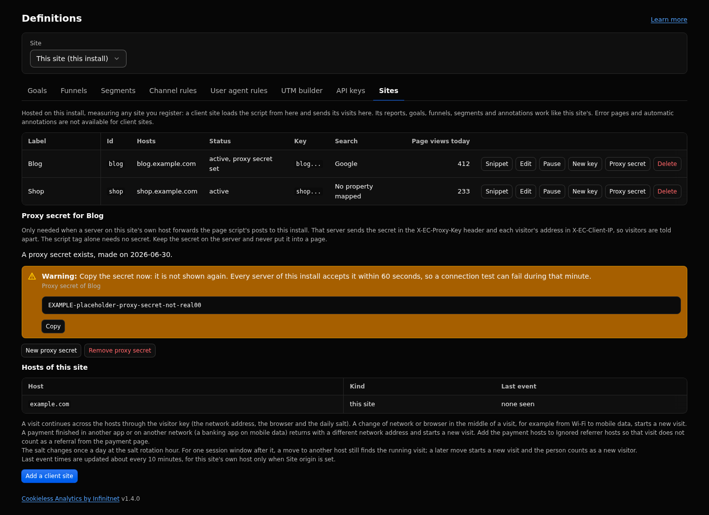
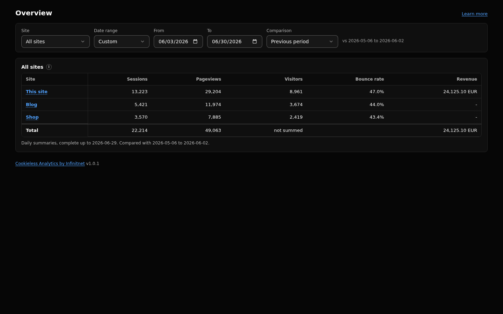

# Multi-Site and Sites View

One install can measure several sites: its own site, client sites that load the page script from it, linked hosts (a shop or checkout of the same site), and connected sites (other installs read through their agent API). The site select in the header switches between them, and the All sites view compares them in one table.

## How to use it

### Register a client site

1. Select this install in the site select, then open Definitions, **Sites**.
2. Add a site: a **Label**, an **Id** (lowercase letters, digits and dashes, up to 32 characters; it cannot be changed later) and 1 to 10 **Host names** without `https://`, port or path, for example `blog.example.com`.
3. Optional: the Google property and Bing site URL, a default currency, "Accept revenue from browsers", and site search parameters. Inherit uses this install's settings.
4. Save. The site gets a public key of 20 letters and digits.
5. Copy one of the three snippets the tab shows (script tag, Google Tag Manager, single page apps) into the client site, for example:

```html
<script defer src="https://example.com/_/e.js" data-ec-key="abcdefghij0123456789"></script>
```

6. For a single page app without Astro's ClientRouter, call this after each route change:

```js
window.__ec && window.__ec.page();
```



### Link a shop or checkout host

When a second host belongs to the same site (for example `shop.example.com` next to `example.com`), register it on the Sites tab with **Linked to this site** checked and add its script tag to the shop's pages.

- Its page views and events are stored under this site, with the host recorded on each one. It is not listed in the site select or the All sites table.
- The visit continues from `example.com` to the shop and back as one visit of one visitor. A move between the hosts is never a referral and never changes the channel or entry page, and a click between them is not an outbound click (`_outbound`).
- This site's settings apply to the shop's events (currency, `acceptClientRevenue`, site search parameters, channel rules).
- The Sites tab lists the hosts of this site with the time of the last page view or event from each.

### Connect another install

A connected site is another EmDash install that runs this plugin and keeps its own data.

1. On that install, open Definitions, API keys, and create a key with `read:analytics` and `read:search`.
2. On this install, store the key as a secret environment variable, for example `wrangler secret put CA_SITE_BLOG_KEY`.
3. Add the site to the plugin options in `astro.config` and redeploy:

```js
import cookielessAnalytics from "@infinitnet/cookieless-analytics";

emdash({
  plugins: [
    cookielessAnalytics({
      sites: [{ id: "blog", label: "Blog", origin: "https://blog.example.com", keyEnv: "CA_SITE_BLOG_KEY" }],
    }),
  ],
});
```

Every report page then works for the connected site. Definitions and Data show a link to its own admin instead of forms.

### A server proxy on the site's own host

The script tag above is the default. Proxy mode is opt-in: a server on the client's own host (a Worker on its zone, a route of its CMS) answers `/_/e.js` and `/_/e` there and forwards them to this install, so both paths are first party for the client's visitors.



1. On the Sites tab, select **Proxy secret** for the site and create one. Copy it at once: it is shown once, and only its hash is stored.
2. Store the secret on the proxy server. Never put it into a page.
3. The proxy forwards each post of the event path to `https://<this install>/_/e` with the body unchanged and these headers:

| Header | Value |
|---|---|
| `X-EC-Proxy-Key` | The proxy secret. |
| `X-EC-Client-IP` | The visitor's address as the proxy's own connection saw it. |
| `X-EC-Country` | Optional: the visitor's country, two letters. |
| `Origin` | The site's own https origin on a registered host name: the one the browser sent, passed on unchanged. |
| `User-Agent`, `Accept-Language`, `Sec-GPC`, `DNT`, `Sec-CH-UA-Mobile`, `Sec-CH-UA-Platform` | The visitor's. |

4. It returns the status and `Retry-After` to the browser unchanged.
5. Test it: `GET /_emdash/api/plugins/cookieless-analytics/proxy/check?k=<site key>` with the secret in `X-EC-Proxy-Key` answers 200 when the secret is the one of that site and 403 otherwise. A new secret reaches every Worker within 60 seconds, so a test right after making it can answer 403: retry for a minute.

Without the secret a proxy's posts all arrive from the proxy's own address, so its visitors merge into shared visits. With it, the address the proxy states is used once for the visitor key and never stored. A post with a wrong secret, or with the right secret and no usable address, is dropped and counted (see [Troubleshooting](Troubleshooting)); it is never recorded under the proxy's address.

## The site select

The site select in the header appears once a client or connected site exists. It lists **All sites** first, then this install, the client sites and the connected sites, each with its kind. A connected site whose key is missing shows "key missing". The range, comparison, filters and site carry over between admin pages for the browser session.

## The All sites view



With **All sites** selected, the Overview shows one table: a row per site with sessions, pageviews, visitors, bounce rate and revenue per currency, each with the change against the header's comparison, sorted by pageviews. Engaged rate (1 minus bounce rate) is in the API.

- Click a row to open that site.
- The totals row sums sessions, pageviews and revenue per currency. Visitors read "not summed": one person who visits two sites is a visitor of each.
- Figures come from the daily summaries and are complete up to the date the page shows.
- Connected sites join the table as their own rows. A site that does not answer shows an error row; the rest still loads.
- Every other page shows this install while All sites is selected, with a way back to the table.

## Pause, new key, delete

- **Pause** stops a site at once. Its data stays.
- **New key** invalidates the old key at once. Pages with the old snippet stop sending until you update them.
- **Proxy secret**: a second secret replaces the first, and **Remove proxy secret** deletes it. The old secret stops within 60 seconds. While the site list cannot be read, every proxy secret is refused once the last successful read is 10 minutes old.
- **Delete** removes the site after a typed confirmation. With "also delete its data" every row of the site is deleted; without it, the rows stay until retention removes them.

## Own database per site

By default every site is stored in the EmDash database. Two plugin options change that:

- `database`: all analytics tables move to a D1 database of their own.
- `databases`: chosen sites get a D1 database each, the rest go to a default database or stay in the EmDash database. It cannot be combined with `database`.

```js
cookielessAnalytics({
  databases: {
    default: "CA_DB",
    sites: { shop: "CA_DB2" },
  },
})
```

Moving a site to another database does not move its data. See [Quick Install](Quick-Install) for the wrangler setup.

## Settings

| Key | Default | What it does |
|---|---|---|
| `siteId` | default | Id of this install's own site. Client and connected site ids must differ from it. |
| `siteOrigin` | empty | Canonical origin; set it when the event path is proxied on a shop's own host. |
| `proxyRateLimitPerMinute` | 3000 | Posts a server proxy may forward for one site per minute, per Worker isolate. Above it the proxy gets 503 with `Retry-After`. It stops a proxy that runs away; it is not a security limit. |
| `defaultCurrency` | USD | Inherited by client sites that do not set their own. |
| `acceptClientRevenue` | true | Inherited by client sites that do not set their own. |
| `siteSearchParams` | empty | Inherited by client sites that do not set their own. |
| `capacityProfile` | standard | Storage budget shared by every site of one database. |
| `rawRetentionDays` | 760 | Applies to every site of the database; cannot differ per site. |

## Limits

- Client site ids: up to 32 characters; 1 to 10 host names per site. The id `all` is reserved.
- Connected sites: each call times out after 8 seconds, answers are capped at 1 MB and cached for 60 seconds. At most 10 connected sites are read on the All sites table, three at a time.
- Exports of a connected site are capped at 1,000 rows.
- A pause, link or unlink, and a replaced or removed proxy secret, reach every Worker within 60 seconds. Browsers cache the page script, which names the linked hosts, for up to an hour.

## Gotchas

- A client site's key is public (it is in the page source). It only allows "accept visits for this site from these host names"; events from other origins are dropped.
- Sessions and visitor keys are per site. The same person on two sites counts on each.
- The host filter matches the first page of a visit only, and Pages has no host column: `/` on the shop and `/` on the main host are one row. Give shop paths their own prefix.
- A client site gets no error pages, no editor exclusion and no automatic annotations.
- Retention and the capacity budget are shared by every site of a database. Many busy sites may need a larger profile or their own database.
- This install's Search connection serves its client sites, never a connected site.
- The host names of linked sites are named in the served page script.
- The middleware must be installed for client sites; the Sites tab warns when it has not been seen for a day.
- A server proxy must answer the event path at the root of the client's host (default `/_/e`): the page script sends there, whatever path the script file was served from. `collectPath` is one setting for every site of this install.
- Proxy mode carries no country unless the proxy sends `X-EC-Country`, and never a region.

Full reference: https://github.com/infinitnet/cookieless-analytics/blob/main/docs/client-sites.md

## Related

- [Reports](Reports)
- [Definitions](Definitions)
- [Search Integrations](Search-Integrations)
- [How Visits Are Counted](How-Visits-Are-Counted)
- [Capacity Profiles and Cloudflare Plans](Capacity-Profiles-and-Cloudflare-Plans)
- [Agent API and MCP](Agent-API-and-MCP)
