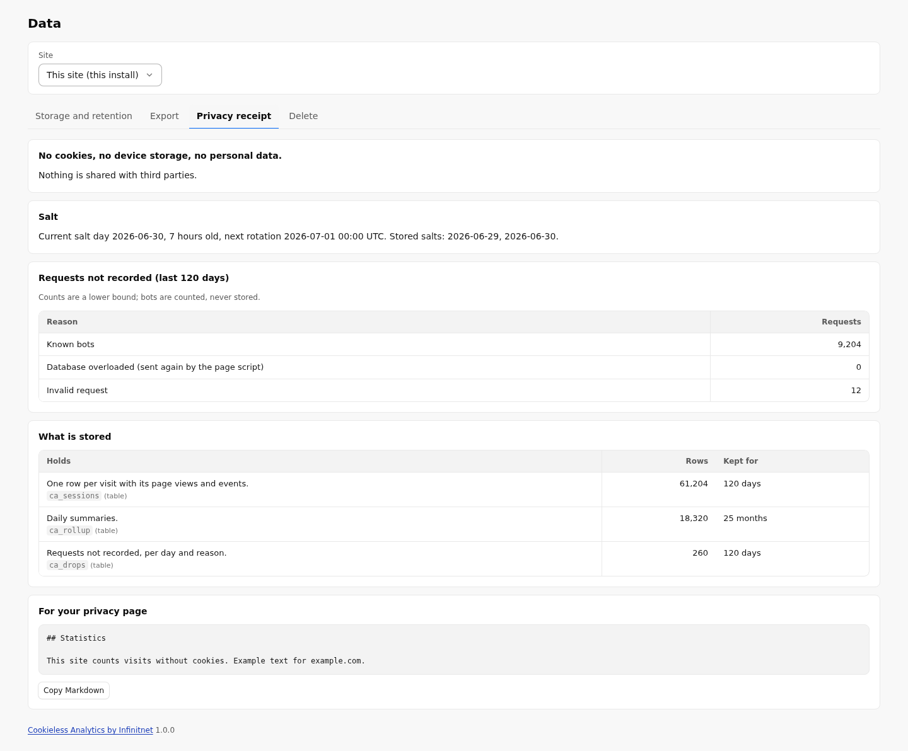

# Privacy Model

The plugin counts visits without writing anything to the visitor's device unless a visitor opts out, and without storing an IP address or a full user agent. This page explains how sessions work without cookies, what is stored, what never is, and which settings change it.

## How to use it

1. Open Settings, section Privacy and exclusions, and check `signals`, `ipTruncation` and the exclusions.
2. Open Data, tab Privacy receipt. It lists every table and column for your install, with live row counts.
3. Copy the Markdown block of the receipt into your own privacy page and adjust it.



## Design rules

- **Nothing on the visitor's device,** except the opt-out flag a visitor sets by clicking the opt-out control. No cookies, no sessionStorage, no IndexedDB, no Cache API entries, no ETag tricks. The only client state is a JavaScript variable that dies with the page.
- **No device probing, no lasting key.** The visitor key is a hash of a shortened IP address and a normalized browser family, mixed with a random salt that changes every day. It reads no canvas, font or hardware value and cannot link visits across days.
- **No raw IP address and no full user agent** is stored or logged.
- **Exact counts, no sampling** for human traffic.
- **Bots are excluded.** A known bot gets an empty 204 and no row of any kind is written. See [Bot-Handling](Bot-Handling).
- **No third party calls from the browser.** The page script talks only to your own install.
- **The script never touches browser history.** It adds nothing to links or the address and makes no history call.

## The daily visitor key

```text
vkey = base64url(HMAC-SHA256(salt of the day, site | truncated IP | browser family and major, OS family, device class)), cut to 22 characters
```

- The IP is cut before hashing: IPv4 to /24 and IPv6 to /48 (`ipTruncation` `standard`), or /16 and /32 (`strict`). The address is then gone. An address that a client site's server proxy forwards is cut and used the same way.
- The salt is 32 random bytes, created on first use each day. The `salts` task deletes salts older than two days. A deleted salt cannot be recomputed, so older keys can no longer be matched to anyone.
- The salt day follows `saltTimezone` and `saltRotationHour`.
- Because the key changes every day, visitors are counted per day. A figure over several days is the sum of daily visitors and is labeled so.

### Sessions without cookies

The browser makes a random session id each time a document loads and keeps it in a script variable. Soft navigations keep it. A full page load makes a new one, and the server joins it to the running visit through the visitor key. A visit ends after `sessionWindowMinutes` without activity. Details: [How-Visits-Are-Counted](How-Visits-Are-Counted).

Known error class: two people behind the same shortened IP with the same browser, OS and device class get the same key and can be joined into one session (offices, schools, mobile carriers). `strict` makes this more likely, not less.

## Privacy signals

| `signals` | Effect |
|---|---|
| `none` | Browser privacy signals are ignored. |
| `gpc` (default) | A browser that sends Global Privacy Control is not counted. |
| `dnt_and_gpc` | A browser that sends Global Privacy Control or `DNT: 1` is not counted. |

The check runs twice: the page script does nothing at all when the signal is on, and the server checks the `Sec-GPC` and `DNT` headers and drops the event. Dropped events are counted as `privacy_signal`, without any identity.

## What is stored

- **Visits** (one row per visit): a random session id, the daily visitor key, local day and hour, entry and exit page, counts, active and visible time, scroll depth, referrer host and path, channel, source, campaign fields, country, region (only with `captureRegion`), device class, browser and OS family, primary language (turn off with `captureLanguage`), a screen size class (only with `captureScreen`), and the host. Inside it, each page view (path with only allowlisted query parameters, timings, how it was reached and left) and each event (name, path, up to 10 properties).
- **Orders and server events**: value, currency, day and visit. Order ids only as a one-way hash.
- **Error pages**: a count per day, status, path and referring page.
- **Drop counters**: counts of requests not recorded, per site, day and reason. Nothing about the request.
- **Daily summaries**: top values per dimension, no visitor keys.
- **Search rows**: clicks, impressions and positions the providers report. No visitor data.
- **Configuration**: goals, funnels, rules, dashboards, API key hashes, shares (a hash of the link, never the link or password).

## What is never stored

- A raw IP address, a full user agent string, a cookie, or anything on the device.
- A person's identity, email address, name, user id or profile.
- Order ids themselves (only a one-way hash that decides whether an order was already counted), buyer names, emails or payment data.
- Page content, form field values, titles or the text of search boxes (except the words of a configured site search parameter, with emails and long numbers removed).
- Anything about a known bot.

## The admin and your browser

The admin itself may keep UI preferences in the editor's browser: session storage for this tab (such as the range, filters and site that carry over between admin pages) and local storage for this browser (the table columns you picked). Keys start with `ca.`. This applies only to signed-in editors using the admin. It never touches visitors, and the public page script stores nothing except the opt-out flag a visitor sets by clicking the opt-out control.

## Consent and cookie banners

Cookieless Analytics sets no cookies and stores nothing on the visitor's device, so it has no cookie to ask consent for; the only value it writes is the opt-out flag a visitor sets by clicking the opt-out control. Counting visits rests on legitimate interest (GDPR Art. 6(1)(f)), which needs a privacy notice and a way to object, not consent. Whether the page script needs consent depends on the country, because each one applies the device rule of the ePrivacy Directive (Art. 5(3)) in its own way. This section describes the software and the published rules; it is not legal advice.

The values the page script reads, the conditions and a text for your privacy page are in [privacy.md](https://github.com/infinitnet/cookieless-analytics/blob/main/docs/privacy.md#consent-and-the-law).

### By country

- **European Union.** Art. 5(3) of the ePrivacy Directive asks consent for storing information on a device and for reading information stored there. It has two exemptions: carrying a transmission, and what is strictly necessary for a service the user asked for. The EDPB counts a page script that makes the browser send information as reading (Guidelines 2/2023, paragraphs 33 and 53) and leaves the exemptions to each case (paragraph 56). The Article 29 Working Party called first party statistics low risk and still not exempt under the Directive (Opinion 04/2012, section 4.3; Opinion 9/2014, section 7.1). The exemptions below are national.
- **France.** The CNIL exempts audience measurement from consent (Art. 82 of the Loi Informatique et Libertés) when it serves only the publisher's own measurement, produces anonymous statistics, is not combined with other processing or passed to third parties and does not follow a person across sites. It recommends a notice in the privacy policy, 13 months for an identifier and 25 months for the data. The daily key bound to one site, the shortened IP address and the 760 day default fit these. The CNIL self-assessment list of July 2025 asks for more: no campaign tags and no acquisition channel reports, the referrer host without its path, figures rounded to the nearest ten or shown anonymous by analysis, and an objection link in the privacy policy. The plugin offers the visitor opt-out control for that; it always records campaign tags and the referrer path and shows exact counts. A setup outside the list can still qualify; the CNIL then expects a documented analysis.
- **Spain.** The AEPD applies the same exemption under Art. 22.2 LSSI (guide of January 2024) and lists the measurements it counts as strictly necessary: audience page by page, referrers, device type, browser and screen size, load time, time spent per page, bounce rate, scroll depth, clicks and geographic area. The list names neither campaign tags nor order values. Its guarantees are a notice to users, 13 months for an identifier and 25 months for the data.
- **Italy.** The Garante treats analytics identifiers as technical, without consent, when they serve aggregate statistics for one site and are not combined with other data. Run by a third party, they must also be unable to single out a person: for IPv4, at least the fourth part of the address is masked (guidelines of 10 June 2021, section 7.2). A publisher that produces the statistics itself may do so without that masking and across its own domains, as long as it stays statistical counting.
- **Netherlands.** Art. 11.7a(3)(b) of the Telecommunicatiewet exempts storage or access that serves to learn about the quality or effectiveness of a service, provided the effect on privacy is small or absent.
- **Germany.** § 25 TDDDG carries the two exemptions of the Directive and none for audience measurement. The DSK declines to call reach measurement free of consent in general (OH Digitale Dienste, version 1.2 of November 2024, paragraphs 87 to 90) and counts device properties that JavaScript reads and sends to a server for a fingerprint as access (paragraph 24). The data protection authority of Baden-Württemberg treats the IP address, user agent and referrer a browser sends by itself as outside § 25, names legitimate interest as a possible basis under the GDPR and gives a screen resolution read by script as an example of active fingerprinting, which is access (FAQ on cookies, section 3.1). The page script sends the screen width only when `captureScreen` is on, and it is never part of the visitor key. Under the EDPB reading that is access and Germany has no exemption to cover it, so a German site asks consent for the script or relies on the narrower national texts, which speak of values read for a fingerprint.
- **Austria.** The DSB lists what it accepts as technically necessary (session handling, forms over several pages, the consent status) and counts services that record and evaluate behavior on a site as needing consent (FAQ on cookies). It names no exemption for audience measurement.
- **Ireland.** The DPC accepts the two exemptions of the Directive only, asks consent for analytics cookies and adds that first party analytics cookies are unlikely to be an enforcement priority (guidance note of April 2020).
- **United Kingdom.** Schedule A1, paragraph 5 of PECR, in force since 5 February 2026, allows storage and access without consent when the sole purpose is statistics about how a service is used in order to improve it, the information is shared with nobody except to help with those improvements, and users get clear information and a simple, free means to object. The ICO counts scripts and tags as storage and access technologies, does not accept browser settings as the only means to object and expects visit level data to be aggregated and kept no longer than that takes. The plugin honors Global Privacy Control and offers the visitor opt-out control as the simple means to object; shorten `rawRetentionDays` as well.
- **Switzerland.** The FADP has no general consent rule: processing must be proportionate and recognizable (Art. 6), with information when data is collected (Art. 19), and statistics not related to persons are a named justification when the data is made anonymous as soon as the purpose allows (Art. 31(2)(e)). Art. 45c of the Telecommunications Act allows processing on a visitor's device when users are told about it and that they may refuse.
- **California.** The CCPA is built on notice and opt-out: it regulates the sale and sharing of personal information (Cal. Civ. Code 1798.140(ad) and (ah)) and accepts a browser signal as the opt-out (1798.135(b)). A self-hosted install sells and shares nothing, and Global Privacy Control is honored by default.
- **Brazil.** The LGPD lists legitimate interest among its legal bases (Art. 7, IX) and ties it to strictly necessary data and transparency (Art. 10).
- **Canada.** PIPEDA asks for knowledge and consent and accepts implied consent for less sensitive information (Schedule 1, clauses 4.3 and 4.3.6). Quebec asks that a technology able to identify, locate or profile a person is announced first (Act respecting the protection of personal information in the private sector, section 8.1).
- **EU reform.** The Council position of 21 October 2026 on the Digital Omnibus adds audience measurement to the purposes that need no consent. It is not law until Council and Parliament agree on a text.

### Sources

- [Directive 2002/58/EC, consolidated](https://eur-lex.europa.eu/eli/dir/2002/58/2009-12-19/eng): Art. 5(3), the device rule and its two exemptions. [Recitals 24 and 25](https://eur-lex.europa.eu/legal-content/EN/TXT/HTML/?uri=CELEX:32002L0058) and [recital 66 of Directive 2009/136/EC](https://eur-lex.europa.eu/eli/dir/2009/136/oj/eng) give its purpose.
- [Regulation (EU) 2016/679 (GDPR)](https://eur-lex.europa.eu/eli/reg/2016/679/oj/eng): Art. 5(1)(e), 6(1)(f), 13 and 21, Recitals 26 and 47.
- [EDPB Guidelines 2/2023, version 2.0](https://www.edpb.europa.eu/system/files/2024-10/edpb_guidelines_202302_technical_scope_art_53_eprivacydirective_v2_en_0.pdf): what counts as access under Art. 5(3) (paragraphs 33, 53 and 56).
- [CJEU C-673/17 Planet49](https://eur-lex.europa.eu/legal-content/EN/TXT/HTML/?uri=CELEX:62017CJ0673): Art. 5(3) covers information that is not personal data (paragraphs 68 to 71).
- [CJEU C-582/14 Breyer](https://eur-lex.europa.eu/legal-content/EN/TXT/HTML/?uri=CELEX:62014CJ0582): a dynamic IP address is personal data for a site operator with legal means to identify the person (paragraph 49).
- [Article 29 Working Party, Opinion 04/2012](https://ec.europa.eu/justice/article-29/documentation/opinion-recommendation/files/2012/wp194_en.pdf) and [Opinion 9/2014](https://ec.europa.eu/justice/article-29/documentation/opinion-recommendation/files/2014/wp224_en.pdf): first party statistics and device fingerprinting under Art. 5(3).
- France: [CNIL, audience measurement](https://www.cnil.fr/fr/cookies-et-autres-traceurs/regles/cookies-solutions-pour-les-outils-de-mesure-daudience) and its [self-assessment list of July 2025](https://www.cnil.fr/sites/default/files/2025-07/outil_d_auto-evaluation_mesure_d_audience.pdf).
- Spain: [AEPD, guide on audience measurement, January 2024](https://www.aepd.es/guias/guia-cookies-analiticas-externas.pdf).
- Italy: [Garante, guidelines on cookies of 10 June 2021](https://www.garanteprivacy.it/home/docweb/-/docweb-display/docweb/9677876), section 7.2.
- Netherlands: [Telecommunicatiewet, Art. 11.7a](https://wetten.overheid.nl/jci1.3:c:BWBR0009950&hoofdstuk=11&paragraaf=11.1&artikel=11.7a).
- Germany: [§ 25 TDDDG](https://www.gesetze-im-internet.de/ttdsg/__25.html), [DSK, OH Digitale Dienste, version 1.2](https://www.datenschutzkonferenz-online.de/media/oh/OH_Digitale_Dienste.pdf) and [LfDI Baden-Württemberg, FAQ on cookies](https://www.baden-wuerttemberg.datenschutz.de/faq-zu-cookies-und-tracking-2/).
- Austria: [DSB, FAQ on cookies](https://dsb.gv.at/faqs/datenschutz-cookies).
- Ireland: [DPC, guidance note on cookies](https://www.dataprotection.ie/sites/default/files/uploads/2020-04/Guidance%20note%20on%20cookies%20and%20other%20tracking%20technologies.pdf).
- United Kingdom: [PECR, Schedule A1](https://www.legislation.gov.uk/uksi/2003/2426/schedule/A1), [ICO, the exceptions](https://ico.org.uk/for-organisations/direct-marketing-and-privacy-and-electronic-communications/guidance-on-the-use-of-storage-and-access-technologies/what-are-the-exceptions/) and [ICO, the technologies covered](https://ico.org.uk/for-organisations/direct-marketing-and-privacy-and-electronic-communications/guidance-on-the-use-of-storage-and-access-technologies/what-are-storage-and-access-technologies/).
- Switzerland: [FADP](https://www.fedlex.admin.ch/eli/cc/2022/491/en) and [Telecommunications Act, Art. 45c](https://www.fedlex.admin.ch/eli/cc/1997/2187_2187_2187/en#art_45_c).
- California: [Cal. Civ. Code 1798.135](https://leginfo.legislature.ca.gov/faces/codes_displaySection.xhtml?lawCode=CIV&sectionNum=1798.135.) and [1798.140](https://leginfo.legislature.ca.gov/faces/codes_displaySection.xhtml?lawCode=CIV&sectionNum=1798.140.).
- Brazil: [LGPD, Lei 13.709/2018](https://www.planalto.gov.br/ccivil_03/_ato2015-2018/2018/lei/l13709.htm).
- Canada: [PIPEDA, Schedule 1](https://laws-lois.justice.gc.ca/eng/acts/p-8.6/page-7.html) and [Quebec, section 8.1](https://www.legisquebec.gouv.qc.ca/en/version/cs/P-39.1?code=se:8_1).
- EU reform: [Council of the EU, press release of 21 October 2026](https://www.consilium.europa.eu/en/press/press-releases/2026/10/21/digital-rulebook-council-agrees-position-to-simplify-data-protection-privacy-and-cyber-reporting-rules/).

## Settings

| Key | Default | What it does |
|---|---|---|
| `signals` | `gpc` | Browser privacy signals that drop a visit. |
| `ipTruncation` | `standard` | Prefix kept for the daily visitor key (/24 and /48, or /16 and /32 with `strict`). |
| `saltTimezone` | `UTC` | Timezone of the daily salt rotation. |
| `saltRotationHour` | `0` | Local hour at which the salt rotates. |
| `captureLanguage` | `true` | Store the primary browser language tag. |
| `captureRegion` | `false` | Store the edge region in addition to the country. |
| `captureScreen` | `false` | Send the screen width and store it as a size class (`xs` to `xl`). |
| `queryAllowlist` | `utm_*,gclid,msclkid,fbclid` | Query parameters kept on stored paths. |
| `excludeEditors` | `true` | Do not record signed-in editors and administrators. |
| `excludePaths` | `/_emdash/` | Path prefixes that are not recorded. |
| `excludeIpPrefixes` | empty | IP ranges (CIDR) that are not recorded. |

## Limits

- Salts: kept 2 days.
- Event properties: at most 10 keys, values up to 128 characters.
- Detailed data: 760 days by default; summaries 25 months; Search rows 800 days. See [Retention](Retention).

## Gotchas

- Cross-day returning visitor figures do not exist, by design.
- A visitor whose network or browser changes mid-visit starts a new session on the next full page load.
- Exclusions apply from the moment they are saved. To remove what was already counted, use Delete matching visits on the [Data-Page](Data-Page).
- With the queue tier, a queued message holds no IP address and no user agent string; it waits only until the consumer writes it.
- Whether the page script needs consent depends on the country. See [Consent and cookie banners](#consent-and-cookie-banners).

## Related

[How-Visits-Are-Counted](How-Visits-Are-Counted), [Bot-Handling](Bot-Handling), [Data-Page](Data-Page), [Retention](Retention), [Settings-Reference](Settings-Reference).

Full reference: https://github.com/infinitnet/cookieless-analytics/blob/main/docs/privacy.md
