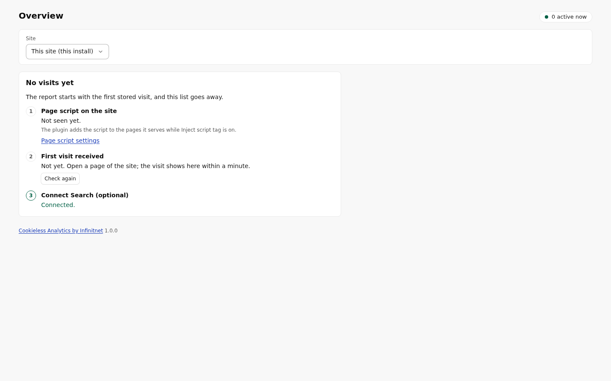

# Quick Install

This page gets the plugin counting visits: on an EmDash site, and on any other site through a script tag. It ends with the few settings worth checking on day one and a way to confirm that it works.

The target setup is Cloudflare Workers with D1. Peer ranges: `emdash` `>=1.4.0 <2`, `astro` `^7.0.0`, `react` 18 or 19. Node 20 or newer builds it.

## How to use it

### New site: Deploy to Cloudflare

[](https://deploy.workers.cloudflare.com/?url=https://github.com/infinitnet/cookieless-analytics/tree/main/template)

The button copies the [site template](https://github.com/infinitnet/cookieless-analytics/tree/main/template) into a new repository on your GitHub or GitLab account and deploys it to your Cloudflare account: the EmDash Cloudflare starter with the plugin installed from npm and steps 1 to 4 below already done, a D1 database, an R2 bucket for media and a Cron Trigger every minute. It asks for `EMDASH_ENCRYPTION_KEY` (see [below](#the-emdash_encryption_key-secret); it can stay empty until you connect Search). Afterwards:

1. Open `/_emdash/admin` on the new site and complete the setup wizard.
2. On Workers Free, set `capacityProfile` to `small` (Settings, Data and capacity).
3. Continue with [Check that it works](#check-that-it-works).

### On an EmDash site

1. Install the package from npm:

   ```sh
   npm install @infinitnet/cookieless-analytics
   # or
   pnpm add @infinitnet/cookieless-analytics
   yarn add @infinitnet/cookieless-analytics
   ```

2. Add the plugin to the `plugins` option of `emdash()` and the Astro integration to `integrations`, after `emdash()`. Both parts are needed: the plugin owns the settings, admin pages, tables, routes and cron tasks; the integration adds one middleware that serves the page script and the event path from your own origin.

   ```js
   // astro.config.mjs
   import { defineConfig } from "astro/config";
   import emdash from "emdash/astro";
   import cookielessAnalytics from "@infinitnet/cookieless-analytics";
   import cookielessAnalyticsIntegration from "@infinitnet/cookieless-analytics/integration";

   export default defineConfig({
     integrations: [
       emdash({
         // database, storage and the rest of your EmDash config
         plugins: [cookielessAnalytics()],
       }),
       cookielessAnalyticsIntegration(),
     ],
   });
   ```

3. Make sure your layout renders `EmDashHead`. The plugin adds its script through the `page:fragments` hook, which EmDash runs only inside that component. Without it, nothing is counted.

   ```astro
   ---
   import { EmDashHead } from "emdash/ui";
   import { createPublicPageContext } from "emdash/page";

   const page = createPublicPageContext({ Astro, kind: "custom", title: Astro.props.title });
   ---
   <html>
     <head>
       <EmDashHead page={page} />
     </head>
     <body><slot /></body>
   </html>
   ```

   The hook adds exactly one tag, the same for every visitor:

   ```html
   <script defer src="/_/e.js"></script>
   ```

4. Add a Cron Trigger to your Wrangler config. The plugin's background tasks (daily summaries, retention, salt cleanup, Search, revenue, mail) run from it. Treat it as required.

   ```jsonc
   // wrangler.jsonc
   {
     "triggers": { "crons": ["* * * * *"] }
   }
   ```

5. Redeploy. The plugin creates its tables when it activates.

6. If you plan to connect Google Search Console or Bing, set the encryption key now (see [Secrets](#the-emdash_encryption_key-secret) below).

### On any other site

Any website (a static site, another CMS, WordPress) can send its visits to your install as a client site.

1. In the admin, open Definitions, tab Sites, and add a site: a label, an id, and 1 to 10 exact host names such as `example.com` and `www.example.com`.
2. Copy the script tag the Sites tab shows and put it in the `<head>` of every page:

   ```html
   <script defer src="https://example.com/_/e.js" data-ec-key="EXAMPLEKEY0123456789"></script>
   ```

   The key (20 letters and digits) is public. It only means "accept visits for this site from these host names".
3. For a single page app, call this after each client side route change (Astro's ClientRouter needs nothing):

   ```js
   window.__ec && window.__ec.page();
   ```

Full steps, Tag Manager and linked hosts: [Multi-Site-and-Sites-View](Multi-Site-and-Sites-View).

### The first party path idea

The page script and the event path are served from your own origin, under neutral paths: `scriptPath` (default `/_/e.js`) and `collectPath` (default `/_/e`). No third party host is involved, and the paths contain no word that content blockers look for. A path that would contain such a word, or that collides with another path, falls back to its default. The data attribute prefix follows `namespace` (default `__ec`, giving `data-ec-`).

A client site loads the script from your install, which is a third party host from its point of view. If you want first party paths there too, proxy `/_/e.js` and `/_/e` on the client's own Cloudflare zone to your install (an operator setup, not a plugin feature).

### Settings to look at first

Open Settings, section General.

| Key | Default | What it does |
|---|---|---|
| `siteTimezone` | `UTC` | IANA timezone for days and hours in reports, for example Europe/Berlin. |
| `siteOrigin` | empty | Canonical origin such as `https://example.com`. Used to match Search pages and as the Google sign-in return address. Empty uses the request origin. |
| `excludeEditors` | `true` | Visits of signed-in editors and administrators are not recorded. |
| `defaultCurrency` | `USD` | Currency stored with event values that name none. Changing it later relabels nothing. |

On Workers Free, also set `capacityProfile` to `small` (Settings, Data and capacity). See [Capacity-Profiles-and-Cloudflare-Plans](Capacity-Profiles-and-Cloudflare-Plans).

### Check that it works

Test in a private window: signed-in editors are not counted, and neither are browsers that send Global Privacy Control.

1. The sidebar of the EmDash admin has a folder Analytics.
2. View the source of a public page: one `<script defer src="/_/e.js">` in `<head>`.
3. Open `https://example.com/_/e.js`: it answers 200 with JavaScript.
4. Load a page. The browser's network panel shows one `POST /_/e` answered with 204.
5. Open Overview. Until the first visit is stored, a "No visits yet" panel lists the steps to the first visit (page script seen on a host, and so on). A few seconds after your page view, the report replaces it, and the "Active now" badge in the page head shows the visit.



## The `EMDASH_ENCRYPTION_KEY` secret

The Search sign-in values (Google client secret, refresh token, service account key, Bing API key and Bing OAuth secrets) are secret settings. EmDash encrypts them with the key in `EMDASH_ENCRYPTION_KEY`. Without it, saving a secret fails.

```sh
npx emdash secrets generate
wrangler secret put EMDASH_ENCRYPTION_KEY
```

Keep a backup. A lost key makes the stored secrets unreadable, and you have to connect again.

## Limits

- Workers Free: 50 D1 queries per invocation, 100,000 rows written and 5 million rows read per day per account, 500 MB per database.
- Every D1 database: at most 10 GB, one query at a time.
- Rows written per page view: about 3.3 with a typical mix.
- The Free plan's daily rows give an estimated 25,000 page views a day across all sites of an account (an estimate, not a measurement).
- The page script retries a refused page view up to 3 times, only while the page stays open.
- The plugin's own caps: 60 events per session per minute, 300 per visitor per minute, 8 KB per body, counted per Worker isolate.

## Gotchas

- Without the integration the plugin falls back to an inline script that posts to `/_emdash/api/plugins/cookieless-analytics/in`. Counting works, but the neutral paths, error page logging and shared dashboards need the integration.
- The integration must come after `emdash()` in `integrations`.
- If your theme adds the script tag itself, turn off `injectScript` and use the path from `scriptPath`.
- Without the Cron Trigger, older ranges get no summaries, expired rows stay and old salts are not deleted.
- Add a WAF rate limiting rule for `POST /_/e` (your `collectPath`). The plugin's caps are approximate across isolates; the rule is the real limit. Change it when you change `collectPath`.
- Without Cloudflare in front (a local dev server) the country stays empty.

## Related

[Settings-Reference](Settings-Reference), [Capacity-Profiles-and-Cloudflare-Plans](Capacity-Profiles-and-Cloudflare-Plans), [Queue-Worker](Queue-Worker), [Multi-Site-and-Sites-View](Multi-Site-and-Sites-View), [Search-Integrations](Search-Integrations), [Privacy-Model](Privacy-Model), [Troubleshooting](Troubleshooting), [Upgrade](Upgrade).

Full reference: https://github.com/infinitnet/cookieless-analytics/blob/main/docs/install.md
