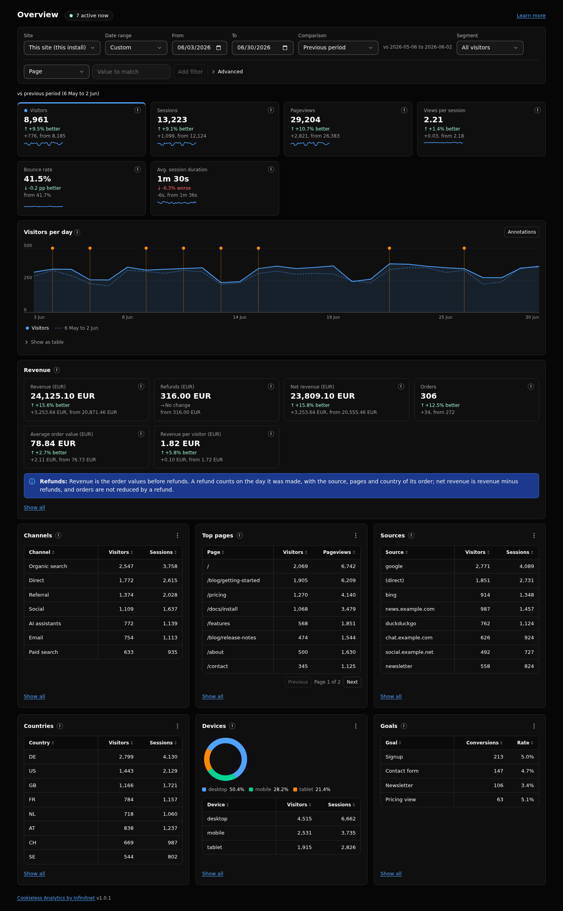
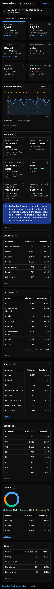
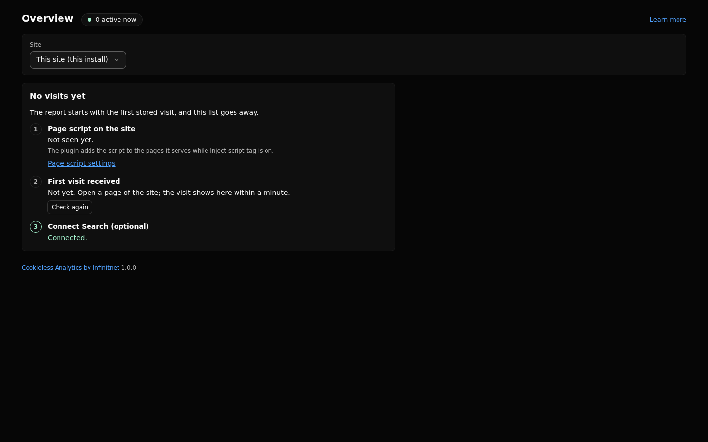
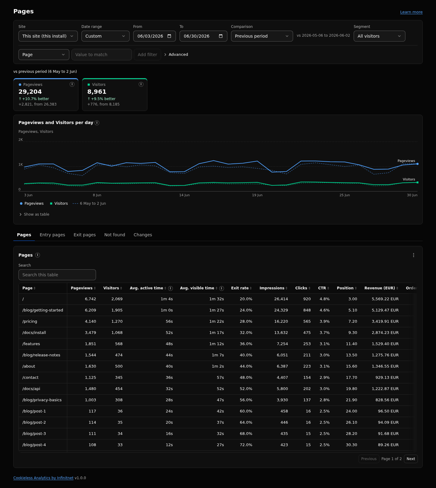
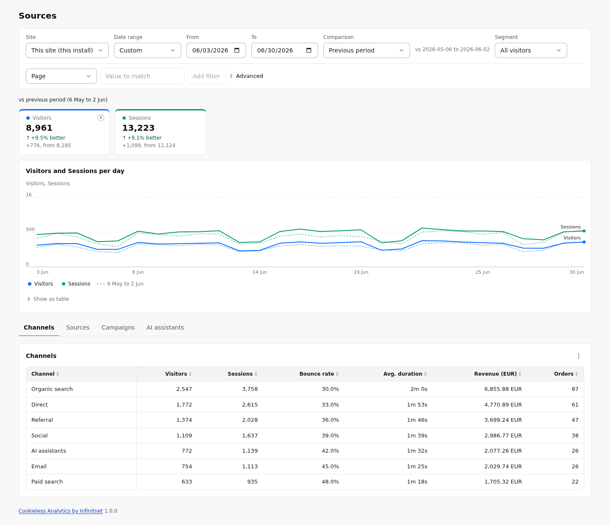
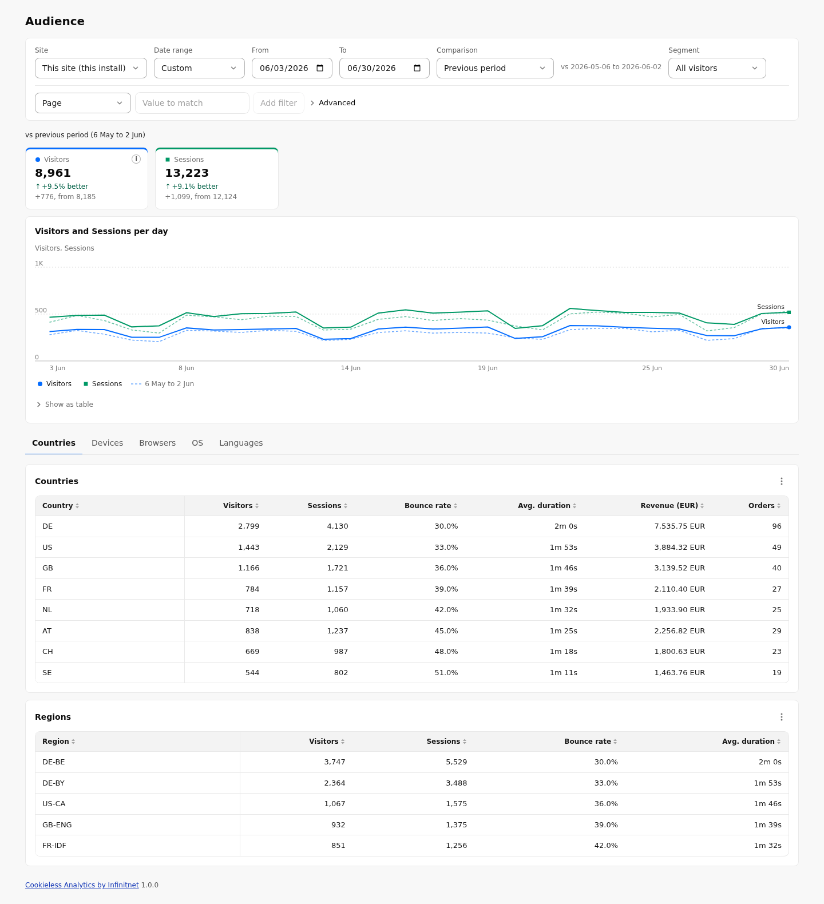

# Reports

The report pages show your traffic for a date range: how many people came, what they read, where they came from, who they are and what they did. They share one header, one chart component and one table component, so they all work the same way.

## How to use it

1. Open the plugin in the admin and start on **Overview**.
2. Pick a range in the header (for example Last 30 days) and, if you want, a comparison.
3. Click metric cards to choose the lines on the chart.
4. Click any value in a table (a page, a channel, a country) to add it as a filter. The whole page, and every other page, then shows only matching sessions.
5. Move to Pages, Sources, Audience or Behaviour. The range, comparison, filters and site come with you.
6. Use the panel menu of a table to export it or to pick columns.

## The header

Every report page has the same header controls:

| Control | What it does |
|---|---|
| Site | Choose the site. Shown only when client or connected sites exist. See [Multi-Site and Sites View](Multi-Site-and-Sites-View). |
| Range | Presets Today, Yesterday, Last 7 days, Last 30 days (default), Last 90 days, Last 12 months, Month to date, Year to date, or two custom days. Every preset ends today in the site time zone. |
| Comparison | Off, previous period, same period last year, or another segment. |
| Segment | Apply a saved segment, or save the current filters as a segment ("Save as segment"). |
| Filters | The filter bar. See [Filters and Segments](Filters-and-Segments). |

On a narrow screen the header collapses to one summary line (site, range, comparison, segment, number of filters) that opens the controls.

### The view carries over

The range, comparison, filters and site carry over between admin pages for the browser session. Filter Overview to "Organic Search", open Sources, and Sources shows organic search too. Closing the browser tab resets the view to the default.

Every view is also a link: the range, filters, comparison, segment and site are in the query string, so you can copy the address and send it to a colleague. Tabs are in the URL too, so the browser's Back button returns to the previous tab.

## The pages

### Overview

- **Metric cards**: Visitors, Sessions, Pageviews, Views per session, Bounce rate and Avg. duration, each with the change against the comparison. A click on a card turns its line on the chart on or off.
- **Info markers**: the small "i" on a card or panel opens the definition of its number.
- **Active now**: a live badge in the page head with the sessions seen within the realtime window (`realtimeWindowMinutes`, default 5).
- **Revenue strip**: revenue, orders, average order value and revenue per visitor, shown only when the site has recorded orders. See [Revenue and Refunds](Revenue-and-Refunds).
- **Panels**: Channels, Top pages, Sources, Countries, Devices (with a donut) and Goals, top 10 each. Click a value to filter.
- **Annotations**: markers on the chart. The Annotations button hides them. See [Annotations and Impact](Annotations-and-Impact).

**First run.** Before the site has recorded any visit, the Overview shows a first run panel instead of empty charts, with the steps to get the page script running and a way to check that it works.

With "All sites" selected in the site select, the Overview shows the All sites table instead. See [Multi-Site and Sites View](Multi-Site-and-Sites-View).

### Pages

A trend chart with cards for pageviews and visitors per day, above the tabs **Pages**, **Entry pages**, **Exit pages**, **Not found** and **Changes** (pages rising and declining by page views). The Pages table shows pageviews, visitors, **Avg. active time** (time with interaction, so an open but untouched page counts 0 s), **Avg. visible time** (time the page was in view, from detailed data only), exit rate and median scroll; see [Definitions](Definitions#active-time-and-duration). A page row opens its Search queries when a Search source is connected and mapped. The Pages table has a column picker in the panel menu: Search columns (impressions, clicks, CTR, position) and Revenue columns are hidden unless a source is connected or orders exist, and one click adds them.

### Sources

A trend chart with cards for visitors and sessions, above the tabs **Channels**, **Sources**, **Campaigns** (switch between the UTM fields Campaign, Source, Medium, Term and Content) and **AI assistants** (visits referred by AI assistants). How channels are assigned: [How Visits Are Counted](How-Visits-Are-Counted).

### Audience

A trend chart with cards for visitors and sessions, above the tabs **Countries** (with a Regions table, filled only when `captureRegion` is on), **Devices**, **Browsers**, **OS** and **Languages**.

### Behaviour

Tabs **Events**, **Goals**, **Revenue**, **Funnels**, **Journeys**, **Site search**, **Outbound**, **Downloads**, **Forms** and **Scroll**. See [Goals and Funnels](Goals-and-Funnels), [Events](Events), [Revenue and Refunds](Revenue-and-Refunds) and [Content and Site Search](Content-and-Site-Search).

Search Satisfaction, Links and Search have their own pages: [Search Satisfaction](Search-Satisfaction), [Links Report](Links-Report), [Search Integrations](Search-Integrations).

## The chart

Overview, Pages, Sources, Audience, Search Satisfaction, Search, Revenue and Links use metric cards that toggle the lines of one chart.

- Up to 4 metrics at once.
- At most 2 scales (for example a count on the left and a percentage on the right). A click that would need a third scale is refused with a hint: "These metrics use two scales already. Turn one off first."
- At most 2 metrics while a comparison is on (each has a dashed comparison line), and at most 2 on a small screen.
- One metric always stays on.
- Shift click or Alt click on a card shows that metric alone.
- Your choice of metrics is remembered in this browser.

**Keyboard on the chart.** Focus the chart, then use Left and Right to move one point, Page Up and Page Down to move 7, Home and End for the first and last point, and Escape to clear. The values of the point are read out to screen readers.

**Show as table.** Under every chart, "Show as table" opens the values as a table with a Date column and one column per line (and per comparison line).

## Tables

- Click a value to add it as an `is` filter. "(not set)" values cannot be clicked.
- Sort by a column header; long tables are paged.
- A table with more than one page of rows has a search box above it that keeps the rows whose text columns contain what you type, in any case; when the report has more rows than it loaded, the search covers the rows shown, so narrow the range or add a filter to search the rest. A new range, filter or report clears it.
- **Panel menu** (the button at the top right of a panel): Export CSV, Export JSON, and the column picker where a table has optional columns. Your column choice is remembered per report in this browser.
- The export runs the same report with the header range, segment and filters.

## Settings

| Key | Default | What it does |
|---|---|---|
| `siteTimezone` | UTC | Time zone of days, hours and range presets. |
| `realtimeWindowMinutes` | 5 | Window of the Active now badge. |
| `captureRegion` | false | Fills the Regions table on Audience. |
| `rawRetentionDays` | 760 | Days of detailed data; older ranges use daily summaries. |

## Limits

- A range is at most 1,000 days.
- Up to 4 metrics on a chart, 2 scales, 2 metrics with a comparison.
- Overview panels show the top 10 rows.
- An export is capped at 10,000 rows.

## Gotchas

- Visitors over several days are the sum of daily visitors. See [How Visits Are Counted](How-Visits-Are-Counted).
- Ranges before the detailed data window, or very long ranges, are answered from daily summaries. Some filters then do not apply; the chip is struck through and the reason is named. See [Filters and Segments](Filters-and-Segments).
- Hourly charts over summary data show days instead.
- Today and yesterday are always computed live, so figures for them can change as visits arrive.
- Revenue columns appear only when the site has orders; amounts of different currencies are never added together.

## Related

- [Filters and Segments](Filters-and-Segments)
- [How Visits Are Counted](How-Visits-Are-Counted)
- [Dashboards and Sharing](Dashboards-and-Sharing)
- [Annotations and Impact](Annotations-and-Impact)
- [Multi-Site and Sites View](Multi-Site-and-Sites-View)
- [Data Page](Data-Page)
