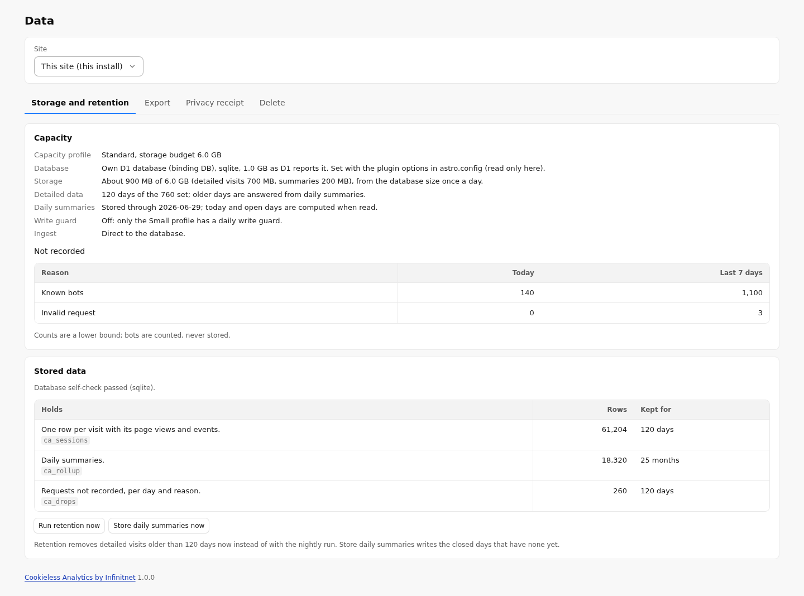

# Retention

Retention decides how long the plugin keeps detailed visits, daily summaries and Search rows. Detailed rows answer every filter and view; once they expire, older days are still answered from daily summaries.

## How to use it

1. Open Settings, section Data and capacity.
2. Set **Detailed data (days)** (`rawRetentionDays`), **Summary retention (months)** (`rollupRetentionMonths`) and, in section Search, **Search retention (days)** (`searchRetentionDays`).
3. Save. The hourly retention task deletes what is now too old, oldest first, over the next runs.
4. To run it at once, open Data, tab Storage and retention, and click **Run retention now**. If it says "Retention deleted a batch of old rows; run it again to continue.", click again until it says "Retention ran; old rows were deleted."



## Settings

| Key | Default | What it does |
|---|---|---|
| `rawRetentionDays` | `760` (7 to 760) | Days of detailed rows kept: visits with their page views and events, orders and server events, error page and drop counters. Shortens by itself when the storage budget requires it. |
| `rollupRetentionMonths` | `25` (1 to 120) | Months of daily summaries kept. |
| `searchRetentionDays` | `800` (90 to 1000) | Days of Search rows (Google Search Console and Bing) kept. |
| `capacityProfile` | `standard` | Sets the storage budget and the requests one retention run may spend. |

## What is kept where

| Data | Kept |
|---|---|
| Visits with their page views and events, orders and server events | `rawRetentionDays`; a day is deleted only once the daily summaries hold it |
| Error page and drop counters | the detailed window |
| Daily summaries (per report dimension, pairs, channel x country x device cube, revenue per currency) | `rollupRetentionMonths` |
| Search rows | `searchRetentionDays` |
| Second tab aliases | one day after they were written (the longest visit), then they expire |
| Daily salts | 2 days (fixed) |
| Configuration (goals, dashboards, keys and so on) | until you delete it |

**Detailed rows** hold every visit with its pages, events, timing, source and device. All filters, segments, Satisfaction, filtered journeys and per visit views need them.

**Daily summaries** hold top values per dimension (at most 500 pages and 200 values of every other dimension per day, the rest summed into `(other)`), pairs of a dimension with channel, country or device, the cube of channel x country x device, the top links and journey steps, and revenue per currency. They hold no visitor keys. Totals stay exact, but filters that the summaries do not keep cannot be applied; reports say so with a notice.

## The nightly and hourly tasks

The plugin runs its tasks from the site's Cron Trigger:

| Task | Schedule | What it does |
|---|---|---|
| `rollup` | minutes 0 and 30 | Stores the daily summaries of closed days not stored yet. |
| `retention` | minute 17 of every hour | Deletes days older than the retention settings, oldest first, within the request budget of the profile; continues on the next run. Also continues a running filtered delete. |
| `salts` | 00:05 | Deletes daily salts older than two days. |

A Cron Trigger of `* * * * *` is recommended:

```jsonc
// wrangler.jsonc
{
  "triggers": { "crons": ["* * * * *"] }
}
```

Every 15 minutes also works; tasks then take turns and catch up about once an hour each.

## Storage budget

Once a day the plugin estimates the size of its tables without a table scan. When the detailed data would pass its share of the budget (three quarters), the detailed window shortens to the newest days that fit. The Data page then shows a notice, and the Detailed data line reads, for example, "540 days of the 760 set".

## Limits

- Retention deletes within the request budget of the profile: 40 requests per run on `small`, 400 otherwise.
- On `small`, retention deletes at most 2,000 rows per run and 15,000 per UTC day, so a backlog cannot spend the day's write allowance. A deleted row counts as a written row.
- A closed day's summary is stored 15 minutes after the local midnight that starts the day after next.

## Gotchas

- Retention applies per database, to every site in it, client sites included. It cannot differ per site.
- Without a Cron Trigger, expired rows are not deleted, summaries for older ranges are not built, and old salts stay in storage.
- Lowering `rawRetentionDays` removes detail for good. Older days then answer from summaries only, with fewer filters.
- Satisfaction before the detailed window answers with a notice and a button that moves the range inside the window. Journeys there read the daily summaries, which keep only the top steps and paths of each day and apply no filter.
- Raising `rawRetentionDays` does not bring back deleted detail.
- Days older than the detailed window cannot be filtered by Delete matching visits; see [Data-Page](Data-Page).

## Related

[Data-Page](Data-Page), [Capacity-Profiles-and-Cloudflare-Plans](Capacity-Profiles-and-Cloudflare-Plans), [Privacy-Model](Privacy-Model), [Settings-Reference](Settings-Reference), [Troubleshooting](Troubleshooting).

Full reference: https://github.com/infinitnet/cookieless-analytics/blob/main/docs/privacy.md
