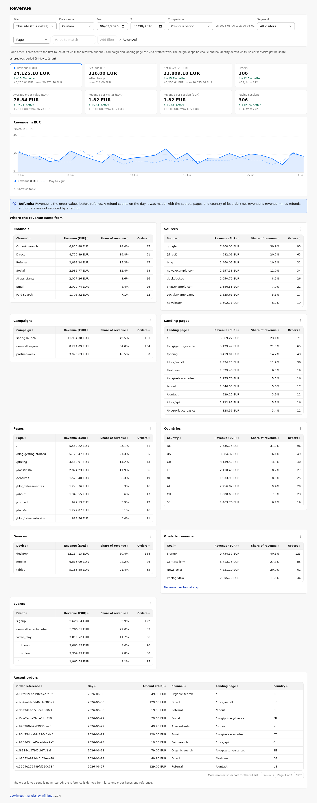

# Revenue and refunds

Any event can carry an order value, a currency and an order id. The plugin stores each amount in the currency it was recorded in and never adds, averages or ranks money of two currencies together. Refunds are booked by your server and reported next to gross revenue.

## How to use it

1. Set `defaultCurrency` on the Settings page, General section (default `USD`). `acceptClientRevenue` is in the Revenue section.
2. Record orders. For amounts you must trust, send them from your server through the agent events route. For a quick start, send them from the page.
3. Attribute server orders to the visit: read `window.__ec.sid` at checkout, keep it with the order, and pass it back from your payment webhook.
4. Book refunds and corrections from your server.
5. Open Revenue in the Analytics menu: currency chips, key figures that toggle the lines of the chart, one panel per breakdown (channels, sources, campaigns, landing pages, pages, countries, devices, goals, events) with share of revenue, and the recent orders of the detailed window. Each order is credited to the first touch of its visit. "Revenue per funnel step" under the panels opens Behaviour, Funnels, where every step shows the revenue of the sessions that reached it ([Goals and funnels](Goals-and-Funnels)).

### From the page

```js
// Number form: the site's default currency.
window.__ec && window.__ec.event("purchase", {}, 49.9);
// Object form: value, currency and order id.
window.__ec && window.__ec.event("purchase", { plan: "pro" }, { value: 49.9, currency: "EUR", id: "A-1001" });
```

```html
<button data-ec-event="purchase" data-ec-value="49.90" data-ec-currency="EUR" data-ec-id="A-1001">Buy</button>
```

Browser revenue is unauthenticated: anyone who can run script on a page can post any value. Turn `acceptClientRevenue` off to drop `val`, `cur` and `oid` from every browser request (counted as `revenue_not_accepted`). That stops casual console spoofing; it is not authentication.

### From your server

Create an API key with the scope `write:events` (Definitions, API keys).

```sh
curl -X POST "https://example.com/_emdash/api/plugins/cookieless-analytics/agent/v1/events" \
  -H "X-Api-Key: $KEY" -H "content-type: application/json" \
  -d '{"events":[{"name":"purchase","val":49.9,"cur":"EUR","oid":"A-1001","sid":"k3j9x0a1b2c3d4e5f6g7"}]}'
```

```js
// Webhook handler, after verifying the payment provider's signature.
export async function onOrderPaid(order) {
  await fetch("https://example.com/_emdash/api/plugins/cookieless-analytics/agent/v1/events", {
    method: "POST",
    headers: { "X-Api-Key": process.env.EVENTS_KEY, "content-type": "application/json" },
    body: JSON.stringify({
      events: [{ name: "purchase", val: order.total, cur: order.currency, oid: order.id, ...(order.metadata.visit ? { sid: order.metadata.visit } : {}) }],
    }),
  });
}
```

Keep the `sid` on your server only until this call is sent: stored next to an order it links the purchase to that visit's pages in your own records. Send amounts and order ids only, never names, emails or payment data.

### Refunds

```sh
curl -X POST "https://example.com/_emdash/api/plugins/cookieless-analytics/agent/v1/events" \
  -H "X-Api-Key: $KEY" -H "content-type: application/json" \
  -d '{"events":[{"name":"purchase","oid":"A-1001","rid":"RF-7","refund":20}]}'
```

- `name` and `oid` name the stored order. `rid` (1 to 64 characters) is your refund id, required; a retry with the same `rid` counts in `duplicates`. `refund` is the amount, above 0. `cur`, when given, must be the order's currency. `ts` is the refund's own time.
- The refund is booked on its own day with the order's visit, page, event name and currency, so it carries the original channel, source and campaign.
- Partial refunds add up. Above the order's amount is `refund_exceeds_order`, an order not stored is `unknown_order`, another currency is `currency_mismatch`.
- Only the agent route takes refunds; the page and `recordEvent` cannot.

### Corrections and voids

- Correction: post the same `name` and `oid` with a new `val`. The agent route replaces the amount and currency and keeps the time, day, page and name.
- Void: `{ "name": "purchase", "oid": "A-1001", "void": true }` without `val`. The event stays; the order, its revenue and its refunds are gone.
- Spoofed amounts without an order id are removed on the Data page, Delete tab, "Void revenue": a day, an event name and a minimum value, counted first and voided after a confirmation.

## Net revenue and how figures are defined

- `revenue` is gross, the order values before refunds. `refunds` is the refunds booked in the range, by the refund's own day. `net_revenue` is `revenue` minus `refunds`. A day with refunds and no orders shows a negative net.
- Refunds and Net revenue appear next to Revenue (cards and columns) only when the range holds refunds.
- An order is one event with a value (0 is an order of zero). `aov` is revenue / orders. `revenue_per_visitor` divides by all visitors of the same filters and range. `paying_sessions` counts sessions with an order in the currency.
- Amounts print with the code after them and no symbol: `1,234.50 USD`, `9,800 JPY`.



## Revenue by source

Revenue belongs to the session of its event: by channel, source, campaign, country and device it follows the session's first touch, by landing page the session's entry, by page the page the event fired on. The breakdown dimensions are channel, source, campaign, landing page, page, country, device, goal and event. An order without a session counts in the totals under `(not set)` and is left out as soon as a session filter is active.

Revenue and Orders columns appear on Sources, Pages, Audience and Goals, and the Overview shows a revenue strip in the default currency, whenever the site has revenue. The URL keeps the chosen currency as `cur=EUR`.

## Settings

| Key | Default | What it does |
|---|---|---|
| `defaultCurrency` | `USD` | Currency stored on events that name none, and shown when no currency is chosen. Changing it never relabels recorded rows. |
| `acceptClientRevenue` | `true` | When off, browser posts lose `val`, `cur` and `oid`. Server calls still record them. |

Client sites can inherit these or set their own on Definitions, Sites.

## Limits

- `val`: 0 to 1,000,000,000, rounded half away from zero to the currency's minor unit (2 digits for most codes, 0 for JPY and others, 3 for BHD and others). Negative values are refused.
- `cur`: three letters on the ISO 4217 list. An invalid code drops the revenue fields, never falls back to the default.
- `oid` and `rid`: 1 to 64 characters of letters, digits, `_`, `.`, `:`, `-`. Never stored.
- Agent route: 1 to 20 items per call; `ts` from 30 days ago to 60 seconds ahead, and inside the detailed window.
- A `sid` attaches only to a visit that started at most 7 days ago; an unknown one is `invalid_sid`.
- Corrections, voids and refunds work only while the order is inside the detailed window.
- Summaries beyond the detailed window keep the top 200 keys per dimension a day (500 for pages and landing pages).

## Gotchas

- One order, one row: the order is stored once per site, event name and order id. A reloaded thank-you page or a retried post counts as a duplicate and writes nothing. Use the same event name for an order in the browser and on your server.
- A browser or in-process post of an order id already stored is dropped; only the agent route changes a stored order.
- There are no exchange rates. Pick a currency chip to see that currency's figures.
- An order counts on its own day; the visit's page views count on the day the visit started.
- The `revenue` filter compares orders only, refunds are not subtracted.

## Related

[Events](Events), [Goals and funnels](Goals-and-Funnels), [Agent API and MCP](Agent-API-and-MCP), [Data page](Data-Page), [Dashboards and sharing](Dashboards-and-Sharing), [Settings reference](Settings-Reference). Full reference: https://github.com/infinitnet/cookieless-analytics/blob/main/docs/revenue.md
