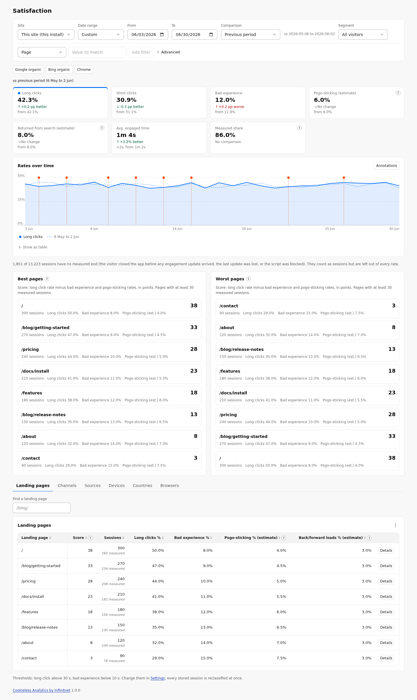

# Satisfaction

The Satisfaction page shows whether landing pages answered the visit: how many visits lasted long, how many left quickly without doing anything, and how often visitors from a search engine went straight back to the results. It is computed from the visits you already record, with no extra script.

## How to use it

1. Open **Satisfaction** in the sidebar (right after Pages). It uses the range, comparison, segment and filters of the header.
2. Read the cards: long clicks, short clicks, bad experience, pogo-sticking (estimate), returned from search (estimate), average engaged time and the measured share. A card click also picks the rate shown on the trend chart.
3. Check **Best pages** and **Worst pages**: the five landing pages with the highest and lowest score, with the score change against the previous period.
4. Use the breakdown tabs (landing pages, channels, sources, devices, countries, browsers) to see where a rate is high.
5. Open a landing page (a ranked row, or Details in the table) for its drawer: its trend, pogo-sticking by search engine and the same breakdowns.
6. Use a preset to focus: **Google organic** (channel Organic Search, source starts with `google.`), **Bing organic** (source starts with `bing.`) or **Chrome** (browser Chrome).
7. To change the thresholds, open Settings, section Sessions and engagement.

## What the page shows

- **Cards**: the seven numbers with the change against the comparison. The estimates and the measured share carry an info marker with their definition.
- **Trend chart**: the rates over time, with annotation markers. A card click picks the rate.
- **Best pages** and **Worst pages**: sessions, long click, bad experience and pogo-sticking rates, the score and its change in points.
- **Breakdown tabs**: landing pages (searchable, sortable and paged), channels, sources, devices, countries and browsers, each with every rate and the score.
- **Landing page drawer**: the page's trend, pogo-sticking by search engine (organic sessions grouped by source, so two engines sit side by side) and the same breakdowns.
- **Thresholds line**: the thresholds in effect, with "Change them in Settings".

The Satisfaction dashboard template carries the same numbers as tiles, including the best and worst pages and the pogo-sticking trend.

## Definitions

For each human session with at least one page view:

- **Duration**: the longer of the time between the first and last page view, and the time the pages were visible.
- **Measured**: at least one engagement update arrived. Sessions whose end was never observed (a closed app, a lost beacon, a blocked script) are unmeasured and left out of every rate. A line under the cards says how many.
- **Long click**: measured, and the duration is above `longClickSeconds`.
- **Short click**: measured, and the duration is at or below `longClickSeconds`.
- **Bad experience**: measured, one page view, no events, no interaction, and a duration below `badExperienceSeconds` (never above the long click threshold, so a bad experience is always also a short click).
- **Search session**: the channel is Organic Search or Paid Search.
- **Pogo-sticking (estimate)**: a measured search session with one page view, no events, a short click, and the page left in a way the browser keeps for Back and Forward. Rate: pogo-sticks divided by measured search sessions.
- **Returned from search (estimate)**: a search session whose first page was left for Back and Forward, and that a later arrival from a search engine joined within the same session window. It is a stronger signal than pogo-sticking because the second arrival is observed. It needs neither a short click nor a single page view, so the two numbers overlap.
- **Search re-entry (estimate)**: search sessions that a later arrival from a search engine joined, divided by search sessions.
- **Back/forward loads (estimate)**: per page, the share of page loads that came from the browser's Back or Forward action.

### The score

Score = long click rate minus bad experience rate minus pogo-sticking rate, shown in points (25 percent is 25). A page without measured search sessions counts its pogo-sticking rate as 0. Short clicks are left out because they include many quick, successful answers. The lists always show the three parts next to the score.

Only landing pages with at least 30 measured sessions in the range are ranked, so a few lucky visits cannot top the list. Ties go to the busier page.

### Thresholds apply at once

The thresholds are read when the report runs. Changing `longClickSeconds` or `badExperienceSeconds` reclassifies every stored session at once, old and new. There is no job to wait for.

## Settings

| Key | Default | What it does |
|---|---|---|
| `longClickSeconds` | 60 | A session longer than this (10 to 600 seconds) is a long click; at or below it, a short click. |
| `badExperienceSeconds` | 10 | A single page session without interaction shorter than this (1 to 60 seconds) is a bad experience. |
| `rawRetentionDays` | 760 | Satisfaction needs detailed session rows, kept for this many days. |

## Limits

- Ranking needs at least 30 measured sessions per landing page.
- Best and worst lists show five pages each.
- Satisfaction works inside the detailed data window only. For a range that starts earlier, the page shows: "Satisfaction is computed from session rows, which are kept for the raw retention window only. Choose a more recent range or raise the raw retention." with a button that moves the range inside the window. There are no daily summaries of these numbers.

## Gotchas

"Pogo-sticking, returned from search, search re-entry and back/forward loads are estimates from passive browser signals. The script never reads or changes browser history."

- The referrer is the search engine's origin only, so the query is never known, and a second search cannot be told from the same search again. Apps and browsers that send no referrer count as Direct and are outside every search based rate.
- The "left for Back and Forward" signal fires on Back and on Forward alike. It means the visitor left without closing the tab and without clicking one of your links, not that they pressed Back. A tab close is not counted.
- Browsers differ in what they keep for Back and Forward. Compare within one browser; the Chrome preset is there for that.
- A tab or app switch is not an exit. On mobile, a page left through the app switcher and later closed by the system never reports an exit.
- A page restored from the browser's Back and Forward cache is not a new page load, so the back/forward load share is a lower bound.
- Search re-entry also counts two results opened in tabs at once, and two people behind the same network address (see [How Visits Are Counted](How-Visits-Are-Counted)).
- Active time accrues only within 60 seconds of an interaction, so a long passive read (a video) can be a long click by visible time with low engaged time.

Full reference: https://github.com/infinitnet/cookieless-analytics/blob/main/docs/sessions.md

## Related

- [How Visits Are Counted](How-Visits-Are-Counted)
- [Reports](Reports)
- [Search Integrations](Search-Integrations)
- [Dashboards and Sharing](Dashboards-and-Sharing) (Satisfaction template)
- [Annotations and Impact](Annotations-and-Impact)
- [Agent API and MCP](Agent-API-and-MCP) (`satisfaction` and `satisfaction_series` reports)
