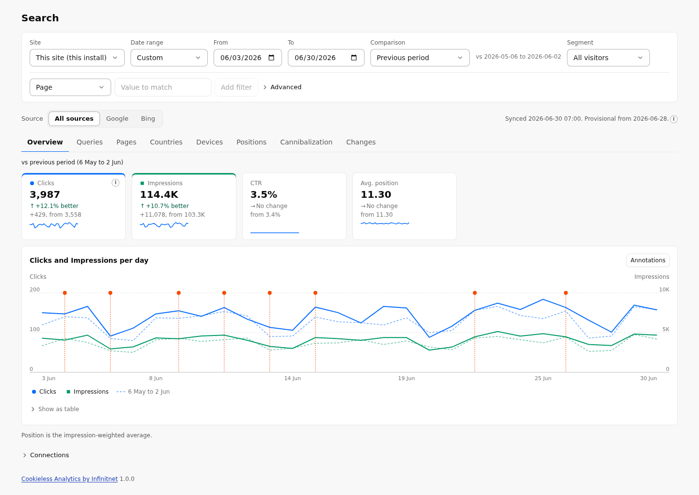
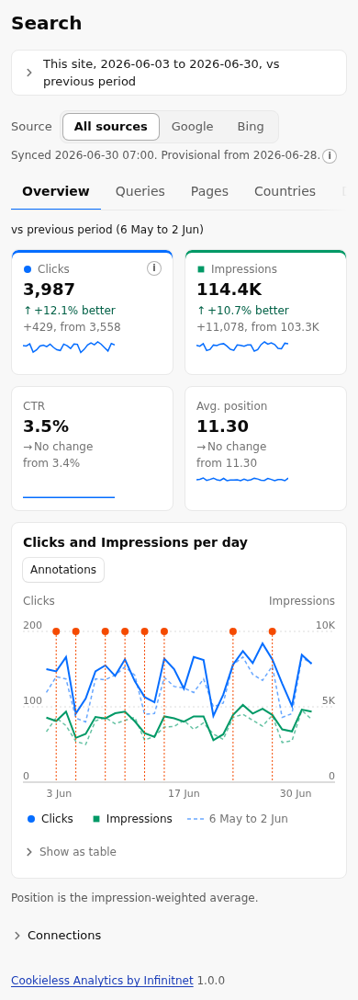
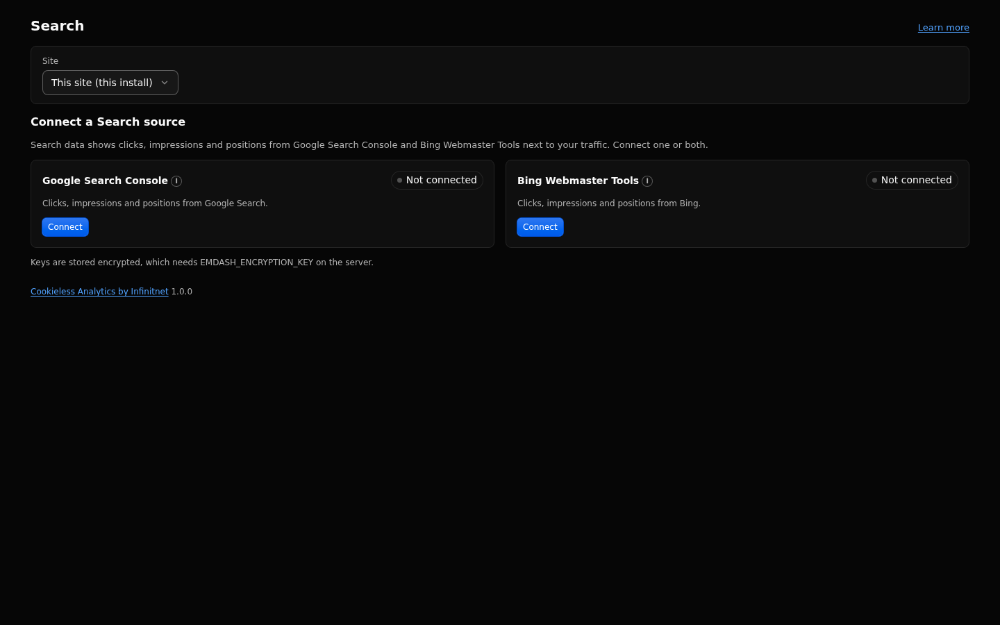

# Search Integrations

The plugin pulls clicks, impressions and positions from Google Search Console and Bing Webmaster Tools into the same database as your traffic, so Search numbers and page views can be read side by side per page. Everything is set up and read on the **Search** page.

## How to use it

### Before you start

1. Set `EMDASH_ENCRYPTION_KEY` on the server. Client secrets, refresh tokens, the service account key and the Bing API key are encrypted with it. Without it, saving a secret fails.
2. Set `siteOrigin` (Settings, General) to the canonical address of the site, for example `https://example.com`. It is used to match Search pages with your pages and as the return address of the Google sign-in.

### Google Search Console, option 1: OAuth client

1. [Create a Google Cloud project](https://console.cloud.google.com/projectcreate), or pick an existing one. Keep it selected for the next steps.
2. [Enable the Google Search Console API](https://console.cloud.google.com/apis/library/searchconsole.googleapis.com) in that project (APIs and Services, Library, Google Search Console API, Enable). Sign-in works without it, but every sync then fails with an access error.
3. Open the [Audience page](https://console.cloud.google.com/auth/audience) of Google Auth Platform and set up the app (Branding asks for an app name and your support email): user type **External**, your own address as contact. Add your Google address as a test user.
4. On the same Audience page choose **Publish app** and confirm, so the publishing status reads **In production**. Do not leave it in Testing: Google ends every authorization of a Testing app 7 days after consent, including the refresh token, and the plugin cannot renew it. The sync then stops with `invalid_grant` and you must connect again.
5. Open the [Clients page](https://console.cloud.google.com/auth/clients), choose Create client, type **Web application**, and add exactly one authorized redirect URI: `https://example.com/_emdash/admin/plugins/cookieless-analytics/search` (your site origin in place of example.com; the Search page shows the exact value with a copy button).
6. Copy the client ID and client secret from the dialog.
7. On the Search page, under Google Search Console, choose **OAuth client**, paste both and choose **Connect Google**.
8. Google shows "Google hasn't verified this app". That is expected for your own client: choose **Advanced**, then **Go to (app name)**, and approve read access to Search Console.
9. You return to the Search page. Pick the property in the property picker.

### Google Search Console, option 2: service account

1. [Enable the Google Search Console API](https://console.cloud.google.com/apis/library/searchconsole.googleapis.com) in your Google Cloud project.
2. Open [Service accounts](https://console.cloud.google.com/iam-admin/serviceaccounts), create a service account, open it, then Keys, Add key, Create new key, **JSON**. The file downloads once.
3. In [Search Console users and permissions](https://search.google.com/search-console/users) open the property and add the service account email (`...@...iam.gserviceaccount.com`) as a user. Restricted is enough. A service account has no consent screen, so nothing expires.
4. On the Search page choose **Service account**, paste the whole JSON key and save.
5. Pick the property in the property picker.

### Bing Webmaster Tools

1. Open [Bing Webmaster Tools](https://www.bing.com/webmasters) and add and verify the site, or import it from Search Console.
2. **API key** (the default): open Settings, then API access, choose Generate API key, paste it on the Search page under Bing Webmaster Tools and save.
3. **OAuth client** (optional): in Settings, API access, create an OAuth client with the redirect URI shown on the Search page, choose **OAuth client** on the Search page, paste the id and secret, and choose **Connect Bing**.
4. Pick the site in the Bing property picker. It proposes the site whose host name matches.

**Import from a file.** When the Bing API keeps refusing calls, use **Import Bing data from a file**: download the Keywords table and the Pages table from Bing's Search Performance report and import each CSV file. A file without a Date column is stored on the day you choose.

## What the page shows

The Search page changes with the connection state:

| State | What you see |
|---|---|
| Nothing connected | A setup page, "Connect a Search source", with the Google and Bing connection forms. |
| Connected, no property picked | A notice with the property picker on top. |
| A source with a problem | The problem on top of the page (sync failed, or Throttled with the next attempt), with "Open connections". For Bing, "Import a file instead". |
| Connected, no data yet | One explanation with **Sync now** in place of the tabs and chart. |
| One mapped source | The reports, with no source switch: every tab shows that source. |
| Two mapped sources | The reports with a source switch: All sources, Google or Bing. |

Below the reports a short sync line shows the last sync with **Sync now** and **Load older days**. The connection forms and the Bing import sit under **Connections** at the bottom; that section opens by itself when a sync failed.

### Tabs

- **Overview**: cards for clicks, impressions, CTR and average position with the comparison, and a chart with annotation markers.
- **Queries**, **Pages**, **Countries**, **Devices**: tables with click to filter and export. Countries and Devices are Google only and hidden when only Bing is mapped.
- **Positions**: position bands (1-3, 4-10, 11-20, 21-50, 51+), bands over time, band movement and striking distance (Google page and query pairs with an average position from 4 to below 21, with an estimate of extra clicks).
- **Cannibalization**: queries where two or more of your pages each hold at least `searchOverlapMinShare` percent of the impressions, labelled Dominant, Split, Inverted or Shared, and the competing pages.
- **Changes**: rising and declining pages and queries, new and lost queries, and decay (pages falling in three periods in a row, with a diagnosis of Position, CTR or Demand).

The Pages report of the traffic pages also gets impressions, clicks, CTR and position per page, and a Queries drawer per page, once the site has a connected and mapped source.

### Sync and Load older days

- The plugin checks hourly and pulls a site at most every `searchSyncHours` hours per source.
- Each Google pull refreshes the last 7 days. The newest three days are provisional, because Google updates them for 2 to 3 days. A day whose rows equal the stored rows is not written again, so a pull of unchanged days writes nothing.
- **Load older days** fills older dates: Last 30 days, Last 90 days, Last 180 days, Last 12 months, Everything the source offers, or from a date. Each option shows its estimate (days, rows, budget) before Start. It runs in batches across runs and days and can be cancelled.
- The first connect of a source loads `backfillDays` days by itself, except on the `small` capacity profile, where you press Start.

## Settings

| Key | Default | What it does |
|---|---|---|
| `siteOrigin` | empty | Canonical origin, used to match pages and as the sign-in return address. |
| `searchSyncHours` | 6 | Minimum hours between pulls per source (1 to 24). |
| `backfillDays` | 90 | Default range of Load older days and of the first connect (1 to 490). |
| `searchRetentionDays` | 800 | Days of Search rows kept (90 to 1000). |
| `searchMaxRowsPerDay` | 5000 | Page with query rows stored per day (1000 to 25000). |
| `syncSubrequestBudget` | 40 | Requests one sync run may make. Keep 40 on the Workers Free plan. |
| `searchMinImpressions` | 50 | Impression floor of the SEO views. |
| `searchOverlapMinShare` | 10 | Share floor (percent) of cannibalization. |
| `searchBrandTerms` | empty | Brand terms left out of cannibalization and striking distance. |
| `gscAuth` | off | Google sign-in: off, OAuth client or service account. |
| `bingEnabled` | false | Pull data from Bing Webmaster Tools. |
| `bingAuth` | apikey | Bing sign-in: API key or OAuth client. |

The sign-in keys show read only in Settings, section Search connections, and are edited on the Search page.

## Limits

- Google keeps about 16 months (490 days), Bing about 6 months (180 days). A longer range stops there.
- The Positions, Cannibalization and Changes views read at most 93 days. Last 12 months and Year to date show a notice instead.
- Cannibalization lists at most 200 queries with up to 10 pages each.
- A Bing import file is at most 500 KB and 50,000 rows.
- On the `small` profile Search writes at most 21,250 rows a day, so Load older days spreads over several days.

## Gotchas

- Google reports with a lag of 2 to 3 days, and Search days are Google's days (Pacific time), not your site time zone.
- Google leaves out rare queries, so query rows add up to less than the totals.
- A search query is never joined to a visit. Search and traffic meet per page and period only.
- Bing has no country or device data, and its query and page rows are weekly sums. Use ranges of whole weeks.
- Bing sometimes answers shared server addresses with `ThrottleIP`. The page shows Throttled and retries later; stored data stays. A file import always works.
- While the Google app is in Testing, Google ends the connection 7 days after consent and the sync stops with `invalid_grant`. Choose Publish app on the Audience page so the status is In production, then connect again. A service account never expires.
- One connection serves the local site and its client sites. Select a client site to map its own property. A connected remote site keeps its own Search connection.

Full reference: https://github.com/infinitnet/cookieless-analytics/blob/main/docs/search-sources.md

## Related

- [Reports](Reports)
- [Annotations and Impact](Annotations-and-Impact)
- [Dashboards and Sharing](Dashboards-and-Sharing)
- [Multi-Site and Sites View](Multi-Site-and-Sites-View)
- [Settings Reference](Settings-Reference)
- [Capacity Profiles and Cloudflare Plans](Capacity-Profiles-and-Cloudflare-Plans)
