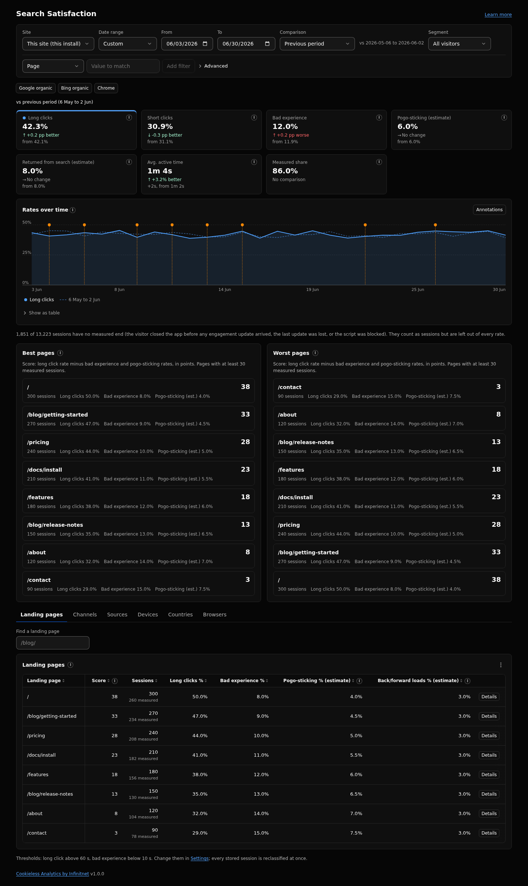

# Search Satisfaction

The Search Satisfaction page shows whether landing pages answered a visit from organic search: how many visits lasted long, how many left quickly without doing anything, and how often visitors went straight back to the results. It is computed from the visits you already record, with no extra script.

Search Satisfaction covers organic search sessions only, from every search engine. Direct, social, email, paid and all other visits are outside every number, on the page, in dashboards and shared views, in annotation impact and in the agent API alike.

## How to use it

1. Open **Search Satisfaction** in the sidebar (right after Pages). It uses the range, comparison, segment and filters of the header, inside the organic search scope. The filter bar shows the scope as a fixed chip, **Channel is Organic Search**, that cannot be removed; other filters narrow inside it. A channel filter does not apply on this page: the channel is not offered in the add filter menu, and a channel chip from another page shows struck through.
2. Read the cards: long clicks, short clicks, bad experience, pogo-sticking (estimate), returned from search (estimate), average active time and the measured share. A card click also picks the rate shown on the trend chart.
3. Check **Best pages** and **Worst pages**: the five landing pages with the highest and lowest score, with the score change against the previous period.
4. Use the breakdown tabs (landing pages, search engines, devices, countries, browsers) to see where a rate is high.
5. Open a landing page (a ranked row, or Details in the table) for its drawer: its trend, pogo-sticking by search engine and the same breakdowns.
6. Use a preset to narrow the organic sessions: **Google organic** (source starts with `google.`), **Bing organic** (source starts with `bing.`) or **Chrome** (browser Chrome).
7. To change the thresholds, open Settings, section Sessions and engagement.

## What the page shows

- **Cards**: the seven numbers with the change against the comparison. Every card and every table column has an info marker with its own definition; a card, a column and a dashboard tile of one figure show the same text.
- **Trend chart**: the rates over time, with annotation markers. A card click picks the rate.
- **Best pages** and **Worst pages**: sessions, long click, bad experience and pogo-sticking rates, the score and its change in points.
- **Breakdown tabs**: landing pages (searchable, sortable and paged), search engines, devices, countries and browsers, each with every rate and the score. A score resting on fewer measured sessions than the sample minimum shows muted with the note "low sample" and sorts last.
- **Landing page drawer**: the page's trend, pogo-sticking by search engine (sessions grouped by source, so two engines sit side by side, with the measured sessions that are the base of both rates) and the same breakdowns.
- **Thresholds line**: the thresholds and the sample minimum in effect, with "Change them in Settings".

The Search Satisfaction dashboard template carries the same numbers as tiles, including the best and worst pages and the pogo-sticking trend, for organic search sessions as well.

## Definitions

Every rate, the score and the average active time are shares of the measured sessions only. A session without a measurable end is in none of them; it counts only in the session count, the measured share and Avg. session duration.

For each human organic search session with at least one page view:

- **Duration**: the longer of the time from the session's start to its last page view or event, and the time the pages were visible.
- **Measured**: at least one engagement update arrived. Sessions whose end was never observed (a closed app, a lost beacon, a blocked script) are unmeasured: they count as sessions and in Avg. session duration, and are left out of every rate, the score and the average active time. A line under the cards says how many.
- **Long click**: measured, and the duration is above `longClickSeconds`.
- **Short click**: measured, and the duration is at or below `longClickSeconds`.
- **Bad experience**: measured, one page view, no events, no interaction, and a duration below `badExperienceSeconds` (never above the long click threshold, so a bad experience is always also a short click).
- **Pogo-sticking (estimate)**: a measured session with one page view, no events, a short click, and the page left in a way the browser keeps for Back and Forward. Rate: pogo-sticks divided by measured sessions.
- **Search re-entry (estimate)**: measured sessions that a later arrival from a search engine joined, whichever way the landing page was left, divided by measured sessions.
- **Returned from search (estimate)**: the part of search re-entry whose first page was left for Back and Forward before the later arrival from a search engine, within the same session window, divided by measured sessions. It is never above search re-entry. It is a stronger signal than pogo-sticking because the second arrival is observed. It needs neither a short click nor a single page view, so the two numbers overlap.
- **Average active time**: the active time of the measured sessions divided by the measured sessions.
- **Back/forward loads (estimate)**: per page, the share of full page loads in organic search sessions that came from the browser's Back or Forward action.

### The score

Score = long click rate minus bad experience rate minus pogo-sticking rate, all over measured sessions, shown in points (25 percent is 25) on the page, on dashboard tiles, shared pages and emails. Short clicks are left out because they include many quick, successful answers. The lists always show the three parts next to the score.

Only landing pages with at least the sample minimum of measured sessions in the range are ranked (setting `satisfactionMinMeasured`, 30 by default), so a few lucky visits cannot top the list. Ties go to the busier page. A score under the minimum stays visible but is marked low sample: muted with "low sample" in the tables, sorted last, "low sample" under the cell on tiles, shared pages and emails, and no score change in the lists when the previous period was under the minimum.

### Thresholds apply at once

The thresholds and the sample minimum are read when the report runs. Changing `longClickSeconds` or `badExperienceSeconds` reclassifies every stored session at once, old and new. Changing `satisfactionMinMeasured` classifies no session: it changes only which landing pages are ranked and which are marked low sample. There is no job to wait for.

## Where the idea comes from

Search Satisfaction is an attempt to approximate how a click-based ranking system such as Google's Navboost could judge your pages and your site. The court record of United States v. Google describes Navboost as a signal that pairs queries and documents by memorizing user click data, kept for about 13 months (18 months before 2017) and sliced by location and device. One of Google's engineers called it essentially a very large table of how often users clicked each document for each query.

Google has the clicks of all its users. This plugin sees only the visits to your own site, so the page measures the part you can observe: what visitors from a search engine did after the click (long clicks, short clicks, bad experience, pogo-sticking and returns to the results). It is not Navboost, it does not reproduce Google's definitions or weights, and the thresholds are settings you can change. Read it as a directional signal: as a trend over time and as a comparison between your own pages.

Primary sources from the trial record:

- [Memorandum Opinion, United States v. Google LLC, No. 20-cv-3010 (D.D.C. Aug. 5, 2024)](https://storage.courtlistener.com/recap/gov.uscourts.dcd.223205/gov.uscourts.dcd.223205.1033.0.pdf), findings of fact, paragraph 96.
- [Trial exhibit PXRD016](https://www.justice.gov/atr/media/1398886/dl): testimony of Eric Lehman, September 20, 2023.
- [Trial exhibit PXR0357](https://www.justice.gov/atr/media/1398866/dl): notes of a call with Pandu Nayak.
- [Trial exhibit UPX0228](https://www.justice.gov/atr/media/1316476/dl): Google presentation "Google is magical." (October 30, 2017).
- [Trial exhibit UPX0004](https://www.justice.gov/atr/media/1322476/dl): Google presentation "Life of a Click (user-interaction)" (May 15, 2017).
- [All trial exhibits (U.S. Department of Justice)](https://www.justice.gov/atr/us-and-plaintiff-states-v-google-llc-2020-trial-exhibits).

## Settings

| Key | Default | What it does |
|---|---|---|
| `longClickSeconds` | 60 | A session longer than this (10 to 600 seconds) is a long click; at or below it, a short click. |
| `badExperienceSeconds` | 10 | A single page session without interaction shorter than this (1 to 60 seconds) is a bad experience. |
| `satisfactionMinMeasured` | 30 | Fewest measured sessions (10 to 500) a landing page needs to be ranked as a best or worst page. A score under it is marked low sample. |
| `rawRetentionDays` | 760 | Search Satisfaction needs detailed session rows, kept for this many days. |

## Limits

- Ranking needs at least the sample minimum of measured sessions per landing page (`satisfactionMinMeasured`, 30 by default).
- Best and worst lists show five pages each.
- Search Satisfaction works inside the detailed data window only. For a range that starts earlier, the page shows: "Search Satisfaction is computed from session rows, which are kept for the raw retention window only. Choose a more recent range or raise the raw retention." with a button that moves the range inside the window. There are no daily summaries of these numbers.

## Gotchas

"Pogo-sticking, returned from search, search re-entry and back/forward loads are estimates from browser navigation signals."

- The referrer is the search engine's origin only, so the query is never known, and a second search cannot be told from the same search again. Apps and browsers that send no referrer count as Direct and are outside Search Satisfaction.
- The "left for Back and Forward" signal fires on Back and on Forward alike. It means the visitor left without closing the tab and without clicking one of your links, not that they pressed Back. A tab close is not counted.
- Browsers differ in what they keep for Back and Forward. Compare within one browser; the Chrome preset is there for that.
- A tab or app switch is not an exit. On mobile, a page left through the app switcher and later closed by the system never reports an exit.
- A page restored from the browser's Back and Forward cache is not a new page load, so the back/forward load share is a lower bound.
- Search re-entry also counts two results opened in tabs at once, and two people behind the same network address (see [How Visits Are Counted](How-Visits-Are-Counted)).
- Active time accrues only within 60 seconds of an interaction, so a long passive read (a video) can be a long click by visible time with low active time.

Full reference: https://github.com/infinitnet/cookieless-analytics/blob/main/docs/sessions.md

## Related

- [How Visits Are Counted](How-Visits-Are-Counted)
- [Reports](Reports)
- [Search Integrations](Search-Integrations)
- [Dashboards and Sharing](Dashboards-and-Sharing) (Search Satisfaction template)
- [Annotations and Impact](Annotations-and-Impact)
- [Agent API and MCP](Agent-API-and-MCP) (`satisfaction` and `satisfaction_series` reports)
