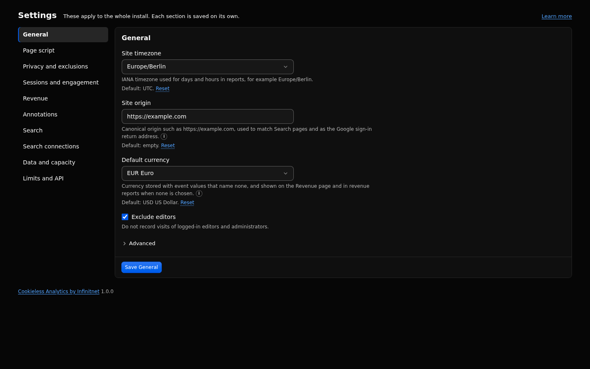
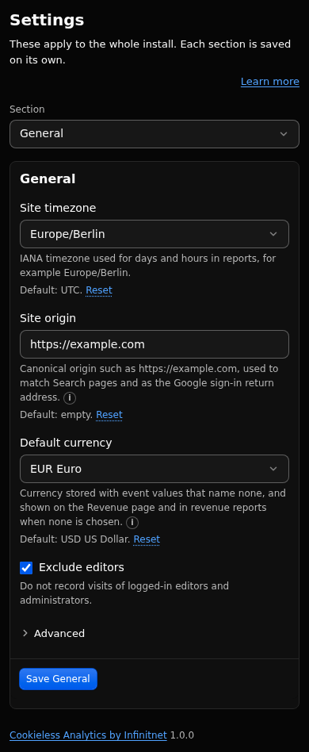

# Settings reference

Every setting of the plugin, grouped as on the Settings page of the admin (Analytics, Settings). Use this page to look up a key, its default and its range.

## How to use it

1. Open Analytics, Settings in the EmDash admin.
2. Pick a section in the list on the left (a select at narrow widths). One section is shown at a time.
3. Change values and press Save for that section. Each value is checked on save; a refused value is named next to its field, and nothing else in the section is written.
4. Secrets (client secrets, API keys, tokens, service account keys) all belong to the Search connections section. The Settings page shows them as "Set" or "Not set" only; they are entered on the Search page and never sent back to the browser.

The host's own settings form for the plugin lists the same keys in the same order. Prefer the Settings page: it groups the keys, checks each value and writes only the section you save.

## Rules that apply to every key

- Numbers are clamped to their range, and an invalid value falls back to the default, so a bad value never stops the plugin.
- Public paths (`scriptPath`, `collectPath`, `sharePath`) and the window namespace (`namespace`) fall back to their defaults when a value contains a word that blockers look for or collides with another path.
- Per site overrides for client sites (currency, site search parameters) are set on the Sites tab of [Definitions](Definitions), not here.
- Exclusions (`excludePaths`, `excludeIpPrefixes`) and the user agent rules keep traffic out from the moment they are saved. To remove what was already counted, use the Delete tab of the [Data page](Data-Page).
- Secrets are stored encrypted by the host, which needs the `EMDASH_ENCRYPTION_KEY` secret on the server ([Quick install](Quick-Install)).

## General

Keys marked Advanced sit under the closed Advanced disclosure of the section.

| Key | Type | Default | Range or options | Meaning |
|---|---|---|---|---|
| `siteTimezone` | string | `UTC` |  | Site timezone: IANA timezone used for days and hours in reports, for example Europe/Berlin. |
| `siteOrigin` | url | empty |  | Site origin: Canonical origin such as https://example.com, used to match Search pages and as the Google sign-in return address. Empty uses the request origin. |
| `defaultCurrency` | select | `USD` | 155 codes (ISO 4217) | Default currency: Currency stored with event values that name none, and shown on the Revenue page and in revenue reports when none is chosen. Changing it never relabels recorded values and converts nothing. |
| `excludeEditors` | boolean | `true` |  | Exclude editors: Do not record visits of logged-in editors and administrators. |
| `siteId` (Advanced) | string | `default` |  | Site id: Identifier stored with every row. Lowercase letters, digits and dashes, up to 32 characters. |

## Page script

Keys marked Advanced sit under the closed Advanced disclosure of the section.

| Key | Type | Default | Range or options | Meaning |
|---|---|---|---|---|
| `injectScript` | boolean | `true` |  | Inject script tag: Turn off when the theme adds the script tag itself. |
| `scriptDelivery` | select | `external` | `external` (External file), `inline` (Inline) | Script delivery: External file (cacheable) or one inline script tag. |
| `autoOutbound` | boolean | `true` |  | Outbound link events: Record clicks to other hosts. |
| `autoDownloads` | boolean | `true` |  | Download events: Record clicks on download links. |
| `downloadExtensions` | string | `pdf,zip,docx,xlsx,pptx,csv,mp3,mp4,dmg,exe` |  | Download extensions: Comma separated file extensions treated as downloads. |
| `autoForms` | boolean | `true` |  | Form events: Record form submissions. |
| `ignorePathPrefixes` | string | empty |  | Short link path prefixes: Path prefixes of short link redirects on this site, one per line or comma separated, for example /go/. Links and form buttons pointing under them get no download, form or link rule event; the redirect reports its own outbound link event. |
| `linkRules` | string | empty |  | Link rules: Link clicks to record, one rule per line: a pattern, an event name and an optional label, for example /go/ out. A pattern is the start of a path, of a host and path, mailto: or tel:, or ~ followed by a regular expression. The label is sent as the slug property; without one, the rest of the link after the prefix (or the first group of the regular expression) is. The first rule that matches sends its one event and stops: that click gets no automatic outbound or download event. The event name - records nothing. Links under a short link path prefix and elements with a markup event are left to those. At most 20 rules. |
| `siteSearchParams` | string | empty |  | Site search parameters: Query parameter names of your site search, comma separated, at most 5 (for example q or s). Empty is off. The words searched for are kept on page views, lowercased, with emails and long numbers removed. |
| `logErrorPages` | boolean | `true` |  | Log error pages: Record human requests that end with status 400 or above. |
| `scriptPath` (Advanced) | string | `/_/e.js` |  | Script path: Neutral public path that serves the page script. |
| `collectPath` (Advanced) | string | `/_/e` |  | Event path: Neutral public path that receives page events. |
| `sharePath` (Advanced) | string | `/_/s` |  | Share path: Neutral public path under which shared dashboard links are served. |
| `namespace` (Advanced) | string | `__ec` |  | Window namespace: Global name of the page script API. Also derives the data attribute prefix. |
| `scriptForBots` (Advanced) | select | `always` | `always` (Always (identical HTML)), `skip_known_bots` (Skip for known bots) | Script for known bots: Always emit the same tag for every visitor (default), or skip it for known bot user agents. Page fragments land in the route cache, which is keyed without the user agent and sends no Vary: User-Agent header, so a page first cached for a bot would be served to humans without the script. Enable only with route caching off. |

## Privacy and exclusions

Keys marked Advanced sit under the closed Advanced disclosure of the section.

| Key | Type | Default | Range or options | Meaning |
|---|---|---|---|---|
| `signals` | select | `gpc` | `none` (None), `gpc` (Global Privacy Control), `dnt_and_gpc` (Do Not Track and Global Privacy Control) | Privacy signals: Browser privacy signals that drop a visit. |
| `ipTruncation` | select | `standard` | `standard` (Standard (/24 and /48)), `strict` (Strict (/16 and /32)) | IP truncation: Prefix kept for the daily visitor key. The address itself is never stored. |
| `captureLanguage` | boolean | `true` |  | Capture language: Store the primary browser language tag. |
| `captureRegion` | boolean | `false` |  | Capture region: Store the edge region in addition to the country. |
| `captureScreen` | boolean | `false` |  | Capture screen size: The page script sends the screen width and the server stores it as a size class (xs to xl), which Delete matching visits can use. Off by default: the script then sends no screen value. |
| `excludePaths` | string | `/_emdash/` |  | Excluded path prefixes: One prefix per line or comma separated. |
| `excludeIpPrefixes` | string | empty |  | Excluded IP ranges: CIDR list, comma or newline separated. |
| `ignoreReferrerHosts` | string | empty |  | Ignored referrer hosts: Extra payment or login hosts that never start a source. |
| `queryAllowlist` | string | `utm_*,gclid,msclkid,fbclid` |  | Query parameter allowlist: Query parameters kept on stored paths. A trailing * matches a prefix. |
| `saltTimezone` (Advanced) | string | `UTC` |  | Salt timezone: IANA timezone of the daily salt rotation. |
| `saltRotationHour` (Advanced) | number | `0` | 0 to 23 | Salt rotation hour: Local hour at which the daily salt rotates. |

## Sessions and engagement

Keys marked Advanced sit under the closed Advanced disclosure of the section.

| Key | Type | Default | Range or options | Meaning |
|---|---|---|---|---|
| `sessionWindowMinutes` | number | `30` | 1 to 240 | Session window (minutes): Inactivity gap that ends a session. Applies to new sessions; existing sessions keep their own window. |
| `engagedThresholdSeconds` | number | `10` | 1 to 300 | Engaged threshold (seconds): Active time from which a session counts as engaged. A session with two or more page views or any event is engaged whatever its active time. A session that is not engaged is a bounce. |
| `longClickSeconds` | number | `60` | 10 to 600 | Long click (seconds): A session lasting longer than this is a long click, at or below it a short click. Applied when reports run, so every stored session is reclassified at once. |
| `badExperienceSeconds` | number | `10` | 1 to 60 | Bad experience (seconds): A single page session without interaction that lasts less than this is a bad experience. Never above the long click threshold. |
| `satisfactionMinMeasured` | number | `30` | 10 to 500 | Search Satisfaction sample minimum: Fewest measured sessions a landing page needs to be ranked as a best or worst page. A score under it is marked low sample. |
| `realtimeWindowMinutes` | number | `5` | 1 to 60 | Realtime window (minutes): Sessions with a page view or event within this time count as active now. |
| `maxSessionMinutes` (Advanced) | number | `1440` | 10 to 1440 | Maximum session length (minutes): A session older than this is closed and a new one starts. At most one day: a visit is looked up among visits started today or yesterday. |
| `reloadDedupeSeconds` (Advanced) | number | `2` | 0 to 60 | Reload dedupe (seconds): A reload of the same path within this time is not counted again. |
| `maxEngagedMsPerPage` (Advanced) | number | `1800000` | 60000 to 7200000 | Maximum active time per page (ms): Cap for the active time and the visible time reported for one page. |

## Revenue

| Key | Type | Default | Range or options | Meaning |
|---|---|---|---|---|
| `acceptClientRevenue` | boolean | `true` |  | Accept revenue from browsers: When off, values, currencies and order ids are dropped from every browser request. Server calls and the agent events route still record them. A guard against casual spoofing, not authentication. |

## Annotations

Automatic annotations from publishing and updating content; see [Annotations-and-Impact](Annotations-and-Impact#automatic-annotations).

| Key | Type | Default | Range or options | Meaning |
|---|---|---|---|---|
| `autoAnnotations` | boolean | `true` |  | Automatic annotations: Add an annotation when content is published or updated. Off, the content hooks write nothing; annotations added by hand are unaffected. |
| `annotatePublish` | boolean | `true` |  | Annotate publishing: Add an annotation when an item is published. |
| `annotateUpdate` | boolean | `false` |  | Annotate updates: Add an annotation when a published item is saved again. Off by default: every save of a published item would mark the charts. |
| `annotateCollections` | string | empty |  | Annotated collections: Collection slugs that add automatic annotations, one per line or comma separated, for example posts. Empty is every collection. |
| `autoAnnotationsPerDay` | number | `10` | 1 to 200 | Automatic annotations per day: At most this many automatic annotations per site and day in the site timezone; further publishes and updates that day add none, so a bulk import cannot fill the charts with markers. Saving the same item again the same day replaces its annotation and does not count again. |

## Search

Keys marked Advanced sit under the closed Advanced disclosure of the section.

| Key | Type | Default | Range or options | Meaning |
|---|---|---|---|---|
| `searchBrandTerms` | string | empty |  | Brand terms: One term per line, at most 20 terms of 2 to 40 characters. Queries containing a term are left out of cannibalization and striking distance unless brand queries are included. |
| `searchMinImpressions` | number | `50` | 1 to 100000 | SEO views impression floor: A query, page or pair counts in cannibalization, striking distance, position movement, rising and declining and decay only with at least this many impressions (page views for the traffic views). |
| `searchOverlapMinShare` | number | `10` | 1 to 50 | Cannibalization share floor (percent): Percent of a query's impressions a page needs to count as competing for it. |
| `backfillDays` | number | `90` | 1 to 490 | Older Search days to load (days): Days that Load older days on the Search page reaches back by default: the first connect of a source uses it (not on the small profile, where older days load only from Start loading), and so do the agent API and the file import, which skips older days. Google keeps about 16 months, Bing about 6 months; a longer range stops there. |
| `searchRetentionDays` | number | `800` | 90 to 1000 | Search retention (days): Days of search rows kept. |
| `searchSyncHours` (Advanced) | number | `6` | 1 to 24 | Search sync interval (hours): Minimum hours between provider pulls per source. |
| `syncSubrequestBudget` (Advanced) | number | `40` | 20 to 950 | Sync request budget: Requests (provider calls, database statements, storage calls) one Search sync run may make. The Workers Free plan allows 50 per invocation, so keep 40 there; on a Paid plan (1,000) raise it, for example to 900. |
| `searchMaxRowsPerDay` (Advanced) | number | `5000` | 1000 to 25000 | Search rows per day: Row cap per day for the page with query breakdown. Also bounds what the SEO views can see. |

## Search connections

Shown read only on the Settings page. Change these on the Search page, Connections ([Search integrations](Search-Integrations)).

| Key | Type | Default | Range or options | Meaning |
|---|---|---|---|---|
| `gscAuth` | select | `off` | `off` (Off), `oauth` (OAuth client), `service_account` (Service account) | Google Search Console: How the plugin signs in to Google Search Console. |
| `gscProperty` | string | empty |  | Search Console property: Property such as sc-domain:example.com or https://example.com/. Filled by the property picker after sign-in. |
| `gscClientId` | string | empty |  | Google OAuth client id: Client id of your own Google Cloud OAuth web client. |
| `gscClientSecret` | secret | none | secret, encrypted by the host | Google OAuth client secret: Client secret of the OAuth web client. Encrypted by the host; needs EMDASH_ENCRYPTION_KEY. |
| `gscRefreshToken` | secret | none | secret, encrypted by the host | Google refresh token: Written by the Google sign-in on the Search page; may also be pasted. Encrypted by the host. |
| `gscServiceAccount` | secret | none | secret, encrypted by the host | Google service account key: Service account JSON key. Add the service account email to the property as a user. Encrypted by the host. |
| `bingEnabled` | boolean | `false` |  | Bing Webmaster: Pull search data from Bing Webmaster Tools. |
| `bingAuth` | select | `apikey` | `apikey` (API key), `oauth` (OAuth client) | Bing sign-in: API key (default) or OAuth client. OAuth needs a client created in Bing Webmaster Tools under Settings, API access, OAuth client. |
| `bingApiKey` | secret | none | secret, encrypted by the host | Bing Webmaster API key: API key from Bing Webmaster Tools. Encrypted by the host. |
| `bingClientId` | string | empty |  | Bing OAuth client id: Client id of the OAuth client created in Bing Webmaster Tools. |
| `bingClientSecret` | secret | none | secret, encrypted by the host | Bing OAuth client secret: Client secret of the Bing OAuth client. Encrypted by the host; needs EMDASH_ENCRYPTION_KEY. |
| `bingRefreshToken` | secret | none | secret, encrypted by the host | Bing refresh token: Written by Connect Bing on the Search page. Encrypted by the host. |
| `bingSiteUrl` | url | empty |  | Bing site url: The site url exactly as registered in Bing Webmaster Tools. |

## Data and capacity

Keys marked Advanced sit under the closed Advanced disclosure of the section.

| Key | Type | Default | Range or options | Meaning |
|---|---|---|---|---|
| `capacityProfile` | select | `standard` | `small` (Small (Workers Free)), `standard` (Standard), `dedicated` (Dedicated database) | Capacity profile: How much analytics data is kept and how much background work one run may do. Standard: for Workers Paid, up to 6 GB of analytics data. Small: for the Workers Free plan, up to 300 MB and lighter background work (40 requests per run instead of 400); it also pauses recording for the rest of the UTC day when the day's writes near the Free plan's limit, so the CMS can still save content. Dedicated: when analytics has its own database, up to 9 GB. The storage budget below can change these sizes. When the budget is reached, the oldest detailed days are replaced by daily summaries; nothing is sampled. A quarter of the budget is reserved for summaries. |
| `storageBudgetMb` | number | `0` | 0 to 2000000 | Storage budget (MB): Space the analytics tables may use, in megabytes. 0 uses the capacity profile's default (Small 300, Standard 6000, Dedicated 9000). When the detailed data would not fit, the detailed window shortens and older days are kept as daily summaries. A D1 database holds 10 GB in total and refuses writes when full; in the EmDash database that space is shared with the site's content. Allowed: 50 to 450 with Small, 100 to 9000 in the EmDash database, 100 to 9500 in an own D1 database, 100 to 2000000 on Postgres. The Settings and Data pages warn above 300 with Small (strongly above 400), above 6000 in the EmDash database (strongly above 8000, or when budget and content together pass 9500) and above 9000 in an own D1 database. |
| `rawRetentionDays` | number | `760` | 7 to 760 | Detailed data (days): Days of detailed rows kept. All filters and views work on detailed data. Older days are kept as daily summaries for the summary retention. The window shortens by itself when the detailed data would not fit the storage budget. |
| `rollupRetentionMonths` | number | `25` | 1 to 120 | Summary retention (months): Months of daily summaries kept. |
| `ingestTier` (Advanced) | select | `direct` | `direct` (Direct to the database), `queue` (Queue (needs the CA_QUEUE binding and the consumer Worker)) | Ingest tier: Where page views, events and engagement updates are written. Direct writes them to the database. Queue sends them to a Cloudflare Queue for the consumer Worker to write; it is used only while the CA_QUEUE binding exists, and a failed send is written directly. See Limits. |

## Limits and API

Keys marked Advanced sit under the closed Advanced disclosure of the section.

| Key | Type | Default | Range or options | Meaning |
|---|---|---|---|---|
| `agentRateLimitPerMinute` | number | `60` | 5 to 1200 | Agent API requests per minute: Rate limit per API key and isolate, so approximate across isolates. |
| `maxPageviewsPerSession` (Advanced) | number | `500` | 10 to 10000 | Maximum pageviews per session: Further pageviews in the same session are dropped. |
| `maxEventsPerSession` (Advanced) | number | `200` | 10 to 10000 | Maximum events per session: Further events in the same session are dropped. |
| `maxEventsPerSidPerMinute` (Advanced) | number | `60` | 10 to 600 | Events per session per minute: Rate cap per session id. |
| `maxEventsPerVkeyPerMinute` (Advanced) | number | `300` | 10 to 3000 | Events per visitor per minute: Rate cap per daily visitor key. |

## Gotchas

- Changing `siteId` starts a new data set: rows already stored keep the old id and no longer show in reports.
- `badExperienceSeconds` must not be above `longClickSeconds`.
- `maxEngagedMsPerPage` is stored in milliseconds and shown in minutes on the Settings page.
- `scriptForBots` set to skip known bots is only safe with route caching off (see [Bot handling](Bot-Handling)).
- Changing `defaultCurrency` never relabels recorded values and converts nothing ([Revenue and refunds](Revenue-and-Refunds)).

## Related

- [Quick install](Quick-Install)
- [Capacity profiles and Cloudflare plans](Capacity-Profiles-and-Cloudflare-Plans)
- [Retention](Retention)
- [Privacy model](Privacy-Model)
- Full reference, generated from the code: [docs/settings.md](https://github.com/infinitnet/cookieless-analytics/blob/main/docs/settings.md)
